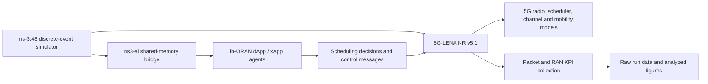

# O-RAN Based 5G RAN Performance and Resource Allocation

This independent research project studies latency, throughput, reliability, and resource allocation in a simulated 5G RAN with an O-RAN-inspired control loop. It is a new repository and isolated simulator environment; the earlier [NR-U/Wi-Fi coexistence project](https://github.com/kirolossedra/nru-publication) remains a historical archive.

## Research question

How do baseline and modified RAN resource-allocation policies affect a latency-sensitive UE and competing UEs as background uplink/downlink load increases?

The first proposed topology is one gNB, one latency-sensitive UE, and several background UEs. Planned outcomes include mean/P95/P99 packet latency, UL/DL achieved throughput, packet loss, PRB allocation/utilization, and effects on competing UEs. Offered traffic, delivered traffic, and radio resource allocation will be reported separately. UE mobility is an optional extension, subject to validation of upstream model behavior.

## Motivation and scope

5G RAN scheduling allocates finite radio resources among flows with different channel conditions and traffic demands. ib-ORAN couples ns-3/5G-LENA simulation with control applications that can implement resource-allocation policies. This project emphasizes wireless-system and RAN behavior, not construction of a production external RIC. Control-loop functionality and any standardized-interface claims will be verified against source and documented narrowly.

## Architecture (planned, upstream-supported components)

This is a conceptual architecture from upstream project documentation; it does not assert that this repository has installed or run those components. See [architecture](docs/architecture/simulator-and-control.md) and [scenario topology](docs/architecture/initial-scenario.md).

## Selected software baseline

The upstream ib-ORAN installation instructions document ns-3.48, 5G-LENA v5.1, ns3-ai `main`, and Python 3.11+. Exact source tags/commits and dependency minimums are in [compatibility](docs/COMPATIBILITY.md) and [manifest](manifests/environment.json). At migration time, this project is documentation-only: simulator sources have not been downloaded, dependencies have not been changed, and no O-RAN simulation has run.

## Repository navigation

- [Compatibility and version rationale](docs/COMPATIBILITY.md)
- [Installation and reproducibility plan](docs/INSTALLATION.md)
- [Architecture and control boundary](docs/architecture/simulator-and-control.md)
- [Initial scenario](docs/architecture/initial-scenario.md)
- [Proposed methodology](docs/methodology/proposed-study.md)
- [Mission index](docs/MISSIONS.md)
- [Decision records](docs/decisions/README.md)
- [Documentation audit](docs/DOCUMENTATION-AUDIT.md)
- [Mission template](templates/MISSION-TEMPLATE.md)

## Status and next step

Migration preparation is complete and published. The legacy project-owned simulator checkout/build was retired only after confirming its historical GitHub archive. Before a first baseline, review pinned source revisions, provision Python 3.11 and missing compatible dependencies in an isolated layout, install/build only the supported stack, run upstream smoke tests, then select and validate one ib-ORAN scenario. This migration did not install the simulator or start a load sweep/resource-allocation comparison.
