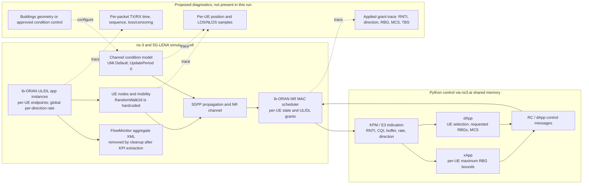

# RA-ENG-001 source-grounded signal path

**Status:** source inspection only. **Pin:** ib-ORAN `3ea5046389f0eb993cdf01ef6d6d33017e6921bb`, NR v5.1 `cedceadda17392c90587fb9400eb9b1f8c236713`, ns-3 `d2add90b452d600cfb4859baed8e9ea633519447`.

The solid arrows show source-traced interfaces in the pinned code. Dashed arrows show proposed diagnostics or source/configuration changes; they were not implemented or run. This is a simulator architecture, not a deployed RAN or validated industrial channel.

## Source map

- ib-ORAN configures `UMi` / `Default` / `ThreeGpp`, sets both channel-condition and small-scale channel update periods to zero, enables shadowing, then assigns the channel to bands in [`iboran-nr-environment.cc`](https://github.com/Orange-OpenSource/ns3-iboran/blob/3ea5046389f0eb993cdf01ef6d6d33017e6921bb/model/iboran_ran_environment/iboran-nr-environment.cc#L53).
- UE mobility and initial positions are installed in [`SetupFronthaulMobility`](https://github.com/Orange-OpenSource/ns3-iboran/blob/3ea5046389f0eb993cdf01ef6d6d33017e6921bb/model/iboran_ran_environment/iboran-ran-common.cc#L295).
- Per-UE flows and endpoints are created in [`SetupIbOranApplications`](https://github.com/Orange-OpenSource/ns3-iboran/blob/3ea5046389f0eb993cdf01ef6d6d33017e6921bb/model/iboran_ran_environment/iboran-ran-common.cc#L356).
- The Python orchestration loop reads C++ reports, invokes xApp and dApp, and sends responses in [`iboran_orchestrator.py`](https://github.com/Orange-OpenSource/ns3-iboran/blob/3ea5046389f0eb993cdf01ef6d6d33017e6921bb/model/iboran_campaign/iboran_orchestrator.py#L229).
- Interface fields are declared in [`iboran-shm-structure.h`](https://github.com/Orange-OpenSource/ns3-iboran/blob/3ea5046389f0eb993cdf01ef6d6d33017e6921bb/model/iboran_interfaces/iboran-shm-structure.h#L44); NR MAC applies bounds and dApp grants in [`iboran-nr-mac-scheduler.cc`](https://github.com/Orange-OpenSource/ns3-iboran/blob/3ea5046389f0eb993cdf01ef6d6d33017e6921bb/model/iboran_mac_scheduler/iboran-nr-mac-scheduler.cc#L473).
- FlowMonitor computes aggregate means and cleanup removes its temporary XML in [`iboran_orchestrator.py`](https://github.com/Orange-OpenSource/ns3-iboran/blob/3ea5046389f0eb993cdf01ef6d6d33017e6921bb/model/iboran_campaign/iboran_orchestrator.py#L476).

**Observed limitation:** the source code and old Mission 1 documentation describe the previous successful baseline, but the ignored simulator source/build and its run logs are absent from the current workspace. No run-level telemetry is inferred from this diagram.
