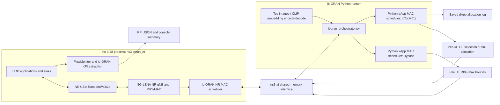
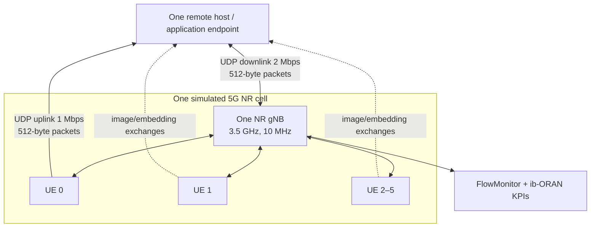

# Mission 1 executed NR baseline: architecture and implementation map

**Evidence basis:** pinned source revisions in manifests/environment.json, build logs, and run 20261109-nr-toy-ibTopKCqi-k3-seed5. The diagram below describes this executed upstream path; it does not claim a deployed O-RAN RIC or standardized interface interoperability.

## Runtime/control and measurement paths

The diagram follows actual source flow: the Python orchestrator starts ns3iboran_nr through ns3ai_utils.Experiment, sets up shared-memory messages, then invokes the xApp and dApp on each received report and writes the result into the response structure. The NR MAC scheduler reads xApp RBG bounds and dApp controls. The saved dApp log records allocation decisions. This baseline uses the xApp Bypass algorithm; it still reports control steps/decisions and provides the control interface, but this configuration is not evidence of a resource-constraining xApp policy.

## Topology and workload actually used

This shows six UEs, one gNB and one remote host. Standard UDP flows use 512-byte payloads. The application workload also sends dataset images and receives CLIP-derived embeddings: the toy repository contains ten bundled PNG images (36,342 bytes each); output payloads were recovered in the run directory. It is not the proposed latency-sensitive industrial traffic. The installed upstream scenario sets the gNB at the area center and installs RandomWalk2d UE mobility (constant 0.83 m/s, direction changes every 100 m) with random initial UE positions in a 500 m square. This run therefore includes the upstream random-walk model; positions and mobility are not held fixed for a controlled comparison.

## Source locations for future work (map only)

| Future concern | Pinned source location | Current behavior/evidence |
|---|---|---|
| Workload, packet size, offered bit rate, flow direction | contrib/iboran/model/iboran_campaign/iboranConfig.yaml, iboran_common_params.py, iboran_orchestrator.py | UDP rate, size and enable flags configurable in default YAML/CLI config system; app setup lives in orchestrator. |
| Packet-level latency | contrib/iboran/model/iboran_campaign/iboran_orchestrator.py (FlowStatsAnalyzer.compute_std_kpis, _computed_flow_kpis, _get_flowstats) and iboran_run.py cleanup path | Standard KPI computes aggregate mean delay from FlowMonitor totals; raw per-packet XML is removed after extraction. Mission 1 does not add instrumentation. |
| Control and Python/NR scheduler interface | contrib/iboran/model/iboran_campaign/iboran_orchestrator.py, iboran_controller/iboran_xapp_mac_scheduler.py, iboran_controller/iboran_dapp_mac_scheduler.py, iboran_interfaces/ | ns3-ai messages carry KPM reports, E2 RC bounds and E2 dApp allocations. |
| NR MAC scheduling application | contrib/iboran/model/iboran_mac_scheduler/iboran-nr-mac-scheduler.cc | Applies per-UE max RBG values and dApp allocations on UL/DL paths. |
| Mobility and positions | contrib/iboran/model/iboran_ran_environment/iboran-nr-environment.cc and SetupFronthaulMobility in iboran-ran-common.cc | Source installs RandomWalk2dMobilityModel for UEs at 0.83 m/s and random initial positions. This baseline uses moving UEs; fixed-position comparisons require a future documented scenario change. |
| KPI collection | iboran_orchestrator.py, KPI definitions, FlowMonitor XML helpers | Mean delay, throughput, PDR, jitter, PRB/RBG use and app decision time summarized; see below. |

## Control path: source support vs observed execution

- **Source-supported:** iboran_orchestrator.py creates Experiment("ns3iboran_nr", ...), calls exp.run(show_output=True), initializes the xApp/dApp schedulers, receives C++ reports through PyRecvBegin/GetCpp2PyStruct, invokes both Python schedulers, then sends their response through PySendBegin/PySendEnd.
- **Observed:** log prints “Shared memory interfaces established” and “MAC Scheduler xApps and dApps initialized”; simulation completes; xApp reports 22,337 total UL/DL control steps, 1,887 decisions, 0 errors; dApp reports 22,337 total UL/DL control steps, 7,548 decisions, 0 errors.
- **Observed scheduling decisions:** saved dApp log includes records such as RNTI=31, PRBs=[0-4], MCS=0 and later grants with nonzero MCS. Thus the dApp produced concrete per-UE allocations during the run.
- **Source-supported application:** NR MAC scheduler consumes e2RcControl and dApp controls, maintains UE RBG bounds, and constrains grants. iboran-nr-mac-scheduler.cc stores maxRbgAllocation and checks allocations against it in UL and DL scheduling paths.
- **xApp caveat:** effective config selected Bypass; KPI has nonzero xApp decision time and the log shows decisions, confirming that the xApp loop ran. It is not proof that this xApp imposed restrictive bounds. No alternate policy run was needed for the installation acceptance criteria.
- The logs establish simulation and control-loop execution in this local build, but this baseline does not validate E2 interoperability with an external RIC, real-time behavior, or a custom policy.

## Available KPI interpretation

The saved kpi.json contains PDR, Throughput, Latency, Jitter, SatisfactionScore, PRBUtilizationRatio, DAppDecisionTime, XAppDecisionTime, FidelityScore, CosineSimilarity, and CompletenessRatio. It includes aggregated UL/DL flow measurements and intent/data-processing measures. The exact two-link values and units are in results/mission1-nr-baseline/kpi.json. Mean flow latency comes from FlowMonitor aggregate delay divided by received packets. PDR is received/sent packets; throughput uses received bytes and flow interval; jitter is an aggregate FlowMonitor measure. RBG-use and dApp/xApp decision times are internal counters. Output JSON is not packet-level data and does not support P95/P99 estimates. Per-packet instrumentation, preserving FlowMonitor XML, and a custom application are future work.
