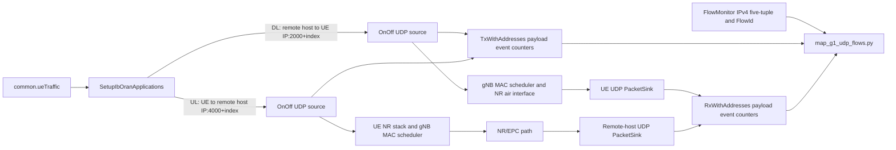

# G1 synthetic UDP flow mapping

**Claim classes:** C++/Python paths below are **source-verified** at the pinned ib-ORAN revision; the six short traffic cases are **observed** run evidence. This is an engineering path record, not a claim about research traffic or network performance.

## Runtime path



The diagram describes the implemented synthetic UDP mode and its mapping workflow. DL sources are installed on the remote host and target each UE's address; UL sources are installed on the UE and target the remote host. Each flow has a unique destination port (`2000 + UE index` for DL, `4000 + UE index` for UL). All six UEs remain in the radio topology; `common.ueTraffic` controls which UE/direction has applications.

## Source/configuration mapping

| Concern | Pinned implementation |
|---|---|
| C++ simulation parameters | `contrib/iboran/model/iboran_ran_environment/iboran-ran-params.h/.cc` parses `trafficMode` and per-UE `ueTraffic` rows. |
| Application path | `contrib/iboran/model/iboran_ran_environment/iboran-ran-common.cc`, `SetupIbOranApplications`; UDP mode returns before dataset access. |
| Source/sink | ns-3 `OnOffApplication` and `PacketSink`, installed on the existing remote host / UE nodes after NR/EPC address assignment. |
| Flow identity | C++ emits `UE_TRAFFIC_CONFIG` and `UE_TRAFFIC_RESULT`; `scripts/map_g1_udp_flows.py` joins direction, UE index/IP, end-of-run RNTI, UDP endpoint tuple, FlowMonitor FlowId, and payload event counters. |
| Python validation | `contrib/iboran/model/utils/config_store.py` validates traffic fields; when both legacy dataset flow toggles are false, orchestrator skips dataset/CLIP/embedding KPI initialization. |
| Raw flow retention | `contrib/iboran/model/iboran_campaign/iboran_orchestrator.py` retains FlowMonitor XML only when `trafficMode: Udp`; dataset mode retains original cleanup behavior. |

`OnOffApplication` Tx and `PacketSink` Rx callbacks count application payload bytes and packets. FlowMonitor counters include network-layer accounting and are used for packet-count reconciliation and FlowId mapping; the mission does not equate FlowMonitor bytes with application payload bytes. The sink starts with the source and remains active through `sinkStopTime` to drain packets after source stop.

## Reproduction and evidence

The six software-validation configs are in `configs/scenarios/g1-traffic-*.yaml`; they use a 3.5 s run, source interval 1.0–2.5 s, sink stop 3.0 s, fixed UE geometry, and small configured rates (4–16 kbps, 128-byte payload). These are bounded engineering-check values, not researcher-approved experimental rates.

For a pristine pinned ib-ORAN checkout, apply `patches/RA-ENG-002-radio-mobility.patch` and then `patches/RA-ENG-003-udp-traffic.patch` with `git apply --unidiff-zero` before building.

From `simulator/ns-3.48/contrib/iboran/model/iboran_campaign`, use the isolated environment:

```sh
/home/george/oran-publication/simulator/ns-3.48/.venv/bin/python iboran_run.py \
  --scenario_config /home/george/oran-publication/configs/scenarios/g1-traffic-target-only.yaml
```

Copy `contrib/iboran/notebook/.flowstats/iboran-flowstats.xml` into a unique ignored run directory before the next run. Join the raw stdout and XML with:

```sh
python3 scripts/map_g1_udp_flows.py \
  --stdout simulator/logs/RA-ENG-003-<run-id>/target-only.log \
  --flowstats simulator/logs/RA-ENG-003-<run-id>/target-only-flowstats.xml \
  --output simulator/logs/RA-ENG-003-<run-id>/target-only-map.csv
```

Full commands, effective configs, XML, logs, mapping CSVs, and checksums for the observed run are retained locally under ignored `simulator/logs/RA-ENG-003-20261112/`. A Dataset-mode/no-application-flow regression log is also preserved there; the image/CLIP workload smoke could not initialize its uncached model because the model host failed DNS resolution.
