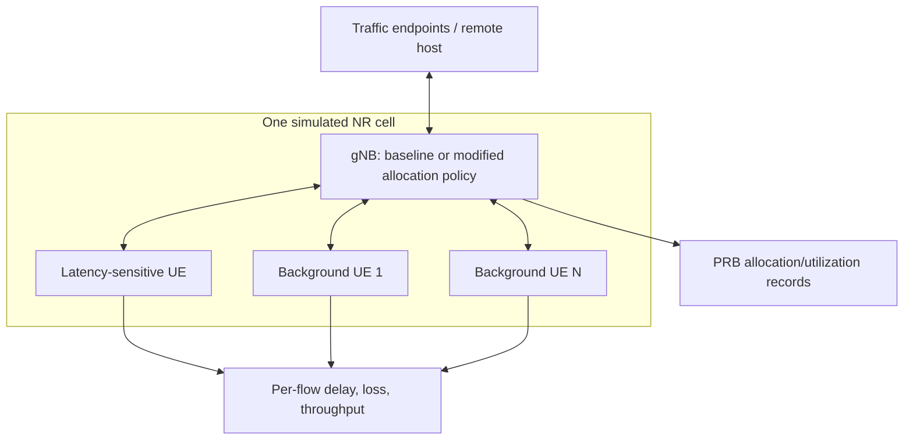

# Initial one-cell scenario

**Status:** proposed topology, not yet implemented or simulated. Distances, propagation, traffic rates, packet sizes, duration, and scheduler settings remain to be selected and documented in the first experiment protocol.

This remains a conceptual target research topology. Mission 1 found that the current upstream ib-ORAN NR example installs RandomWalk2d mobility for all UEs (0.83 m/s and a 100 m direction-change distance) with random initial positions; its own smoke run therefore has moving UEs. A controlled first study must deliberately choose whether to retain that motion or configure stationary UEs, and hold positions/mobility seeds constant when comparing policies. The actual transport path and endpoint placement should be confirmed in the implemented research scenario. The latency-sensitive UE's QoS and flow treatment are not yet specified. Background UE count and offered UL/DL loads are experimental factors, not fixed assumptions.

Planned comparisons hold topology, channel, traffic, simulation horizon, and randomization protocol fixed while changing only the allocation policy. Include a baseline scheduler and competing UEs; record per-UE outcomes so aggregate gains cannot hide harm to other users. Mobility remains optional; validate ns-3/5G-LENA mobility support in the selected scenario before adding it.
