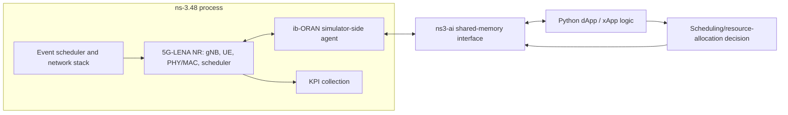

# Simulator and O-RAN control architecture

**Status:** conceptual overview. Mission 1 verified the actual runtime path for the selected baseline; see [executed baseline architecture](executed-baseline.md). This overview still does not claim an external RIC deployment or standardized interface interoperability.

ns-3 is the discrete-event simulation framework. 5G-LENA's NR module supplies modeled NR radio access functions, including gNB/UE, scheduling, radio channels, and integration with ns-3 mobility. Orange ib-ORAN adds control application/agent abstractions. ns3-ai supplies an interface between simulator-side C++ and Python applications, documented by ib-ORAN as shared-memory communication. At a high level, control logic observes reported state/KPIs, calculates a resource policy, and returns control decisions to simulator-side agents.

The diagram omits implementation details and external RIC deployment; it is a conceptual control boundary. Upstream describes dApp as an O-DU layer with sub-10 ms behavior and xApp as near-RT RIC, 10 ms–1 s. E2SM-KPM/RC and E3SM abstractions are described; E3 and E2SM-DAPP are upstream extensions rather than standardized interfaces. This research will focus on radio-system effects and the provided control hooks, not claim production interoperability.

Source references: [ib-ORAN README](https://github.com/Orange-OpenSource/ns3-iboran), [installation](https://github.com/Orange-OpenSource/ns3-iboran/blob/main/doc/installation.md), [KPI definitions](https://github.com/Orange-OpenSource/ns3-iboran/blob/main/doc/kpis.md). Validate details against pinned source when installed.
