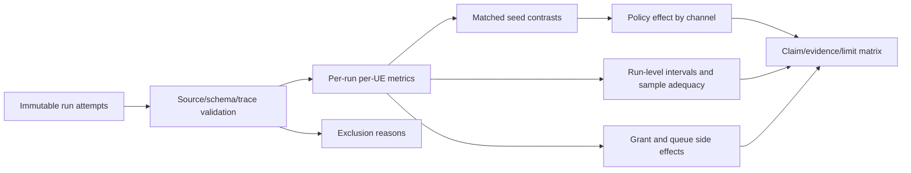

# Mission RA-ENG-008 — Per-UE effects, interactions, and reproducibility

> **Historical snapshot for PI investigation.** These results and status describe the earlier G1 v2 campaign cohort only. The governing [issue #26](https://github.com/kirolossedra/oran-publication/issues/26) warns that campaign snapshots from different attempts are not interchangeable and does not approve this as the current research direction. Preserve this report for review; it is not evidence that the new LOS→NLOS→LOS experiment ran or passed.

**Status:** COMPLETE — validated per-UE analysis, interaction estimates, reproducibility artifacts, tests, and human-review handoff are ready. **Date:** 2026-11-12. **Issue:** [#21 — RA-ENG-008](https://github.com/kirolossedra/oran-publication/issues/21).

## Research objective and scope

Transform the immutable RA-ENG-007 outcomes into reproducible per-run, per-UE, per-direction summaries and matched-seed contrasts. Preserve all six UE outcomes and resource-allocation costs, quantify run-level uncertainty, and report exclusions and sample adequacy. This is a technical evidence mission; it does not choose a literature gap, claim novelty, or decide causal mechanisms.

## Scientific motivation and hypotheses (human-owned)

The research question and interpretation remain researcher-owned. The analysis estimates policy effects within channel/load/mobility conditions and compares the TopKCqi-minus-RoundRobin effect between selective UE6 NLOS and all-LOS cells. These are descriptive paired-seed interactions under the approved simulated conditions, not universal or real-world effects.

## Requirements and acceptance criteria

Issue #21 requires verified run/config/source identity, per-UE TX/RX/goodput/loss and received-delay mean/P50/P95/P99 with sample counts, matched-seed policy contrasts and channel difference-in-differences, run-level uncertainty, all-UE grant costs, plots, an exclusion table, and a neutral claim/evidence/limit matrix. Packet events cannot be treated as independent replicates. The five approved seeds are the independent run units. Deadline loss is not configured; missing-at-stop is reported without labelling it as network loss.

## Existing architecture and affected components

- Approved matrix and runner: `campaigns/20261111-g1-integrated-v2/`.
- Corrected pinned simulator source and raw run attempts: ignored `simulator/runs/20261111-g1-integrated-v2/`.
- Deterministic analysis entry point: `campaigns/20261111-g1-integrated-v2/scripts/analyze_g1_integrated_campaign.py`.
- Metric meanings and censoring conventions: `docs/methodology/g1-packet-grant-metrics.md`.
- RA-ENG-007 protocol/build/execution record: `docs/missions/RA-ENG-007-paired-campaign.md`.

## Source-aware implementation map

- `campaigns/20261111-g1-integrated-v2/scripts/run_g1_integrated_campaign.py:76-156` defines the approved cells, generated scenario configuration, seeds, and provenance; `:159-188` determines whether a prior attempt qualifies for resumption.
- `campaigns/20261111-g1-integrated-v2/scripts/analyze_g1_integrated_campaign.py:34-56` implements the type-7 quantile, seed-level t interval, and policy/channel difference-in-differences; `:59-145` assembles matched-seed interaction rows; `:158-270` validates source/schema/trace files, records explicit exclusions, and selects complete attempts; `:286-396` reconciles packet identities and derives per-UE outcomes, grant joins, and demand metrics; `:397-442` audits channel/mobility states; `:622-679` builds paired factor contrasts and seed-level summaries; `:760-897` emits plots including the per-UE policy interaction and representative CQI/MCS trace.
- `simulator/ns-3.48/contrib/iboran/model/iboran_ran_environment/iboran-ran-common.cc:595-597` starts TX at 1.1 s, stops RX at `simTime-1 s`, and stops TX at `simTime-(1.1 s+drain)`; denominator calculation in the analyzer is matched to this active TX window.
- `simulator/ns-3.48/contrib/iboran/model/iboran-nr-environment.cc:100-137` emits channel condition and UE position samples used by the channel/mobility audit.
- The corrected RoundRobin and TopKCqi policy implementations are `.../dapp_algo_ue_selection_round_robin.py:14-60` and `.../dapp_algo_ue_selection_top_k.py:14-69`; final source SHA-256 values are captured in each selected run's metadata and the curated `source-sha256.txt`.

## Implementation details and alternatives

The deterministic analyzer now emits per-run metrics with TX/RX event and sequence identities, mean/P50/P95/P99 latency, explicit missing-at-stop/unmatched/duplicate counts, exclusion reasons, paired-seed factor contrasts, the TopKCqi-minus-RoundRobin effect by channel and its difference-in-differences, all-UE grant/demand summaries, a UE6-versus-peer table, audits, and figures. Seed-level t intervals use independent seeds; packet pooling is not used for uncertainty. A 1,000 received-sample rule labels exploratory P99 summaries; this is a reporting flag, not proof of a calibrated tail estimate. Seven curated plots include all-UE tails, policy-by-channel interactions, grant shares, goodput, and a preselected seed-11 CQI/MCS time trace.

## Architecture/algorithm/workflow diagrams



Conceptual analysis workflow. Each output remains traceable through `cell_id`, seed, run audit, and the per-attempt SHA-256 inventory.

## Changed files and reproducible patches

Changed source: `scripts/analyze_g1_integrated_campaign.py` adds the validated metrics/interactions and outputs; `tests/test_analysis.py` adds deterministic regression fixtures. Curated outputs and figures are at `results/RA-ENG-008-20261112-audited-v3/`. No simulation source, scenario factor, seed, raw run, or researcher-approved hypothesis was changed. The claim matrix is the canonical interpretation boundary; scientific conclusions remain with the researcher.

## Dependencies, versions, configuration, seeds, commands

The analysis consumes the approved 160-cell v2 matrix and its five independent seeds `[11,22,33,44,55]`. Exact upstream revisions are listed in `campaigns/20261111-g1-integrated-v2/UPSTREAM-SOURCES.md`; the local simulator used the pinned virtual environment and CLIP cache described in the RA-ENG-007 report. Reproduce from repository root:

```sh
simulator/ns-3.48/.venv/bin/python -m unittest discover -s campaigns/20261111-g1-integrated-v2/tests -v
env MPLCONFIGDIR=/tmp/mpl-ra-eng-008 simulator/ns-3.48/.venv/bin/python campaigns/20261111-g1-integrated-v2/scripts/analyze_g1_integrated_campaign.py --campaign-root simulator/runs/20261111-g1-integrated-v2 --output-dir results/RA-ENG-008-20261112-audited-v3
sha256sum -c results/RA-ENG-008-20261112-audited-v3/results-sha256.txt
```

## Tests and verification evidence (logs/paths)

The 13-test suite passed, including deterministic quantile, confidence interval, and policy/channel interaction fixtures; analyzer `py_compile` passed. Final analysis reports 167 attempts, 160 complete selected cells, seven failed/interrupted pilot attempts excluded with reasons, and no successful-but-measurement-incomplete attempts. All selected attempts matched source hashes. All 160 channel/mobility audits pass: 120 channel-state samples each, no condition mismatches, and expected stationary/moving position behavior. All 167 raw attempt manifests were verified: 3,844 files checked with zero hash mismatches. The curated results checksum inventory also verifies.

## Raw data and result references

Raw attempts and per-attempt checksums are ignored under `simulator/runs/20261111-g1-integrated-v2/`. The curated final tables, plots, source hashes, run audit, and `results-sha256.txt` are under `results/RA-ENG-008-20261112-audited-v3/`. Earlier interrupted and completed analysis passes remain local and are not canonical deliverables; only the audited-v3 directory is linked for reuse.

## Analysis, sample sizes, uncertainty, interpretation

Independent run/seed is the replicate unit (n=5 within complete factor cells). Paired contrasts are calculated within seed and summarized with a two-sided Student t 95% interval across independent seed differences; with five seeds, df=4. No inference uses individual packets as independent observations. The final per-UE table has 1,920 rows (160 cells × six UEs × two directions), as do grant and demand tables. Across all cells there are 21,207,360 unique TX sequences, 10,295,873 matched unique RX sequences, and 10,911,487 unique TX sequences unreceived at collection stop. No unmatched RX or duplicate TX/RX events were observed. Missing-at-stop is not classified as network loss. There are 1,729 rows with at least one matched latency observation and 191 with zero; among the 1,920 rows, 673 meet the 1,000-sample P99 reporting flag and 1,247 are exploratory-small-n.

The policy-channel P95 difference-in-differences table has 78 of 96 possible UE/direction/mobility/load groups with at least one complete four-cell latency quartet: 72 groups use five seeds and six use four; 18 groups have no complete quartet because one or more matched cells lack a received P95. The 78 available P95 interaction intervals include zero in 74 groups and exclude zero in four. These are unadjusted descriptive intervals across many UE/condition comparisons; they do not establish a ranking or mechanism. Full null, missing, positive, and negative outcomes remain in the tables.

## Limitations and unverified assumptions

Selective UE6 NLOS is a synthetic per-UE condition; controlled-linear movement and UMi propagation are simulator constructs. Application delay includes modeled backhaul. Missing packets at the observation stop combine potential drop and censoring/in-flight traffic; no deadline-based loss metric is defined. P99 is exploratory when fewer than 1,000 received samples. Five seeds provide limited precision, and model factors do not establish real-world performance or causality.

## Problems, failures, and resolutions

The first analysis pass exposed that processing 1.3 GB of packet events takes several minutes; two early analysis passes were interrupted and retained in separate noncanonical directories. Subsequent review completed the full run and found reporting gaps: mean latency, explicit packet identity accounting/exclusion reasons, and policy-by-channel difference-in-differences. These were implemented and regenerated without altering the approved matrix or raw data. An initial dense trace plot was revised to use log-scale P95 tails and one-second CQI/MCS summaries for readability.

## Decisions and evidence

- **Researcher-approved:** the protocol and seeds in the RA-ENG-007 report.
- **Observed:** 160 complete selected cells, 1,920 per-run UE/direction metric rows, all 160 channel/mobility audits pass, and zero condition-mismatch samples.
- **Observed:** 673/1,920 per-run UE/direction rows meet the 1,000-sample P99 flag; 1,247 are exploratory-small-n; 191 rows have zero matched received-delay samples. 10,911,487 TX packets were unreceived by collection stop; none of this count is asserted to be network loss.
- **Observed:** 78/96 possible P95 interaction groups are estimable; 74/78 unadjusted seed-level intervals include zero, with four excluding zero. This count is descriptive across a large set of comparisons and must not be read as confirmatory significance.
- **Interpretation reserved:** all policy rankings, channel interaction meaning, and any research contribution require researcher review. See the neutral [claim/evidence/limit matrix](../research/g1-claim-evidence-matrix.md).

## Final deliverables

Deliverables are complete: deterministic analysis outputs, explicit exclusions and interaction estimates, 13 tests, seven curated plots, statistical method, claim/evidence/limit matrix, updated navigation/audit, and a researcher review handoff. Raw simulation data remain ignored and local with per-attempt checksums.

## Unresolved questions and next steps

1. Researcher review of the claim/evidence/limit matrix and all-UE service tradeoffs remains the handoff.
2. Issue #22 requires explicit researcher authorization after that review; no publication package or submission is started here.
3. Preserve the local raw run tree and checksum inventories for reproduction.

## Documentation completion checklist

- [x] Report created from the mission template before analysis implementation changes
- [x] Conceptual workflow diagram included and labeled
- [x] Source-aware deterministic analysis and tests complete
- [x] Full outputs and checksum inventory reviewed
- [x] Claim/evidence matrix and statistics documentation complete
- [x] README, mission index, audit, and issue references updated
- [x] Staged-path/security/size audit and safe main push recorded
