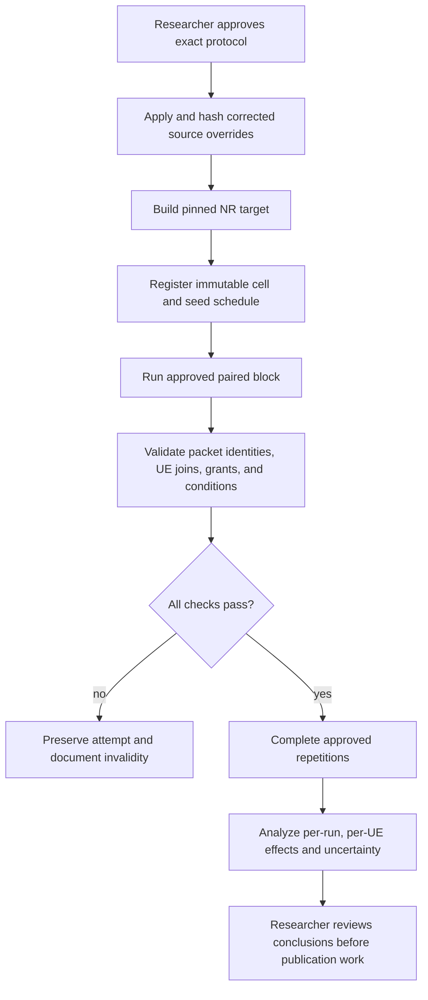

# Mission RA-ENG-007 — paired LOS/NLOS, load, and stock-policy campaign

**Status:** IN PROGRESS — researcher approved the existing v2 matrix; source application/build passed and the 8-cell pilot passed; 152 cells remain. **Date:** 2026-11-12. **Issue:** [#20 — RA-ENG-007](https://github.com/kirolossedra/oran-publication/issues/20).

## Research objective and scope

After feasibility and stock-policy control checks, run the researcher-approved multi-user NR campaign that contrasts channel condition, offered load, and stock scheduling policy while measuring all six UEs. Do not treat a successful simulator run as evidence of novelty, causal mechanism, or real-world performance. This template-first report records the authorized matrix, implementation, and pilot findings. The pilot validates execution and measurement plumbing; its single-seed results are not a formal policy comparison.

## Scientific motivation and hypotheses (human-owned)

The research question, candidate gap, selected primary direction, policy-pair interpretation, hypotheses, and scientific conclusions remain researcher-owned. RA-ENG-006 (#19) source-verified and observed that `RoundRobin` versus `TopKCqi`, with xApp Bypass fixed, can change applied grants under one seed and one LOS contention condition. That result is a technical control probe, not a formal policy ranking.

## Requirements and acceptance criteria

Issue #20 requires explicit protocol approval before formal simulation. On 2026-11-12 the researcher replied **“existing”** to the approval question that contrasted the current 160-cell v2 matrix with a narrower design and explicitly disclosed its selective UE6 NLOS scope and both-direction measurements. This is recorded as approval of the existing matrix: all-LOS vs selective UE6 NLOS; stationary vs controlled-linear mobility; four load arms; RoundRobin vs TopKCqi with xApp Bypass and `k=1`; both DL and UL measured together; five seeds `[11,22,33,44,55]`; 160 planned unique cells; 20 s runs with 1.1 s application start, 1 s receiver drain, 512-byte payloads, and the matrix's declared percentile method. This selection expands the compact design suggested by issue #20; that expansion is now researcher-approved, not inferred by Codex.

Acceptance for the *campaign* remains unmet until all approved cells and repetitions complete with valid trace joins, run-level uncertainty and all UE outcomes are analyzed, and documentation/audit/push gates pass. Corrected source overrides and the pinned build are already verified.

## Existing architecture and affected components

- Researcher-authored campaign package: `campaigns/20261111-g1-integrated-v2/`, including `config/g1-integrated-campaign.json`, runner, analyzer, source overrides, and pinned-source map.
- RA-ENG-006 matched pilot config and results: `configs/scenarios/calibration/dl-contending.yaml` and ignored `simulator/logs/RA-ENG-006-20261112/`.
- Packet identity and applied grants: `experiment-scripts/map_udp_flows.py`, `experiment-scripts/analyze_packet_events.py`, and the RA-ENG-004/005 per-UE grant instrumentation.
- The installed simulator tree and campaign source overrides are distinct artifacts. The approved formal-run source version was pinned, copied, hash-verified, rebuilt, and recorded before pilot execution.

## Implementation details and alternatives

Two materially different scopes are visible in the existing records and require a researcher decision:

| Decision | Existing matrix | Approval recorded |
|---|---|---|
| Channel scope | `all-los` and selective `ue6-nlos` | Approved by “existing” reply; overrides the earlier whole-cell-only scope for this campaign. |
| Direction | DL and UL measured together | Approved by “existing” reply. |
| Policy | `RoundRobin` vs `TopKCqi`; xApp `Bypass`, `k=1` | Approved by “existing” reply; corrected campaign source hashes must be used. |
| Load/mobility | Four load arms; stationary and controlled-linear | Approved by “existing” reply. |
| Repetitions | Seeds 11, 22, 33, 44, 55; five seeds; 160 unique cells | Approved by “existing” reply; preserve checked-in ordering and pairing. |

The researcher has approved the 160-cell v2 matrix despite its broader scope than the compact design described in issue #20. Run exactly this checked-in matrix and do not add cells or alter its factors.

## Architecture/algorithm/workflow diagrams

Conceptual workflow from issue #20; arrows describe the gated process, not completed execution or measured outcome.

## Changed files and reproducible patches

This report is the template-first approval record. Subsequent execution changed the campaign runner/analyzer and created ignored raw pilot output; those changes and their effects are documented below. Source overrides are unchanged from the approved package.

## Dependencies, versions, configuration, seeds, commands

Pinned upstream versions are listed in `simulator/DEPENDENCIES.md`: ns-3.48 `d2add90b452d600cfb4859baed8e9ea633519447`; 5G-LENA NR v5.1 `cedceadda17392c90587fb9400eb9b1f8c236713`; ns3-ai `b8c9858294b1d6a7f122b5154a3ce25057a54740`; Orange ib-ORAN `3ea5046389f0eb993cdf01ef6d6d33017e6921bb`. The campaign package contains corrected full-file source overrides, but no claim is made here that they are installed or built in the local simulator checkout.

**Observed source drift that must be handled before runs:** the installed RoundRobin source SHA is `8638e94c141d430605d00494f429989dbfa80ea9f8afc522069e0a4898e26272`, while its campaign override SHA is `8d4d640fb14400666fa6bbe38496859d4e14c2dc106883c6e5904d1e41b4be22`. The installed TopK source SHA is `c8aa8e6193a03130131716260fc68ff6eac037c0e04c1a06e8973b41851ed425`, while its override SHA is `ff67a43669574505872791bd1ba0239114d2309a223d3e53a97e1b44c6b71956`. These match the #19 run metadata versus `simulator/overrides/iboran/SHA256SUMS`; therefore the policy semantics differ and the earlier #19 traces cannot be pooled with a future corrected-source campaign. The local raw/results search found zero files under the v2 run and result roots.

The researcher-approved protocol and source state are now recorded. The campaign runner retains the full 160-cell matrix and adds a `--pilot-block` selector for the first matched 2×2×2 block (seed 11, stationary, light/contending, both channel states, both policies; DL and UL measured together). The pilot selector does not add or alter cells; the full runner resumes the remaining approved cells. Formal output is kept under `simulator/runs/20261111-g1-integrated-v2/`; failed attempts receive a new attempt number and remain immutable. The analyzer accepts explicit `--campaign-root` and `--output-dir` options and refuses to overwrite nonempty output directories, allowing pilot and final analyses to remain separate.

## Tests and verification evidence (logs/paths)

**Observed repository state before this approval:** `simulator/runs/20261111-g1-integrated-v2/` and `results/20261111-g1-integrated-v2/` were absent locally. The campaign README reports 92/160 successful cells, two incomplete attempts, and 68 incomplete cells at its package snapshot; those are package-reported counts, not locally inspected raw evidence or completed analysis. RA-ENG-006 raw logs are separate, one-seed engineering probes.

The approved source override manifest verified 13 files. Pre-application copies and before/after hashes are retained in `simulator/logs/RA-ENG-007-20261112/source-backup/`, `source-installed/`, and `source-application.json`. `./ns3 build ns3iboran_nr -j 2` succeeded after rerunning outside the sandbox because the sandbox initially blocked ccache writes. The v2 regression suite passed nine tests, including the new pilot-block selector check.

The initial pilot attempts failed because the runner passed two channel flags not supported by this `iboran_run.py`; those flags duplicate settings already written into `scenario.yaml`. After correcting the runner, two further attempts failed before simulation because the default CLIP model snapshot was uncached and the Xet CDN timed out. A retry during the corrected pilot was interrupted. These attempts are preserved. The model was provisioned from the official OpenAI ViT-B/16 checkpoint, SHA-256 `5806e77cd80f8b59890b7e101eabd078d9fb84e6937f9e85e4ecb61988df416f`, then converted with the official Hugging Face Transformers CLIP conversion script (script SHA-256 `8950db3047c67ce8633052c5498e15ca287f4881f501362272b929bac4c3b7fd`). Conversion parity assertions passed; the converted model and local `CLIPProcessor` load offline on CPU. Model bytes remain ignored and are not committed.

**Observed pilot evidence (analysis output:** `simulator/logs/RA-ENG-007-20261112/pilot-analysis/`**):** the analyzer found 15 attempts: 8 successful and measurement-complete, 7 failed/interrupted, and 152 of 160 planned cells still missing. The 8 valid cells are exactly the approved seed-11 stationary light/contending 2×2×2 block; all six UEs have both-direction packet, demand, and grant rows (96 rows per table). All 8 channel-position audits passed, with 120 channel-state samples per cell and zero condition mismatches. The 7 excluded attempts comprise four exit-2 unsupported-argument failures, one interrupted attempt with no exit status, and two exit-1 CLIP initialization failures. The successful cells were selected for pilot analysis; none of the failed attempts was selected. This is one seed and a pilot block, so it does not support a general policy-effect estimate.

## Raw data and result references

Pilot raw data and analysis are preserved locally under ignored `simulator/runs/20261111-g1-integrated-v2/` and `simulator/logs/RA-ENG-007-20261112/pilot-analysis/`. They are excluded from Git and must be retained with the run-specific checksums. Full campaign output and final analysis remain incomplete.

## Analysis, sample sizes, uncertainty, interpretation

The researcher approved five seeds and the matrix's type-7 percentile method. Formal analysis must report per-run/per-UE offered TX, unique RX, goodput, missing-by-stop/drop, received-delay `n` and P95/P99, actual grant allocation, and condition identity. Compute uncertainty across independent runs, never pooled packets as independent units. All six UEs and service regressions must remain visible. Pilot percentile values are plumbing checks only; interpret no one-seed outcome as a general effect.

## Limitations and unverified assumptions

- Researcher approval was received via the conversation reply “existing,” selecting the current 160-cell v2 matrix and thereby explicitly accepting selective UE6 NLOS, both directions, mobility and five seeds for this campaign.
- Whole-cell LOS/NLOS was approved for RA-ENG-002; the new explicit approval selects the broader selective UE6 NLOS matrix for RA-ENG-007.
- v2 package progress counts are not independently verifiable here because the raw run directory is absent.
- Corrected scheduler source overrides differ from the earlier installed source used for RA-ENG-006. Formal results must use one pinned, rebuilt source version and exclude incompatible earlier outputs.
- The approved design's sample adequacy and the scientific interpretation of outcomes remain for analysis and researcher review; protocol factors and direction are fixed by approval.

## Problems, failures, and resolutions

1. The first pilot cell exited 2 because two unsupported command-line options were passed; the runner was corrected to use the effective scenario YAML for channel settings. Three failed attempts from this runner version are retained.
2. The corrected pilot then exited 1 during CLIP initialization because `openai/clip-vit-base-patch16` was not cached and the Hugging Face Xet storage host timed out. Two failed attempts are retained. The exact OpenAI checkpoint was downloaded from its official Azure URL, its URL-embedded SHA-256 verified, and Hugging Face's conversion script verified numeric parity before the model was loaded from local disk. `ftfy==6.3.1` and the OpenAI CLIP source checkout at `/tmp/ra-eng-007-openai-clip` (commit `d05afc436d78f1c48dc0dbf8e5980a9d471f35f6`) were used only for conversion. Full download/conversion provenance and hashes are in the ignored run root.
3. The initial local build failed because sandbox restrictions made ccache's external write path read-only; the same build command then passed with required filesystem permission. No source/compiler error occurred.
4. Retrying after correcting runner and embedding dependency uses new attempt directories; prior failed artifacts are never overwritten. Any subsequent simulation failure remains in the manifest and requires trace validation before proceeding.

## Decisions and evidence

- **Source-verified:** the v2 campaign config specifies channels `all-los`/`ue6-nlos`, mobility `stationary`/`controlled-linear`, four load arms, `RoundRobin`/`TopKCqi`, and seeds `[11,22,33,44,55]`; issue #20 describes a narrower, direction-selected design.
- **Observed:** the 8-cell pilot completed with valid all-six, both-direction measurements and condition audits; 152 approved cells remain.
- **Researcher-approved:** existing 160-cell v2 protocol as specified in `config/g1-integrated-campaign.json`; exact request and answer recorded above.
- **Observed:** source overrides are applied, the pinned NR target builds, nine regression checks pass, and the pinned CLIP checkpoint converts and loads offline on CPU.
- **Still unresolved:** the remaining 152 approved cells, campaign-level analysis and uncertainty, and researcher-owned scientific interpretation.
- **Stop condition:** stop on source drift during runs, invalid trace/identity joins, or incomplete/failed run integrity; preserve attempts and do not substitute unapproved factors.

## Final deliverables

This report records approval, readiness, and pilot evidence. Campaign analysis and publication deliverables remain incomplete pending the remaining approved runs and subsequent human review.

## Unresolved questions and next steps

1. Complete the remaining 152 cells with the same pinned source and frozen matrix; preserve all retries and failures.
2. Re-run the analyzer into a new, empty final-results directory; inspect valid cell counts, trace joins, censoring, P95/P99 sample counts, condition audits, and per-run uncertainty.
3. Refresh immutable checksums, canonical navigation, documentation audit, and issue #20/#24 after results are validated.
4. Only after validated analysis, proceed to RA-ENG-008; only after researcher review/authorization, proceed to RA-ENG-009.

## Documentation completion checklist

- [x] Report created before formal source mutation/build/run; blocker, scope and criteria recorded
- [x] Conceptual workflow diagram included and labeled
- [x] Researcher-approved protocol recorded (existing 160-cell v2 matrix)
- [ ] Corrected source overrides applied and pinned build verified
- [ ] Approved runs, immutable raw evidence, analysis and results complete (8/160 pilot cells complete)
- [ ] README, mission index and audit updated
- [ ] Reproduction commands, failure record, checksums and claims reviewed
- [ ] Staged-path/security/size audit and safe main push recorded
