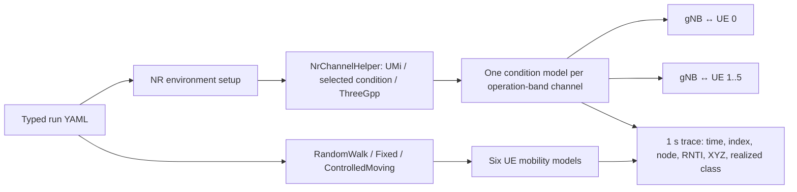

# G1 radio-condition and mobility validation

**Status:** Engineering validation complete. **Date:** 2026-11-12. **Parent:** [RA-ENG-002](../missions/RA-ENG-002-radio-mobility.md). **Scientific status:** no research protocol, treatment-effect hypothesis, or performance claim is defined here.

## Objective and scope

Verify that the pinned ib-ORAN run configuration can select whole-cell forced LOS or NLOS, preserve the upstream RandomWalk baseline, and provide deterministic fixed and controlled-moving six-UE modes. This validates scenario controls and trace observability. The recorded researcher decision selects the whole-cell scope; these runs do not evaluate selective blockage or a factory channel.

## Source and configuration

The tested stack is ns-3 `d2add90b452d600cfb4859baed8e9ea633519447`, 5G-LENA NR `cedceadda17392c90587fb9400eb9b1f8c236713`, ns3-ai `b8c9858294b1d6a7f122b5154a3ce25057a54740`, and Orange ib-ORAN `3ea5046389f0eb993cdf01ef6d6d33017e6921bb`. Versions and dependency locks are in [environment.json](../../manifests/environment.json), [the C++ lock](../../manifests/cpp-environment-lock.txt), and [the Python lock](../../manifests/python-environment-lock.txt).

Source map at the pinned revisions: `contrib/nr/helper/nr-channel-helper.cc`, `NrChannelHelper::CreateChannel` lines 101–158 and `GetConditionTypeId` lines 275–285; ib-ORAN `SetupNrChannelModel` lines 53–68, channel creation and helper wiring in `iboran-nr-environment.cc` lines 217–226, and mobility setup call lines 210–211; `SetupFronthaulMobility` in `iboran-ran-common.cc` lines 296–383 and trace implementation lines 385–439; typed fields in `iboran-ran-params.h` lines 67–100, YAML parsing in `iboran-ran-params.cc` lines 231–245 and 378–383; Pydantic config fields in `model/utils/config_store.py` lines 61–88; scenario override in `iboran_run.py` lines 26–40 and option declaration lines 125–131; no-traffic KPI initialization in `iboran_orchestrator.py` lines 192–207 and 305–308.

The minimal patch is [RA-ENG-002-radio-mobility.patch](../../patches/RA-ENG-002-radio-mobility.patch). Apply it to a clean pinned ns-3 stack whose `contrib/iboran` directory contains the exact ib-ORAN commit:

```sh
git -C simulator/ns-3.48 apply --unidiff-zero --directory=contrib/iboran \
  patches/RA-ENG-002-radio-mobility.patch
```

The patch changes nine upstream ib-ORAN files. `SetupNrChannelModel` in `contrib/iboran/model/iboran_ran_environment/iboran-nr-environment.cc` passes `nr.channelCondition` to the pinned helper. Forced LOS/NLOS use the always/never LOS model; the selected model is shared by the operation band's channel and propagation model, so this is a cell-wide condition. `UpdatePeriod=0` is applied to the default UMi condition factory only, because the forced condition models do not expose that attribute. Shadowing remains enabled. The channel model itself retains its zero-millisecond update period.

The config keys are represented in both the typed Pydantic config and the C++ YAML loader. Defaults are `mobilityMode: RandomWalk`, `channelCondition: Default`, and tracing disabled, preserving normal upstream behavior. `--scenario_config` layers an override onto the main YAML config; `scripts/prepare_g1_radio_mobility_run.py` can materialize a complete validated LOS/NLOS run config from a scenario file.

From the repository root, materialize either effective config for inspection with:

```sh
simulator/ns-3.48/.venv/bin/python scripts/prepare_g1_radio_mobility_run.py \
  --scenario configs/scenarios/g1-radio-mobility-los.yaml --seed 1 \
  --output /tmp/g1-radio-mobility-los-effective.yaml
```

## Scenario parameters

Both paired runs use seed 1, run 1; one gNB; six UEs; a 500 m square area; 20 simulated seconds; 3.5 GHz; 10 MHz; one CC and BWP; numerology 1; the existing TDD pattern; 4×4 gNB and 2×2 UE antennas; 46 dBm gNB and 23 dBm UE maximum transmit power; and the existing default propagation/shadowing settings. The LOS and NLOS configs are identical except for `nr.channelCondition`. Both uplink and downlink application flows are disabled. No dataset or CLIP model is loaded.

For `Fixed` and `ControlledMoving`, the same deterministic grid is used: x coordinates 240, 250, and 260 m; y coordinates 245 and 255 m; z is 1.5 m. The gNB is at (250, 250, 30) m. Controlled movement uses `ConstantVelocityMobilityModel` at 0.83 m/s along +x. Fixed mode uses `ConstantPositionMobilityModel`. Both validation modes require six UEs. The separate `RandomWalk` mode retains the upstream 0.83 m/s RandomWalk2d model, 100 m turn distance, square bounds, and random initial placement.

## Source-grounded path



This is a source-verified representation of the tested single-band path. It is not a physical building or selective-link diagram. Each trace row calls the actual configured `ChannelConditionModel` for that gNB/UE endpoint pair. The same whole-cell condition is therefore observed for all six links in each forced-condition arm.

## Reproduction

From `simulator/ns-3.48` build the NR target using the locked prefix and the project-local ccache configuration recorded in `simulator/tooling/ccache.conf`:

```sh
CCACHE_CONFIGPATH="$PWD/../tooling/ccache.conf" \
CCACHE_DIR="$PWD/../tooling/ccache" \
  ./ns3 build ns3iboran_nr -j 4
```

From `simulator/ns-3.48/contrib/iboran/model/iboran_campaign`, run each arm with the project Python 3.12.3 environment and a full output log in a new run directory:

```sh
CCACHE_CONFIGPATH=/home/george/oran-publication/simulator/tooling/ccache.conf \
CCACHE_DIR=/home/george/oran-publication/simulator/tooling/ccache \
../../../../.venv/bin/python iboran_run.py \
  --scenario_config=/home/george/oran-publication/configs/scenarios/g1-radio-mobility-los.yaml \
  --rng_run=1

CCACHE_CONFIGPATH=/home/george/oran-publication/simulator/tooling/ccache.conf \
CCACHE_DIR=/home/george/oran-publication/simulator/tooling/ccache \
../../../../.venv/bin/python iboran_run.py \
  --scenario_config=/home/george/oran-publication/configs/scenarios/g1-radio-mobility-nlos.yaml \
  --rng_run=1
```

The fixed and RandomWalk regression probes use the correspondingly named configs in `configs/scenarios/`. The Python runner and C++ executable write conventional outputs under the ignored simulator tree. Before another replay, archive each run's `runConfig.yaml`, `kpi.json`, animation and console output to a new run-specific directory; do not overwrite previous artifacts.

For this run, the successful build log is `simulator/logs/RA-ENG-002-20261112/build-final.log`. Successful console logs are `run-los-precision.log`, `run-nlos.log`, `run-fixed.log`, and `run-randomwalk.log`. Per-arm traces, effective configs, KPI JSON, and animation XML are under the corresponding `los/`, `nlos/`, `fixed/`, and `randomwalk/` subdirectories. Paired and RandomWalk validation output is preserved in `validation-pair.log` and `validation-randomwalk.log`. Failed attempts and their causes are retained as `build.log`, `run-los-attempt-001.log`, and `run-los-attempt-002.log`. A checksum manifest is stored alongside these artifacts.

## Observations and validation

**Observed:** the final pinned target built successfully. Each 20 s forced-condition run emitted 120 rows (six UEs at integer seconds 0–19). All LOS rows reported LOS; all NLOS rows reported NLOS. The paired validator confirmed exact equality of time-indexed gNB/UE coordinates, node IDs, and RNTI mappings. At times after attachment, the six distinct RNTIs were 25, 26, 27, 31, 32, and 33. The measured x displacement from t=0 to t=1 was 0.83 m for every controlled-moving UE. The two configs matched after normalizing only the condition field.

**Observed:** a 2 s fixed-mode run kept all six positions unchanged and reported LOS for all trace rows. A separate 2 s `RandomWalk` run completed with six UE identities and changed positions. These checks show the distinct model paths execute; they do not claim the forced state is realistic or that RandomWalk naturally transitions between LOS/NLOS.

**Observed, not interpreted as application traffic:** the run logs show four UDP FlowMonitor entries on port 2123, six packets per entry. Both configured application flows were disabled; these low-level entries are not analyzed as a workload, throughput result, or latency sample.

Re-run the checks with:

```sh
simulator/ns-3.48/.venv/bin/python scripts/validate_g1_radio_mobility_pair.py \
  --los-trace simulator/logs/RA-ENG-002-20261112/los/radio-mobility.csv \
  --nlos-trace simulator/logs/RA-ENG-002-20261112/nlos/radio-mobility.csv \
  --los-config simulator/logs/RA-ENG-002-20261112/los/effective-run-config.yaml \
  --nlos-config simulator/logs/RA-ENG-002-20261112/nlos/effective-run-config.yaml \
  --fixed-trace simulator/logs/RA-ENG-002-20261112/fixed/radio-mobility.csv
```

The validator reported `PASS` for matched configs and trajectories, realized LOS/NLOS labels, all six identities, assigned RNTIs, controlled speed, and fixed-mode invariance. A separate check found movement in all six RandomWalk UE traces.

## Failures and troubleshooting

- The first C++ build used the host's read-only ccache config and failed before compilation. Repeating the build with the ignored project-local `CCACHE_CONFIGPATH` and `CCACHE_DIR` succeeded. One runner retry also omitted those variables and failed during its automatic ns-3 build; the retry with both variables succeeded.
- The first Python run attempted to load the default CLIP model and failed at DNS resolution before starting the simulation. Disabling both configured application flows caused the no-traffic validation path to skip dataset and intent-KPI initialization; no model download was needed.
- The first forced-LOS C++ run aborted because the pinned setup set `UpdatePeriod` on `AlwaysLosChannelConditionModel`, which lacks that attribute. The patch now sets it only for the default UMi condition factory. The later forced-LOS and forced-NLOS runs completed.
- An initial short RandomWalk assertion expected a t=2 sample, while ns-3's stop event ends this 2 s run after t=1. The trace has the expected 12 rows at t=0 and t=1; the corrected validation passed. No raw logs or run outputs were overwritten.

## Limits and unresolved items

- Whole-cell forced LOS/NLOS changes all UE links together. It cannot isolate one UE.
- No buildings, blockage, indoor-factory calibration, or dynamic obstruction is modeled.
- No application traffic was enabled. No throughput, latency, packet-tail, scheduler-treatment, or causal effect is estimated.
- The tested environment does not currently wire RSRP/SINR/CQI or pathloss records into this run trace. The validation logs realized class and geometry; it does not call pathloss calculations from the trace because doing so could consume propagation-model random state and alter the simulation.
- The trace labels RNTI 0 at t=0 before attach completes; assigned RNTIs are recorded from t=1 onward.
- The earlier Mission 1 upstream NR smoke evidence remains preserved and unchanged. The short RandomWalk run here is a mobility-path regression probe, not a rerun or substitute for that full smoke.

## Decision and delivery

The researcher-approved whole-cell condition scope and recorded mobility objective were followed. No new scientific choice was made. The patch is separate from, and contains no changes from, the historical NR-U tree. Raw outputs remain ignored under `simulator/logs/RA-ENG-002-20261112/`; the tracked patch, four configs, and two validation scripts are the replay package.
