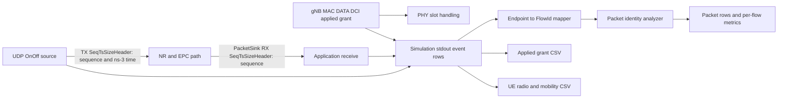

# G1 packet and applied-grant metrics

This document defines the engineering telemetry added for RA-ENG-004. It describes simulator events, not a scientific traffic protocol or evidence of policy benefit.

## Event path and join limits

Conceptual data-flow diagram. The grant row is emitted after the gNB MAC passes its allocated slot to PHY. It does not prove successful transmission or decoding. Packet identities are not joined to individual grants; grant outputs are joined to configured UE using `(RNTI, direction)` when available.

## Raw event records

`PACKET_TX,event_time_ns,sequence,tx_time_ns,payload_bytes,source_ip,source_port,destination_ip,destination_port`

`PACKET_RX,event_time_ns,sequence,tx_time_ns,payload_bytes,source_ip,source_port,destination_ip,destination_port`

Both clocks are ns-3 simulation time in integer nanoseconds. TX time is carried by `SeqTsSizeHeader`; event time is `Simulator::Now()` at the callback. Payload bytes exclude the telemetry header. A run's identity comes from the unique run directory and effective YAML; FlowId, UE index and direction are joined from the C++ traffic configuration rows and FlowMonitor endpoint tuple. A TX trace can expose source `0.0.0.0`; the mapper resolves that trace by stable destination endpoint plus source port and does not alter the captured raw event.

`APPLIED_GRANT,time_ns,direction,rnti,frame,subframe,slot,symbol_start,symbol_count,bwp_id,allocated_rbg,rb_per_rbg,allocated_prb,mcs,tb_size_bytes,ndi,rv,harq_id,rbg_bitmap`

Direction distinguishes DL and UL DATA DCI. PRBs are the RBG bitmap population count multiplied by RBs per RBG. Retransmission allocations are included. dApp allocation intent and xApp maximum RBG are scheduler inputs and are not represented by this event. The callback does not provide source-grounded CQI or buffer occupancy.

## Analyzer output semantics

`packets.csv` has one primary row per unique TX sequence with status `delivered` or `missing_by_sink_stop`, plus rows for RX identities that have no matching TX (`unmatched_rx`). Duplicate counts are retained in per-flow metrics and all individual callback events remain in stdout. `ue_packet_metrics.csv` is keyed by FlowId, UE, direction and RNTI. It reports unique TX/RX, duplicate TX/RX, unmatched RX, missing-at-sink-stop, reordered RX, RX after source stop (`drained`), payload bytes, configured/offered rate, generated rate, delivered goodput, and received delay sample count with P50/P95/P99.

The empirical quantile estimator is nearest rank: sort the matched nonnegative delays and select one-based rank `ceil(q*n)`. Only unique received sequence IDs enter quantiles. Empty samples produce blank quantile values and `received_delay_n=0`. Missing packets have no latency assigned. `missing_by_sink_stop` means no matching application RX was observed by the end of the capture; it does not establish network loss. FlowMonitor is an IP-layer aggregate cross-check and can count packets after PacketSink has stopped.

The rate window is configured source stop minus source start. `offered_rate_bps` is the configured application rate; `generated_rate_bps` is observed unique transmitted application payload bits divided by that window; `delivered_goodput_bps` is matched received payload bits divided by the same window. They should not be read as interchangeable. Delays are app-to-app and include the configured backhaul path.

`ue_grants.csv` holds the gNB MAC allocation events, enriched by `(RNTI, direction)` where a traffic map identifies the UE. `ue_radio.csv` carries the existing radio/mobility trace and is not a packet-level radio condition measurement.

## Reproduction and source locations

See [RA-ENG-004 instrumentation report](../history/missions/instrumentation.md) for pinned versions, scenario settings, exact run commands, results, failures and immutable raw output paths. The core source hooks are in `contrib/iboran/model/iboran_ran_environment/iboran-ran-common.cc`, `contrib/iboran/model/iboran_ran_environment/iboran-nr-environment.cc`, `contrib/nr/model/nr-gnb-mac.cc`, and `contrib/nr/model/nr-phy-mac-common.h`.

## Limits

The current test runs use one seed and short horizons and only establish instrumentation behavior. The gNB grant event is not PHY airtime or packet-level resource attribution. Dataset-mode legacy apps do not emit unique packet timestamps. PacketSink truncation and FlowMonitor layer counters have different observation boundaries. No formal campaign, standard compliance, causal interpretation, or real-world validity is claimed.
