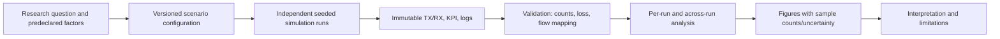

# Proposed experimental methodology

This is a proposal, not an executed protocol. The migration mission does not select numeric traffic rates or report performance results.

## Question and outcomes

Question: as background UL/DL offered traffic grows, how do baseline and modified RAN allocation policies affect a latency-sensitive UE and competing UEs? Primary outcomes: mean and tail packet latency, achieved UL/DL throughput, packet loss, PRB allocations/utilization, and per-UE effects.

## Variables to define before experiments

| Type | Candidates | Status |
|---|---|---|
| Independent | allocation policy; per-UE offered load; UL/DL direction; background UE count | planned |
| Dependent | mean/P95/P99 latency; loss; throughput; PRB metrics; competing UE outcomes | planned; validate metric implementation |
| Controlled | ns-3/NR versions; topology/positions; channel/propagation; bandwidth/numerology; traffic packetization; duration; QoS; scheduler bounds; seed protocol | values not yet selected |

## Traffic and load interpretation

Configured generator rate is a target; realized generated bytes/packets should be measured at application TX. Achieved goodput is successfully received payload per defined interval. Record all three independently and state whether rates are per flow or aggregate, payload or wire rate, UL or DL. Use a latency-sensitive flow distinct from background flows and preserve per-flow IDs.

## Repetition and statistics

Predeclare seed/run IDs and independent repetitions. Report sample count, loss, and the percentile estimator (including interpolation rule). P99 requires adequate samples and P99.9 requires substantially more; never infer stable tails from a tiny population. Report variation across independent seeds and uncertainty method, selected before result interpretation. Do not treat packets as independent experimental replicates; run/seed is the replication unit.

## Warm-up and horizon

Choose a warm-up and measurement interval by checking flow establishment, buffer state, and stationarity; report whether transient data are excluded. Continue sink/trace observation after source stop where needed to distinguish in-flight packets from losses. Record simulator stop behavior. These choices are TBD and must be justified in the mission protocol.

## Planned workflow

The workflow separates configuration, raw evidence, validation, and interpretation. It does not imply a baseline is already operational.
