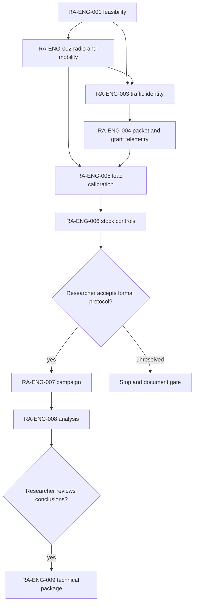

# KIRO — O-RAN mission portfolio execution

**Status:** TECHNICAL EXECUTION THROUGH RA-ENG-008 COMPLETE; RA-ENG-009 and KIRO closeout await researcher review/authorization. **Issue:** [#24 — KIRO](https://github.com/kirolossedra/oran-publication/issues/24). **Updated:** 2026-11-12.

## Objective and scope

Track the O-RAN mission portfolio and execute technical work in dependency order while preserving human ownership of the research question, formal protocol, scientific interpretation, and publication claims. Issue #24 requests completion of the portfolio; issue-specific stop gates and research governance still apply. Issues #1–#10 are superseded drafts. RA-ENG-001–004 (#14–#17) are completed and closed; RA-ENG-005 (#18) is closed with one-seed calibration results; RA-ENG-006 (#19) is a documented one-seed engineering probe. RA-ENG-007 (#20) completed all 160 researcher-approved cells, with seven failed/interrupted pilot attempts preserved and excluded. RA-ENG-008 (#21) completed the validated per-UE analysis, uncertainty, interaction estimates, source-aware statistics, tests, figures, and neutral claim/evidence matrix. RA-ENG-009 (#22) remains gated on the researcher reviewing the findings/novelty and explicitly authorizing a technical publication package; no manuscript submission or novelty claim is made.

## Dependency model

This is a conceptual dependency diagram based on the issue sequence and prior roadmap. It indicates prerequisites, not validation results or approval.

## Current evidence and decisions

- **Observed:** The researcher-authored integrated v2 manifest defines 160 planned cells across channel, mobility, load, scheduler, and five seeds. The local approved execution completed 160/160 complete cells using the source hashes recorded in the [RA-ENG-007 report](RA-ENG-007-paired-campaign.md); seven earlier failed/interrupted attempts remain preserved. Full editable source overrides and their SHA256 manifest are in the campaign package.
- **Observed:** The v2 package replaces invalidated v1 packet tags with a serialized application header and documents its source-observed limitation. Its analysis/reproduction instructions live under `campaigns/20261111-g1-integrated-v2/`.
- **Observed:** This local RA-ENG-004 work adds a separate SeqTsSizeHeader-based UDP instrumentation path and applied gNB MAC DATA DCI grant records. The short engineering runs are not the campaign data. Six bounded cases and three synthetic tests completed; commit `9b2582f` contains the report, schema, replay patches, scenario configs, and analysis tooling.
- **Interpretation:** The integrated v2 package advances the research campaign independently of these bounded RA-ENG-004 checks. Keep its run IDs, header schema, and analysis as the canonical campaign evidence. Do not merge the short low-rate smoke results into campaign tables.
- **Researcher-owned:** Final interpretation, sample adequacy decisions beyond the documented reporting rule, literature novelty, and publication claims remain with the researcher. The [neutral claim/evidence matrix](../research/g1-claim-evidence-matrix.md) is a review aid, not a conclusion.

## Status table

| Issue | Mission | Status | Evidence or gate |
|---:|---|---|---|
| #14–#16 | RA-ENG-001–003 | Closed complete | Prior reports remain in history through commit `fcb460f8ec3098372605635a5c40b823faff1d2d`. |
| #17 | RA-ENG-004 | Closed complete | [Mission report](RA-ENG-004-instrumentation.md), [schema](../methodology/g1-packet-grant-metrics.md), raw `simulator/logs/RA-ENG-004-20261112/`; commit `b75c578` is remote-verified. |
| #18 | RA-ENG-005 | Closed, engineering calibration complete | [Report](RA-ENG-005-load-calibration.md), [method/results](../methodology/g1-load-calibration.md); candidate rates returned, no formal factors selected; closeout SHA `762eb32f56d986aba3e9eac49110e4557efae26b` remote-verified. |
| #19 | RA-ENG-006 | Engineering probe complete; researcher choice pending | [Mission report](RA-ENG-006-stock-scheduling.md) and [source/control note](../research/g1-stock-policy-controls.md). RoundRobin/TopKCqi changed actual applied grants in one matched seed-11 probe; not a formal ranking. |
| #20 | RA-ENG-007 | **Complete; 160/160 cells validated** | [Campaign report](RA-ENG-007-paired-campaign.md), [run audit/results](../../results/RA-ENG-008-20261112-audited-v3/); all selected source hashes and channel/mobility audits pass. |
| #21 | RA-ENG-008 | **Technical analysis complete** | [Analysis report](RA-ENG-008-data-analysis.md), [statistics](../methodology/g1-statistics.md), [claim/evidence matrix](../research/g1-claim-evidence-matrix.md), [curated outputs](../../results/RA-ENG-008-20261112-audited-v3/). |
| #22 | RA-ENG-009 | Researcher review and authorization gate | Requires reviewed analysis, approved claims, and authorization to assemble publication assets. |
| #24 | KIRO | Incomplete pending researcher gates | Technical setup and missions through #19 are documented. The formal campaign, its analysis, and publication package cannot be truthfully marked complete without the required approvals and outputs. |

## Next actions and stop conditions

1. Researcher: review the neutral RA-ENG-008 claim/evidence/limit matrix and decide how the measurements relate to the approved scientific question and candidate literature gap.
2. If desired, explicitly authorize RA-ENG-009 after that review. The issue requires this gate before preparing a technical publication package.
3. Keep the integrated campaign runs separate from earlier RA-ENG-006 engineering traces and from invalidated v1 packet-tag summaries.

## Reproduction references

See the [RA-ENG-004 report](RA-ENG-004-instrumentation.md) for simulator pins, exact short-run configs/commands, test command, scenario outputs, limitations and hash verification. See the [integrated campaign README](../../campaigns/20261111-g1-integrated-v2/README.md) for the current resumable runner, analysis, matrix and campaign-specific reproduction commands.
