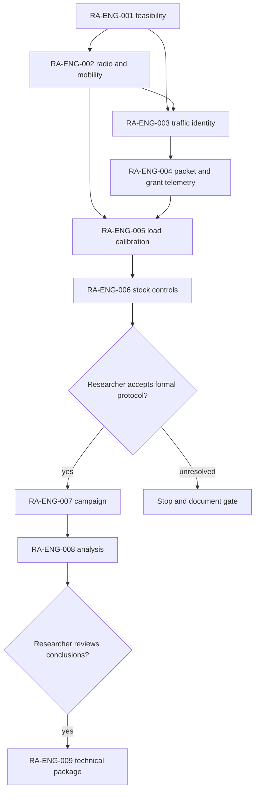

# KIRO — O-RAN mission portfolio execution

**Status:** IN PROGRESS. **Issue:** [#24 — KIRO](https://github.com/kirolossedra/oran-publication/issues/24). **Updated:** 2026-11-12.

## Objective and scope

Track the O-RAN mission portfolio and execute technical work in dependency order while preserving human ownership of the research question, formal protocol, statistical interpretation, and publication claims. Issue #24 requests completion of the portfolio; issue-specific stop gates and the repository's research governance still apply. Issues #1–#10 are superseded drafts. RA-ENG-001–003 were completed and closed before this report update. RA-ENG-004 (#17) has now been implemented, bounded-validated, and safely replayed on top of the newer researcher-authored `origin/main` campaign snapshot; push verification and GitHub issue closure remain.

## Dependency model

This is a conceptual dependency diagram based on the issue sequence and prior roadmap. It indicates prerequisites, not validation results or approval.

## Current evidence and decisions

- **Observed:** The researcher-authored integrated v2 campaign package is on `origin/main` at `e85b4dc0edc25543a5ecbea61e6c4bef4e41102f`. Its manifest defines 160 planned cells across condition, mobility, load, scheduler, and five seeds. The latest package snapshot records 92 successful cells, two incomplete attempts, and 68 cells not complete. Full editable source overrides and their SHA256 manifest were added; the package README says results are not yet campaign conclusions.
- **Observed:** The v2 package replaces invalidated v1 packet tags with a serialized application header and documents its source-observed limitation. Its analysis/reproduction instructions live under `campaigns/20261111-g1-integrated-v2/`.
- **Observed:** This local RA-ENG-004 work adds a separate SeqTsSizeHeader-based UDP instrumentation path and applied gNB MAC DATA DCI grant records. The short engineering runs are not the campaign data. Six bounded cases and three synthetic tests completed; commit `9b2582f` contains the report, schema, replay patches, scenario configs, and analysis tooling.
- **Interpretation:** The integrated v2 package advances the research campaign independently of these bounded RA-ENG-004 checks. Keep its run IDs, header schema, and analysis as the canonical campaign evidence. Do not merge the short low-rate smoke results into campaign tables.
- **Researcher-owned:** Final load calibration and formal interpretation remain subject to the applicable issue gates. The integrated campaign's checked-in configuration is recorded as researcher-authored; its scientific sufficiency and conclusions are not independently asserted here.

## Status table

| Issue | Mission | Status | Evidence or gate |
|---:|---|---|---|
| #14–#16 | RA-ENG-001–003 | Closed complete | Prior reports remain in history through commit `fcb460f8ec3098372605635a5c40b823faff1d2d`. |
| #17 | RA-ENG-004 | Implementation and bounded validation complete; push verification pending | [Mission report](RA-ENG-004-instrumentation.md), [schema](../methodology/g1-packet-grant-metrics.md), raw `simulator/logs/RA-ENG-004-20261112/`. Issue remains open until publication and evidence comment. |
| #18 | RA-ENG-005 | Not started | Requires #17 and load evidence; formal choices remain researcher-owned. |
| #19 | RA-ENG-006 | Not started | Requires contention calibration and scope-specific checks. |
| #20 | RA-ENG-007 | Protocol gate / campaign in progress | Researcher-authored v2 matrix exists; issue acceptance and campaign completion still require review. |
| #21 | RA-ENG-008 | In progress in v2 package; not complete | 68 of 160 matrix cells remained at latest package snapshot; analysis and sample-count review pending. |
| #22 | RA-ENG-009 | Researcher review gate | Requires reviewed analysis and authorized claims. |
| #24 | KIRO | In progress | RA-ENG-004 is rebased on the campaign snapshot; complete safe publication and continue eligible technical missions while honoring remaining review gates. |

## Next actions and stop conditions

1. Push the safe fast-forward RA-ENG-004 commit onto current researcher-authored `main`, retaining the campaign package and required mission navigation and ignore rules.
2. Publish and verify RA-ENG-004, then update issue #17 with its actual bounded validation and limitations.
3. Continue eligible technical items under the user's portfolio instruction without altering campaign protocol or substituting smoke runs for formal results.
4. Leave formal scientific claims and publication readiness to researcher review; report all remaining cells, failures, and uncertainty as observed.

## Reproduction references

See the [RA-ENG-004 report](RA-ENG-004-instrumentation.md) for simulator pins, exact short-run configs/commands, test command, scenario outputs, limitations and hash verification. See the [integrated campaign README](../../campaigns/20261111-g1-integrated-v2/README.md) for the current resumable runner, analysis, matrix and campaign-specific reproduction commands.
