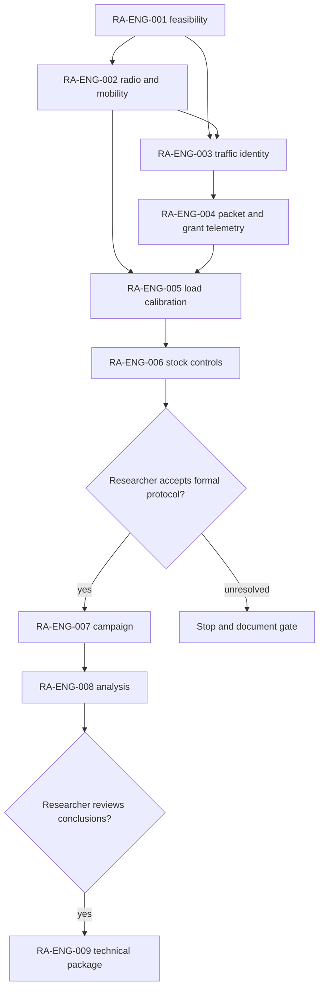

# KIRO — O-RAN mission portfolio execution

**Status:** IN PROGRESS. **Issue:** [#24 — KIRO](https://github.com/kirolossedra/oran-publication/issues/24). **Updated:** 2026-11-12.

## Objective and scope

Track the O-RAN mission portfolio and execute technical work in dependency order while preserving human ownership of the research question, formal protocol, statistical interpretation, and publication claims. Issue #24 requests completion of the portfolio; issue-specific stop gates and the repository's research governance still apply. Issues #1–#10 are superseded drafts. RA-ENG-001–004 (#14–#17) are completed and closed; RA-ENG-004 is published at `b75c5784d0ab928080037f6afa22ab97af359e10` and remote-verified. RA-ENG-005 (#18) is closed with one-seed load-calibration results, candidate rates, and limitations documented; closeout SHA `762eb32f56d986aba3e9eac49110e4557efae26b` is remote-verified. RA-ENG-006 (#19) now has a source-grounded paired seed-11 policy probe and complete per-UE outcome record. RA-ENG-007 (#20) remains gated on explicit researcher protocol approval; RA-ENG-008/009 cannot complete without formal campaign outputs and researcher review.

## Dependency model

This is a conceptual dependency diagram based on the issue sequence and prior roadmap. It indicates prerequisites, not validation results or approval.

## Current evidence and decisions

- **Observed:** The researcher-authored integrated v2 campaign package is on `origin/main` at `e85b4dc0edc25543a5ecbea61e6c4bef4e41102f`. Its manifest defines 160 planned cells across condition, mobility, load, scheduler, and five seeds. The latest package snapshot records 92 successful cells, two incomplete attempts, and 68 cells not complete. Full editable source overrides and their SHA256 manifest were added; the package README says results are not yet campaign conclusions.
- **Observed:** The v2 package replaces invalidated v1 packet tags with a serialized application header and documents its source-observed limitation. Its analysis/reproduction instructions live under `campaigns/20261111-g1-integrated-v2/`.
- **Observed:** This local RA-ENG-004 work adds a separate SeqTsSizeHeader-based UDP instrumentation path and applied gNB MAC DATA DCI grant records. The short engineering runs are not the campaign data. Six bounded cases and three synthetic tests completed; commit `9b2582f` contains the report, schema, replay patches, scenario configs, and analysis tooling.
- **Interpretation:** The integrated v2 package advances the research campaign independently of these bounded RA-ENG-004 checks. Keep its run IDs, header schema, and analysis as the canonical campaign evidence. Do not merge the short low-rate smoke results into campaign tables.
- **Researcher-owned:** Final load calibration and formal interpretation remain subject to the applicable issue gates. The integrated campaign's checked-in configuration is recorded as researcher-authored; its scientific sufficiency and conclusions are not independently asserted here.

## Status table

| Issue | Mission | Status | Evidence or gate |
|---:|---|---|---|
| #14–#16 | RA-ENG-001–003 | Closed complete | Prior reports remain in history through commit `fcb460f8ec3098372605635a5c40b823faff1d2d`. |
| #17 | RA-ENG-004 | Closed complete | [Mission report](RA-ENG-004-instrumentation.md), [schema](../methodology/g1-packet-grant-metrics.md), raw `simulator/logs/RA-ENG-004-20261112/`; commit `b75c578` is remote-verified. |
| #18 | RA-ENG-005 | Closed, engineering calibration complete | [Report](RA-ENG-005-load-calibration.md), [method/results](../methodology/g1-load-calibration.md); candidate rates returned, no formal factors selected; closeout SHA `762eb32f56d986aba3e9eac49110e4557efae26b` remote-verified. |
| #19 | RA-ENG-006 | Engineering probe complete; researcher choice pending | [Mission report](RA-ENG-006-stock-scheduling.md) and [source/control note](../research/g1-stock-policy-controls.md). RoundRobin/TopKCqi changed actual applied grants in one matched seed-11 probe; not a formal ranking. |
| #20 | RA-ENG-007 | **Not started: researcher approval gate** | Explicit approval of channel semantics, policy pair, direction, sample count, and protocol is required. The issue directs Codex to stop if approval is absent. |
| #21 | RA-ENG-008 | Awaiting valid formal campaign outputs | The v2 package snapshot reports 92/160 successful cells and 68 uncompleted; these package counts do not authorize a replacement formal analysis. |
| #22 | RA-ENG-009 | Researcher review and authorization gate | Requires reviewed analysis, approved claims, and authorization to assemble publication assets. |
| #24 | KIRO | Incomplete pending researcher gates | Technical setup and missions through #19 are documented. The formal campaign, its analysis, and publication package cannot be truthfully marked complete without the required approvals and outputs. |

## Next actions and stop conditions

1. Researcher: approve or revise the formal protocol decisions listed in issue #20, including whether to use the RoundRobin/TopKCqi pair observed in RA-ENG-006.
2. After approval, apply the campaign's current corrected scheduler source overrides, rebuild, register the approved seed schedule, and execute only the approved formal cells. Keep RA-ENG-006 engineering traces separate.
3. Analyze validated campaign outputs with run-level uncertainty and all six UE outcomes; request researcher review before any publication package.

## Reproduction references

See the [RA-ENG-004 report](RA-ENG-004-instrumentation.md) for simulator pins, exact short-run configs/commands, test command, scenario outputs, limitations and hash verification. See the [integrated campaign README](../../campaigns/20261111-g1-integrated-v2/README.md) for the current resumable runner, analysis, matrix and campaign-specific reproduction commands.
