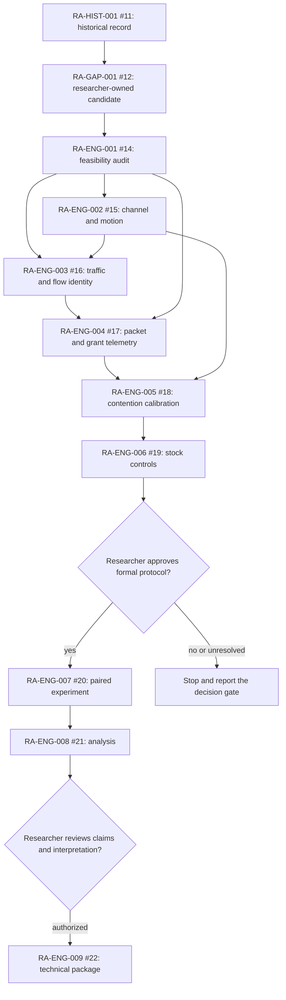

# KIRO — O-RAN mission portfolio execution

**Status:** IN PROGRESS. **Date opened:** 2026-11-12. **GitHub:** [issue #24 — KIRO](https://github.com/kirolossedra/oran-publication/issues/24).

## Research objective and scope

Account for the O-RAN mission portfolio, execute every currently authorized and technically executable engineering deliverable in dependency order, preserve reproducibility evidence, and report outcomes without claiming unsupported research conclusions. This is the local execution record for issue #24, which requests completion of the O-RAN mission portfolio in one execution cycle.

Scope is limited to this repository. The authoritative active engineering sequence is RA-ENG-001–009 in issues #14–#22 and its roadmap in issue #23. Earlier issues #1–#10 are explicitly marked stale by RA-GAP-001 (#12) and RA-PLAN-001 (#23); they are recorded but not treated as approved requirements. RA-HIST-001 (#11), RA-GAP-001 (#12), and RA-METHOD-001 (#13) are researcher-owned records/review gates, not autonomous literature or scientific interpretation tasks.

## Scientific motivation and hypotheses (human-owned)

RA-GAP-001 records a researcher-selected candidate about multi-user mobile NR, LOS/NLOS, loaded packet tails, and scheduling effectiveness. Its novelty is provisional. The researcher owns literature-gap judgment, hypotheses, final protocol choices, interpretation, and publication decisions. A recorded researcher decision selects **whole-cell LOS/NLOS comparisons with mobility** for the engineering path; this does not approve a final formal experiment matrix, sample count, traffic rates, scheduler pair, or scientific claim.

## Requirements and acceptance criteria

Issue #24 requires repository/mission discovery, dependency mapping, environment readiness, execution of eligible engineering missions, validated outputs, reproducibility documentation, issue updates, and safe commits/pushes. Its “all missions” language is constrained by the repository's explicit research-governance instructions and by each mission's stop gates.

Portfolio acceptance is achieved only when every active engineering issue is either completed with verified evidence or left open with a precise blocker and required researcher decision; stale drafts and researcher-owned review issues are identified accurately; all evidence is traceable; and the final status table distinguishes complete, incomplete, and gated work. No issue is closed without meeting its own acceptance criteria.

## Existing architecture and affected components

The repository contains a pinned ns-3.48 / 5G-LENA v5.1 / ns3-ai / Orange ib-ORAN environment under ignored `simulator/`, a completed upstream Mission 1 smoke-run record, and RA-ENG-001 source-feasibility documentation. The engineering path progresses from radio/mobility controls (#15), independently configured traffic (#16), packet/grant telemetry (#17), contention calibration (#18), stock-control validation (#19), paired experiments (#20), analysis (#21), and a researcher-reviewable technical package (#22). The dependency graph and approval gates are source-recorded in issue #23.

This is a conceptual dependency diagram transcribed from issue #23. Arrows show prerequisite order, not evidence that a mission ran. The formal campaign and technical publication package remain subject to their issue-specific researcher gates.

## Implementation details and alternatives

Continue on the existing `main` branch. Keep upstream source/builds, venvs, downloaded wheels, raw logs, and run output under ignored unique `simulator/` locations. Implement only the minimum changes accepted by each engineering issue. If a required capability would change the scientific question or exceed the recorded whole-cell/mobile decision, document the blocker and stop that branch of work for researcher review.

Portfolio alternatives considered: (1) executing the earlier #1–#10 backlog is rejected because the later RA-GAP-001 and RA-PLAN-001 explicitly supersede it; (2) running the full factorial study immediately is rejected because #20 requires completed calibration/control missions and a researcher-approved protocol; (3) complete source and engineering validation first, then stop at the explicit protocol gates. Reasons are recorded in the issue bodies; the ordering above follows the issue #23 dependency map.

## Architecture/algorithm/workflow diagrams

The Mermaid diagram above is a conceptual, GitHub-compatible view of issue #23's dependency graph. It does not depict implemented runtime code.

## Changed files and reproducible patches

This report is the required pre-implementation shell for issue #24. At opening, no issue-24-specific implementation changes have been made. Prior RA-ENG-001 commits already present on `main` document source inspection, isolated channel/mobility probes, environment restoration, and CPU Torch recovery.

## Dependencies, versions, configuration, seeds, commands

The environment is pinned in `manifests/environment.json`, `manifests/cpp-environment-lock.txt`, and `manifests/python-environment-lock.txt`. The active Python 3.12.3 venv now contains pinned CPU `torch==2.9.1+cpu` and `torchvision==0.24.1+cpu`; runtime imports and a CPU tensor operation passed. Simulator source revisions and previous commands are in the RA-ENG-001 report. No campaign seed schedule, formal traffic rates, packet horizons, or policy pair is yet approved.

## Tests and verification evidence (logs/paths)

At opening, the C++ target and Python bridge were built; three existing ns-3 test suites and an isolated six-UE helper/mobility probe passed, with outputs preserved under ignored `simulator/logs/RA-ENG-001-restore-20261111/`. CPU Torch/torchvision installation and runtime verification are recorded in `simulator/logs/RA-ENG-001-restore-20261112/`. No issue-24 portfolio campaign has run. New mission evidence will be added here by link and unique run ID.

## Raw data and result references

No issue-24 portfolio results exist at opening. Existing Mission 1 curated evidence remains under `results/mission1-nr-baseline/`; new raw runs must use unique ignored directories and must not overwrite prior data.

## Analysis, sample sizes, uncertainty, interpretation

No portfolio analysis or scientific performance claim exists at opening. Statistical protocol and interpretation remain researcher-owned; packet-tail analysis must account for loss/censoring and use independent runs as the replication unit per the engineering issue definitions.

## Limitations and unverified assumptions

- RA-ENG-001 has been reconciled against its exact feasibility-audit acceptance criteria; the audit is complete as a source-feasibility result. Its per-UE Buildings geometry route remains a source-supported but runtime-unverified alternative, and the recorded whole-cell choice does not depend on it.
- The previously recorded whole-cell/mobile choice does not resolve every protocol setting or authorize a scientific pivot.
- RA-GAP-001 has not established novelty through full-text prior-art review.
- RA-ENG-007 requires explicit researcher approval of the final scope and protocol; RA-ENG-009 requires review of scientific conclusions before any manuscript package.
- Issue #24's request to complete all work cannot waive research-governance or mission-specific approval gates.

## Problems, failures, and resolutions

The CPU Torch download blocker is resolved through the documented Aliyun mirror workaround. The official PyTorch index and CDN still time out in this environment. No CUDA wheel was installed and no GPU availability is claimed. Other mission-specific blockers will be added with evidence as encountered.

## Decisions and evidence

- **Recorded researcher decision:** primary engineering setup uses whole-cell LOS/NLOS with mobility; see RA-ENG-001 and RA-PLAN-001 records.
- **Recorded issue status:** issues #1–#10 are stale drafts; issue #23 identifies #14–#22 as the engineering chain; #20 and #22 contain explicit researcher approval gates.
- **Execution decision:** proceed in the documented dependency order and leave any unapproved scientific stage open with an evidence-backed gate. This follows user instruction “finish the list” while preserving the higher-priority repository governance and the issue-specific approval criteria.

## Portfolio status snapshot

| Record / issue | Current execution state | Evidence or remaining gate |
|---|---|---|
| Mission 0/1 | Complete | Migration, pinned stack build, and one upstream NR smoke run are documented. |
| #1–#10 | Stale drafts, excluded from active execution | RA-GAP-001 (#12) and RA-PLAN-001 (#23) say these old prompts are superseded. |
| #11 RA-HIST-001 | Historical record | Research history and decision boundaries are recorded. |
| #12 RA-GAP-001 | Researcher review gate | Candidate question exists; novelty, exact protocol, and scientific interpretation are not delegated. |
| #13 RA-METHOD-001 | Researcher review gate | Method is documented; it does not authorize autonomous issue execution. |
| #14 RA-ENG-001 | **Closed as completed** | F1–F6 source audit and bounded probes are recorded; per-UE geometry is explicitly unknown at runtime and outside selected scope. GitHub issue was closed as completed on 2026-11-12. |
| #15 RA-ENG-002 | In progress | Pre-implementation mission report created; selected whole-cell/mobile controls only. |
| #16–#19 RA-ENG-003–006 | Not started | Depend on completed radio/mobility and prior measurement/traffic work. |
| #20 RA-ENG-007 | Gated | Requires completed #15–#19 and explicit researcher approval of formal protocol. |
| #21 RA-ENG-008 | Not started / dependency blocked | Requires valid #20 campaign outputs. |
| #22 RA-ENG-009 | Researcher review gate | Requires analysis plus researcher-reviewed conclusions and publication authorization. |
| #23 RA-PLAN-001 | Roadmap recorded | Defines active #14–#22 chain and decision gates. |
| #24 KIRO | In progress | This portfolio execution report and subsequent evidence updates. |

**As of this update**, #14 is closed as completed and #15 has a pre-implementation report shell. The implementation snapshot will be updated as work advances.

The initial preflight/reconciliation delivery contained eight Markdown paths. Relative-link checking found 67 valid local targets; staged whitespace, credential-pattern, file-size, generated-artifact, and simulator/source-tree checks passed. Exact aggregate staged bytes are recorded in the documentation audit.

## Final deliverables

The final deliverable will be a portfolio status table with one row per active issue, links to mission reports/evidence, exact execution status, completed/blocked acceptance criteria, and verified commit/push state. No portfolio-completion claim is made until that table and all eligible issue deliverables are complete.

## Unresolved questions and next steps

1. Record the GitHub closure of RA-ENG-001 and proceed with RA-ENG-002 within the already recorded whole-cell scope.
2. Complete RA-ENG-002–006 within the recorded whole-cell/mobile scope and their technical prerequisites.
3. Stop before RA-ENG-007 unless the researcher-approved experiment protocol is explicitly available; do not infer its rates, sample counts, policy pair, or selected direction.
4. Prepare RA-ENG-008/009 only from validated outputs and researcher-reviewed conclusions.
5. Update issue statuses with evidence; retain issues with unresolved required decisions as open.

## Documentation completion checklist

- [x] Report shell created before new issue-24 implementation work
- [ ] Relevant implementation and evidence reports updated
- [x] Dependency diagram included and described
- [ ] README, mission index, and documentation audit updated for this mission
- [ ] Commands, results, source paths and researcher gates checked
- [ ] Staged-path, size, credential, and generated-artifact audit passed
- [ ] Descriptive commit pushed to `main`; remote SHA verified
