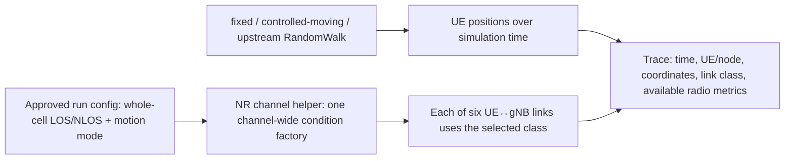

# RA-ENG-002 — Verified radio conditions and repeatable six-UE motion

**Status:** COMPLETE as a bounded engineering validation. **Date:** 2026-11-12. **GitHub:** [issue #15](https://github.com/kirolossedra/oran-publication/issues/15).

## Research objective and scope

Implement the researcher-selected **whole-cell forced LOS versus whole-cell forced NLOS** comparison with a repeatable six-UE mobility setup on the exact pinned ib-ORAN/ns-3/NR stack. Add bounded fixed and controlled-moving modes plus traces sufficient to verify node positions and actual link-condition classes. Keep the existing RandomWalk behavior available and clearly labeled. This is an engineering validation, not a loaded-traffic study, scheduler comparison, indoor-factory model, or P95/P99 experiment.

## Scientific motivation and hypotheses (human-owned)

The parent RA-GAP-001 is a provisional researcher-owned candidate. The recorded researcher decision selects cell-wide LOS/NLOS with mobility. No claim of a single-UE intervention, realistic factory obstruction, novelty, propagation-effect direction, or performance benefit is authorized here.

## Requirements and acceptance criteria

Follow issue #15: expose the selected channel condition at its approved whole-cell granularity; keep six UE identities; support fixed and controlled movement while preserving the upstream RandomWalk baseline; record time, node/UE identity, coordinates, condition and available radio metrics; verify paired positions and two-condition realization under the same seed; preserve an unchanged upstream smoke path; document tests, exact parameters, limitations and safe delivery. The recorded researcher decision explicitly selected whole-cell LOS/NLOS with mobility, satisfying issue #15's condition-scope gate. Per-UE geometry was not substituted.

## Existing architecture and affected components

The pinned source uses `SetupNrChannelModel` in `contrib/iboran/model/iboran_ran_environment/iboran-nr-environment.cc` and `SetupFronthaulMobility` in `contrib/iboran/model/iboran_ran_environment/iboran-ran-common.cc`. `NrChannelHelper::CreateChannel` creates one condition model for the operation-band channel and shares it with propagation models; per-link state is evaluated against endpoints by that model. The approved forced states use always-LOS and never-LOS classes, making this a cell-wide comparison. This report shell was created before new source inspection or modifications.

This is a source-informed view of the implemented single-band channel and mobility paths. Link-specific obstruction is excluded from the selected scope.

## Implementation details and alternatives

Implemented the smallest configuration path that preserves upstream defaults when omitted and adds explicit whole-cell LOS/NLOS, `Fixed`, and `ControlledMoving` modes. Paired modes use deterministic coordinates; RandomWalk remains the separately selectable upstream baseline. No Buildings model, custom per-link model, or loaded research traffic was added. The pinned forced LOS/NLOS classes lack the default model's `UpdatePeriod` attribute, so only the `Default` factory receives that setting; this distinction was observed through a runtime abort and verified by successful reruns.

## Architecture/algorithm/workflow diagrams

The Mermaid diagram above shows the implemented configuration-to-helper and position-to-trace paths; the condition model is per band and shared by its links.

## Changed files and reproducible patches

The implementation is preserved as [a replay patch](../../patches/RA-ENG-002-radio-mobility.patch) against ib-ORAN commit `3ea5046389f0eb993cdf01ef6d6d33017e6921bb`, rather than staging the ignored simulator source tree. Tracked scenario inputs are [LOS](../../configs/scenarios/g1-radio-mobility-los.yaml), [NLOS](../../configs/scenarios/g1-radio-mobility-nlos.yaml), [fixed](../../configs/scenarios/g1-radio-mobility-fixed.yaml), and [RandomWalk](../../configs/scenarios/g1-radio-mobility-randomwalk.yaml). The no-traffic run-config generator and paired trace validator are `scripts/prepare_g1_radio_mobility_run.py` and `scripts/validate_g1_radio_mobility_pair.py`. Full output files remain ignored under the unique `simulator/logs/RA-ENG-002-20261112/` directory.

## Dependencies, versions, configuration, seeds, commands

Use `manifests/environment.json` exact pins, the existing locked C++ prefix and Python 3.12.3 environment. Paired LOS/NLOS probes used seed 1/run 1, a 20 s duration, one gNB, six UEs, 500 m area, a deterministic 2×3 grid centered on (250,250) m, controlled +x motion at 0.83 m/s, and a 1 s trace period. They differed only in `nr.channelCondition`. Fixed and RandomWalk probes used 2 s each and disabled application flows. Complete settings, commands, outcomes, failed attempts, and hashes are in the [validation methodology](../methodology/g1-channel-mobility-validation.md) and ignored run directory.

## Tests and verification evidence (logs/paths)

The final target build succeeded. Full config-path LOS and NLOS runs each emitted 120 link-state rows; all six links reported the selected condition at every sample. A validator confirmed exact paired positions, node IDs, and RNTI mappings. After attachment the six distinct RNTIs were 25, 26, 27, 31, 32, and 33. Each controlled UE moved 0.83 m from t=0 to t=1. The fixed probe held all positions; the RandomWalk probe completed and moved all six UEs. Application flows were disabled and no dataset/model was loaded. Logs, traces, effective configs, generated KPI/animation files, and failed attempts remain under the unique ignored run directory. Prior Mission 1 smoke output was left untouched.

## Raw data and result references

Run outputs and effective configs are indexed by arm under `simulator/logs/RA-ENG-002-20261112/`; the directory includes a checksum manifest. The paired validator checks config equality after normalizing the selected condition, realized condition labels, six UE indices, node/RNTI mappings, trajectories, movement speed, and fixed-position invariance.

## Analysis, sample sizes, uncertainty, interpretation

This bounded engineering validation reports state and trace consistency only; it does not estimate a treatment effect or population uncertainty. No RSRP/SINR/CQI/pathloss record is wired into the run trace; the patch avoids calling pathloss during the run because such a diagnostic could consume propagation-model random state. No sign or magnitude of propagation or latency changes is predicted.

## Limitations and unverified assumptions

- Whole-cell forced conditions do not isolate one challenged UE.
- RSRP/SINR/CQI and pathloss are not exposed in the current validation trace.
- A position trace alone does not prove propagation-model fidelity; the exact condition class and available radio metrics must be observed.
- No industrial indoor validity, loaded traffic, applied-grant intervention effect, packet-tail performance, or scientific novelty is claimed.

## Problems, failures, and resolutions

The initial build failed on the host's read-only ccache path; the project-local ccache configuration succeeded. A first Python run attempted a CLIP model download and failed at DNS; disabling application flows skipped dataset/model initialization. A first forced-LOS run aborted because `UpdatePeriod` was set on a class without that attribute; the patch corrected this and both condition arms then completed. A runner retry also lacked ccache environment variables. A short RandomWalk assertion initially expected a t=2 sample; ns-3 stops at t=2 before that scheduled row, and the correct t=0,1 expectation passed. All failures and retries are preserved in run-specific logs.

## Decisions and evidence

- **Recorded researcher decision:** use whole-cell LOS/NLOS comparisons with mobility; reference [RA-ENG-001](RA-ENG-001-feasibility.md) and [RA-PLAN-001 issue #23](https://github.com/kirolossedra/oran-publication/issues/23).
- **Researcher gate still in force:** do not replace the chosen cell-wide intervention with selective one-UE blockage or add a factory propagation model.
- **Observed source/runtime fact:** one condition model is shared by the operation-band propagation path; forced LOS/NLOS classes are whole-cell in this setup.
- **Observed bounded result:** seed 1/run 1 produced matched coordinates across the two condition arms; all six links reported their configured class. This is a mechanism check, not evidence of a performance effect or physical realism.

## Final deliverables

The completed report, reusable validation methodology, minimal patch/config, short paired condition/mobility traces, preserved smoke evidence, verification outputs, documentation audit, and verified commit/push SHA.

## Unresolved questions and next steps

1. Replay the patch on the exact pinned ib-ORAN source and build the NR target.
2. Run the four stored configs and preserve outputs under a new unique run ID.
3. Run the paired trace validator; see methodology for exact output paths and limits.
4. The upstream Mission 1 smoke remains unchanged and preserved; the new short RandomWalk run is a separate motion-path probe.
5. After publication, proceed to RA-ENG-003 under the user's portfolio instruction.

## Documentation completion checklist

- [x] Report shell created before new source/config inspection or edits
- [x] Report and relevant docs updated with implementation and results
- [x] Conceptual diagram included and labeled
- [x] Raw traces/config/commands preserved under a unique ignored run directory
- [x] README, mission index and documentation audit updated
- [x] Source pins, claims, paths, parameters, and reproduction commands checked
- [x] Staged path, size, credential, source-tree and generated-artifact audit passed
- [ ] Commit pushed to existing `main`; remote SHA verified
