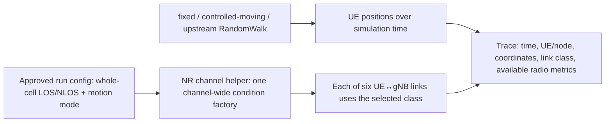

# RA-ENG-002 — Verified radio conditions and repeatable six-UE motion

**Status:** IN PROGRESS. **Date:** 2026-11-12. **GitHub:** [issue #15](https://github.com/kirolossedra/oran-publication/issues/15).

## Research objective and scope

Implement the researcher-selected **whole-cell forced LOS versus whole-cell forced NLOS** comparison with a repeatable six-UE mobility setup on the exact pinned ib-ORAN/ns-3/NR stack. Add bounded fixed and controlled-moving modes plus traces sufficient to verify node positions and actual link-condition classes. Keep the existing RandomWalk behavior available and clearly labeled. This is an engineering validation, not a loaded-traffic study, scheduler comparison, indoor-factory model, or P95/P99 experiment.

## Scientific motivation and hypotheses (human-owned)

The parent RA-GAP-001 is a provisional researcher-owned candidate. The recorded researcher decision selects cell-wide LOS/NLOS with mobility. No claim of a single-UE intervention, realistic factory obstruction, novelty, propagation-effect direction, or performance benefit is authorized here.

## Requirements and acceptance criteria

Follow issue #15: expose the selected channel condition at its approved whole-cell granularity; keep six UE identities; support fixed and controlled movement while preserving the upstream RandomWalk baseline; record time, node/UE identity, coordinates, condition and available radio metrics; verify paired positions and two-condition realization under the same seed; preserve an unchanged upstream smoke path; document tests, exact parameters, limitations and safe delivery. Stop if implementation would change condition scope or introduce unsupported geometry/model assumptions.

## Existing architecture and affected components

The pinned source uses `SetupNrChannelModel` in `contrib/iboran/model/iboran_ran_environment/iboran-nr-environment.cc` and `SetupFronthaulMobility` in `contrib/iboran/model/iboran_ran_environment/iboran-ran-common.cc`. The prior RA-ENG-001 audit reports the global helper semantics and six-link isolated probe; the selected path must remain whole-cell. This report was created before new source inspection or modifications.

This is a conceptual, source-informed view of intended controls and evidence, not a depiction of code already implemented. Link-specific obstruction is excluded from the selected scope.

## Implementation details and alternatives

Implement the smallest configuration path that preserves upstream default behavior when omitted and introduces explicit whole-cell LOS/NLOS plus motion modes. Use deterministic, explicit coordinates/traces for the fixed and controlled-moving validation modes. Keep physical building geometry, custom per-link condition models, channel updates, and research traffic out of scope. Existing RandomWalk remains separately selectable so its upstream behavior is reproducible.

## Architecture/algorithm/workflow diagrams

The conceptual Mermaid diagram above shows configuration-to-helper and position-to-trace paths. It must be corrected if pinned source inspection or implementation shows a different effective path.

## Changed files and reproducible patches

No issue-15 source/config changes have been made at report creation. Tracked implementation is expected to be limited to the ib-ORAN configuration and NR/mobility setup path, a reusable probe/trace tool, this report, `docs/methodology/g1-channel-mobility-validation.md`, canonical indexes, and audit. Simulator sources/builds and raw outputs remain ignored.

## Dependencies, versions, configuration, seeds, commands

Use `manifests/environment.json` exact source pins, the existing local C++ prefix, and the Python 3.12.3 venv with locked dependencies. Channel/mobility paired probes must fix an explicit seed/run and hold all non-condition parameters and initial positions constant. Exact mode names, coordinates, run IDs, and commands will be recorded after source inspection and implementation; no formal campaign parameters are selected here.

## Tests and verification evidence (logs/paths)

At opening, issue #14 records a successful isolated six-link forced-condition probe and two identical seed 1/run 1 mobility traces at 0, 60, and 130 s. Issue #15 still requires new probes exercising the implemented config path and verifying actual conditions and positions. Raw outputs will use a fresh unique ignored run directory; the upstream smoke will not be overwritten.

## Raw data and result references

No issue-15 run outputs exist at report creation. They will be indexed by run ID, source/config hash, effective mode, seed/run, and immutable log paths.

## Analysis, sample sizes, uncertainty, interpretation

This bounded engineering validation reports counts and trace consistency only; it does not estimate a treatment effect or population uncertainty. No sign or magnitude of propagation or latency changes is predicted.

## Limitations and unverified assumptions

- Whole-cell forced conditions do not isolate one challenged UE.
- Fixed and controlled-moving paths must be verified against the actual pinned APIs and scenario setup.
- A position trace alone does not prove propagation-model fidelity; the exact condition class and available radio metrics must be observed.
- No industrial indoor validity, loaded traffic, applied-grant intervention effect, packet-tail performance, or scientific novelty is claimed.

## Problems, failures, and resolutions

None at report creation. Record all source/build/probe failures and troubleshooting verbatim in the completed report and unique logs.

## Decisions and evidence

- **Recorded researcher decision:** use whole-cell LOS/NLOS comparisons with mobility; reference [RA-ENG-001](RA-ENG-001-feasibility.md) and [RA-PLAN-001 issue #23](https://github.com/kirolossedra/oran-publication/issues/23).
- **Researcher gate still in force:** do not replace the chosen cell-wide intervention with selective one-UE blockage or add a factory propagation model.

## Final deliverables

The completed report, reusable validation methodology, minimal patch/config, short paired condition/mobility traces, preserved smoke evidence, verification outputs, documentation audit, and verified commit/push SHA.

## Unresolved questions and next steps

1. Inspect exact pinned channel-helper and mobility code and update line references.
2. Implement only the selected whole-cell condition plus authorized motion controls.
3. Run deterministic fixed/moving and paired LOS/NLOS probes; verify all six links and matched positions.
4. Verify the upstream baseline smoke remains reproducible without changing its saved evidence.
5. Stop after this mission; RA-ENG-003 requires its own report and dependency review.

## Documentation completion checklist

- [x] Report shell created before new source/config inspection or edits
- [ ] Report and relevant docs updated with implementation and results
- [x] Conceptual diagram included and labeled
- [ ] Raw traces/config/commands preserved
- [ ] README, mission index and documentation audit updated
- [ ] Source pins, claims, paths, parameters, and reproduction commands checked
- [ ] Staged path, size, credential, source-tree and generated-artifact audit passed
- [ ] Commit pushed to existing `main`; remote SHA verified
