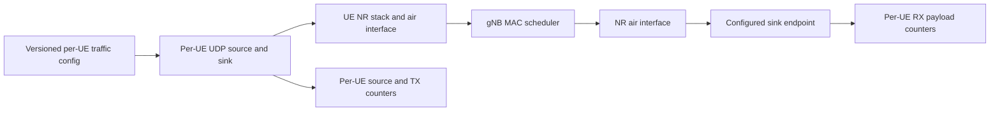

# Mission RA-ENG-003 — six-UE traffic and flow identity

**Status:** COMPLETE. **Date:** 2026-11-12. **Issue:** [#16 — RA-ENG-003](https://github.com/kirolossedra/oran-publication/issues/16).

## Research objective and scope

Implement and verify configurable, per-UE UDP traffic for one gNB and six UEs through the pinned ib-ORAN/NR stack. Preserve a designated latency-sensitive UE identity and independently configurable competing UEs. This mission is an engineering traffic-path check; it does not select a formal research workload or claim latency/performance outcomes.

## Scientific motivation and hypotheses (human-owned)

The research question and hypotheses remain human-owned. The mission supplies an explicit minimal traffic source/sink path so later engineering missions can validate packet identity, direction, and scheduler integration. Software-validation rates will be labeled as such and will not define the campaign protocol.

## Requirements and acceptance criteria

From issue #16: trace the actual application and flow path; establish per-UE identity across index, IP, RNTI, ports, FlowMonitor FlowId, and direction; add independently configurable UL/DL UDP sources and sinks with rate, packet size, start/stop, and sink drain interval; bypass CLIP/image/embedding work without breaking upstream smoke; count source/TX/RX events per UE; keep offered rate, transmitted bytes, and received payload bytes distinct; provide a pinned scenario config and replay patch; and verify target-only, one-competitor-only, all-six, UL-only, DL-only, and low-rate target-plus-competitors cases. The standard controller remains unchanged until RA-ENG-006 (#19).

Acceptance requires a real NR air-interface path with gNB scheduler participation, per-UE/direction controls that do not leak across UEs, explicit endpoint/flow mapping, retained run logs and raw outputs, a successful six-case bounded validation, reproducible commands, documentation/index/audit updates, and a staged-path/size/secret/source-tree audit.

## Existing architecture and affected components

The issue's Python filenames have moved in the pinned source. The actual configuration is parsed by `model/utils/config_store.py` and `model/iboran_ran_environment/iboran-ran-params.cc`; `SetupIbOranApplications` is in `model/iboran_ran_environment/iboran-ran-common.cc`. `model/iboran_campaign/iboran_orchestrator.py` prepares dataset KPI only when the legacy app-flow toggles are enabled, allowing `trafficMode: Udp` with both legacy toggles false to skip CLIP/image/embedding initialization. The existing topology assigns six UE IPs through the NR/EPC path and attaches each to one gNB before application install. The source-grounded map is [G1 flow mapping](../architecture/g1-flow-mapping.md).

## Implementation details and alternatives

Implemented minimal approach: typed per-UE YAML entries select UL/DL enablement, configured rate, packet size, start/stop, and sink drain stop. ns-3 `OnOffApplication` and `PacketSink` are installed on existing UE/remote-host nodes; distinct destination ports encode direction and UE index. Tx/Rx address traces count payload events. UDP mode returns before dataset file discovery and preserves the generated FlowMonitor XML for endpoint/FlowId joining. Default `Dataset` mode and the upstream application setup remain as before. Adapting image payloads or changing the scheduler/controller was rejected because it would mix inference overhead into the traffic path or change the control policy.

## Architecture/algorithm/workflow diagrams

This conceptual workflow is derived from issue #16 requirements. It does not assert that the path has been source-verified or implemented yet.

## Changed files and reproducible patches

Tracked deliverables: [replay patch](../../patches/RA-ENG-003-udp-traffic.patch), six scenario configs under `configs/scenarios/g1-traffic-*.yaml`, `scripts/map_g1_udp_flows.py`, this report, [source-grounded architecture map](../architecture/g1-flow-mapping.md), and canonical navigation/audit updates. The patch was generated as the incremental delta after RA-ENG-002 and applies cleanly after the RA-ENG-002 patch to a pristine checkout of the pinned ib-ORAN commit. Replay in order with `git apply --unidiff-zero patches/RA-ENG-002-radio-mobility.patch` then `git apply --unidiff-zero patches/RA-ENG-003-udp-traffic.patch` from the pinned ib-ORAN tree.

## Dependencies, versions, configuration, seeds, commands

Pins: ns-3.48, NR v5.1, ib-ORAN commit `3ea5046389f0eb993cdf01ef6d6d33017e6921bb`, Python 3.12 venv; exact manifest remains canonical. The six runs used `rngRun=1`, a 3.5 s horizon, 1.0–2.5 s sources, sink stop 3.0 s, fixed mobility, LOS, 128-byte payload, and 8 kbps per flow except the mixed-rate scenario (target UE 0: 4 kbps each direction; UEs 1–5: 16 kbps each direction). Rates are only software-check values. Build: `CCACHE_CONFIGPATH=/home/george/oran-publication/simulator/tooling/ccache.conf CCACHE_DIR=/home/george/oran-publication/simulator/tooling/ccache ./ns3 build ns3iboran_nr -j4`. Run from the pinned campaign directory with the venv Python and `iboran_run.py --scenario_config <absolute config path>`; copy FlowMonitor XML immediately after each run because each run replaces the shared XML.

## Tests and verification evidence (logs/paths)

The `ns3iboran_nr` build completed. All six cases completed and the mapper joined each configured endpoint to exactly one FlowMonitor UDP FlowId. Observed rows: target-only 2 flows; one competitor (UE index 1) only 2; all-six 12; UL-only 6 UL; DL-only 6 DL; target-plus-competitors 12. For all cases, FlowMonitor TX/RX packet counts equal the application source/sink event counts. All-six/mixed scenarios assigned the expected RNTIs 25, 26, 27, 31, 32, 33 to UE indices 0–5; each row retained UE IP, direction, port, FlowId and source/sink endpoints. Target-only and competitor-only confirmed the unconfigured UEs did not gain source/sink flows. Full stdout, XML, effective YAML, mapping CSVs, and SHA256 list are under ignored `simulator/logs/RA-ENG-003-20261112/`.

The upstream image/CLIP smoke regression attempt did not reach simulation: the configured CLIP model was neither locally cached nor reachable because Hugging Face DNS resolution failed. The full failure traceback is retained as `upstream-smoke-regression.log`; this does not demonstrate a regression in Dataset mode. A separate 3.5 s Dataset-mode/no-application-flow regression completed and confirmed the default Dataset branch, NR startup, scheduler/control traffic, and cleanup still run; its config/log are retained locally. The previously documented Mission 1 workload smoke remains the historical successful run. Synthetic UDP mode completed without loading CLIP, image data, or embedding models.

## Raw data and result references

No research outcome dataset was generated. Unique local outputs are ignored and named by case under `simulator/logs/RA-ENG-003-20261112/`; FlowMonitor XML was copied after each run before subsequent execution could replace it.

## Analysis, sample sizes, uncertainty, interpretation

No statistical analysis is planned for these short software checks. Report configured offered load, source TX bytes/packets, and sink RX payload bytes/packets separately. This mission cannot establish treatment effects or network performance.

## Limitations and unverified assumptions

- The upstream CLIP/image smoke could not be repeated because external model DNS resolution failed; the old successful Mission 1 smoke is not a regression test for this patch.
- FlowMonitor `rxBytes` includes network-layer headers while the event counters report UDP application payload bytes; those byte totals must not be compared as equal quantities.
- Bounded engineering rates and short horizons do not define a formal protocol.
- Received-packet latency distributions, censoring/loss treatment, and contention calibration belong to subsequent missions.
- No causal, scientific, standards-compliance, or real-world validity claim is in scope.

## Problems, failures, and resolutions

One upstream smoke attempt failed before simulation in `snapshot_download` with Hugging Face name-resolution failure (retained full log). No code workaround or model download was attempted. The bounded synthetic UDP cases ran successfully without that dependency.

## Decisions and evidence

- Issue #16 acceptance criteria define six configurable UEs and six bounded validation cases.
- The recorded researcher decision for whole-cell LOS/NLOS with mobility remains the scope selected in RA-ENG-002; this mission adds traffic without redesigning that scope.
- Research traffic rates, packet horizon, formal replication count, and scientific interpretation remain researcher-owned.

## Final deliverables

Replayable incremental source patch; six scenario configs; mapper; source-grounded flow diagram; built NR target; six validated traffic cases; preserved configs/logs/XML/mappings/checksums; updated navigation and audit. No latency or research performance conclusion is included.

## Unresolved questions and next steps

1. RA-ENG-004 (#17) can add packet-level delay and grant telemetry using these stable per-UE endpoint/FlowId mappings.
2. Re-run the upstream image smoke when the pinned CLIP model is available locally or model-host DNS works; keep it separate from UDP validation.

## Documentation completion checklist

- [x] Report and relevant docs updated
- [x] Conceptual workflow diagram included and labeled
- [x] Results/logs/config/patches preserved
- [x] README, mission index, and audit updated
- [x] Paths, claims, parameters, and reproduction commands checked
- [x] Staged file/size/secret/source-tree audit passed
- [x] Commit created and pushed to `main`; remote SHA verified

**Publication:** commit `9073f6dce5c19ea6b545b6468d902a653bedfd14` was pushed fast-forward to `main`; `git rev-parse HEAD` and `git ls-remote origin refs/heads/main` returned the same SHA. Worktree was clean after verification.
