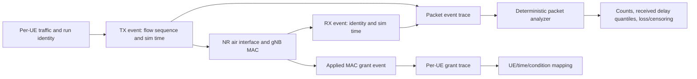

# Mission RA-ENG-004 — packet delay, loss, and per-UE grant telemetry

**Status:** IN PROGRESS. **Date:** 2026-11-12. **Issue:** [#17 — RA-ENG-004](https://github.com/kirolossedra/oran-publication/issues/17).

## Research objective and scope

Instrument the pinned six-UE NR scenario with unique packet TX/RX identity and applied gNB resource grant records, then provide a deterministic analyzer and bounded synthetic/live validation. Report per-received-packet latency quantiles with counts and loss/censoring alongside them. This is instrumentation engineering; it does not select a formal campaign or interpret research effects.

## Scientific motivation and hypotheses (human-owned)

Scientific question, hypotheses, contribution, and final interpretation remain researcher-owned. The engineering deliverable is trustworthy per-UE packet and scheduler evidence with explicit event clocks and resource semantics. Do not label application delay as pure radio delay or infer policy benefit.

## Requirements and acceptance criteria

From issue #17: inspect source-level packet trace hooks, FlowStatsAnalyzer, runner cleanup, and NR grant interface; add unique identity keyed by run/flow/UE/direction/sequence; record simulation-clock TX/RX timestamps, payload size and status; handle duplicates, reordered/unmatched RX, missing-at-stop and drained/late arrivals; compute per-UE/per-flow/per-direction counts, goodput, configured/generated rates, and empirical P50/P95/P99 with an explicit estimator; capture actual NR applied grants separately from dApp intent and xApp maximum RBG bound; map packet/UE to grant and radio condition traces; add deterministic synthetic gold tests and short one-UE/all-six/UL/DL/no-traffic/missing-packet validation; preserve raw run outputs and a documented machine-readable schema.

Completion requires exact event-clock/source mapping, quantiles on received packets with sample counts and adjacent loss/censoring counts, synthetic edge-case validation, live NR reconciliation against FlowMonitor, sound grant semantics or precise source blocker, complete reproduction docs/evidence/audit, and a remote-verified safe commit.

## Existing architecture and affected components

RA-ENG-003 provides per-UE UDP `OnOffApplication`/`PacketSink` sources and sinks, payload event counters, endpoint ports, and FlowMonitor FlowId mapping in the pinned NR/EPC/gNB path. Its actual Python config model is `model/utils/config_store.py`; the issue's `iboran_common_params.py` name does not exist in this pin. The exact NR grant extension points are `contrib/nr/model/nr-gnb-mac.{h,cc}` and `contrib/nr/model/nr-phy-mac-common.h`; the ib-ORAN dApp/xApp input path is `contrib/iboran/model/iboran_mac_scheduler/iboran-nr-mac-scheduler.cc`.

## Implementation details and alternatives

Source inspection confirmed these exact paths and findings:

- `OnOffApplication` offers `EnableSeqTsSizeHeader`, sets a per-source sequence and simulation-time header, and its `TxWithSeqTsSize` trace emits the application payload before UDP send. `PacketSink` offers the matching header option and `RxWithSeqTsSize` callback after reconstructing each complete packet. This supports a stable tuple+sequence identity and TX header timestamp without changing legacy image applications.
- The custom `IbOranTransmissionApplication`/`IbOranReceptionApplication` only expose cumulative byte/packet getters; no unique packet ID or per-packet time is retained there. FlowStatsAnalyzer consumes aggregate FlowMonitor delay sums and XML cleanup occurs after successful runs; neither is a source for per-packet tails.
- `NrGnbMac::DlScheduling`/`UlScheduling` traces are emitted from the gNB MAC after slot allocation is passed to PHY. `NrSchedulingCallbackInfo` carries RNTI, frame/subframe/slot, symbol range, MCS, TBS, BWP, NDI/RV/HARQ but omits the DCI's `m_rbgBitmask`. The actual DCI loop is the appropriate point to extend a grant event so it includes applied RBG bitmap and PRBs (bitmap count × `GetNumRbPerRbg`), including retransmissions. dApp intent and xApp max-RBG state are upstream scheduler inputs, not applied-grant evidence. Buffer/CQI values are not present in the gNB scheduling callback; mark them unavailable unless an independently source-grounded telemetry hook is added.
- RA-ENG-003 UDP mode can enable `SeqTsSizeHeader` conditionally; normal traffic runs will not get extra header bytes unless the instrumentation scenario asks for them.

Implementation will log packet events on the ns-3 simulation clock and retain unique TX/RX rows; the analyzer will use a documented nearest-rank empirical quantile over unique received identities. Keep packet identity and grant records separate and join on RNTI/direction/time where source supports it. No packet is assigned a fabricated delay when missing. The configured 10 ms point-to-point backhaul is included in app-to-app delay and will be labeled accordingly.

## Architecture/algorithm/workflow diagrams

This is a conceptual architecture diagram. The TX/RX and applied-grant source hooks were implemented at the issue-pinned source locations described above and exercised in the bounded runs below.

## Changed files and reproducible patches

Implementation is present in the pinned simulator worktree. [Cumulative ib-ORAN source patch](../../patches/RA-ENG-004-iboran-cumulative.patch) applies the complete RA-ENG-002/003/004 ib-ORAN delta to the pinned ib-ORAN commit; the separate [NR applied-grant patch](../../patches/RA-ENG-004-nr-applied-grants.patch) applies to the pinned NR subtree. The existing RA-ENG-002 and RA-ENG-003 incremental patches remain available for their documented sequential replay. The analyzer is [scripts/analyze_g1_packets.py](../../scripts/analyze_g1_packets.py), the strict/tolerant endpoint mapper is [scripts/map_g1_udp_flows.py](../../scripts/map_g1_udp_flows.py), and deterministic fixtures are [tests/test_analyze_g1_packets.py](../../tests/test_analyze_g1_packets.py). The event schema and source-to-output mapping are documented in [G1 packet and grant metrics](../methodology/g1-packet-grant-metrics.md).

## Dependencies, versions, configuration, seeds, commands

Pins: ns-3.48, NR v5.1 subtree, ib-ORAN commit `3ea5046389f0eb993cdf01ef6d6d33017e6921bb`, Python 3.12 project venv; the canonical manifest remains authoritative. Each traffic run used `rngRun=1`, LOS, fixed UE positions, six UE capacity, 3.5 s horizon, 1.0–2.5 s source interval, 3.0 s sink stop (except the explicit short-sink case), 128-byte application payload, and 8 kbps configured per flow. One-UE target-only enabled UE 0 UL/DL; all-six enabled 6×UL/DL; UL-only and DL-only enabled the respective direction for all six; short-sink enabled UE 0 UL/DL with sink stop at 1.15 s. Telemetry adds the serialized `SeqTsSizeHeader` to wire packet size while retaining configured payload size in counters. The no-traffic Dataset-mode run used a 3.5 s horizon, fixed positions, LOS, and all legacy application flows disabled. These are low-load engineering checks, not formal study settings.

Build after source changes: `CCACHE_CONFIGPATH=/home/george/oran-publication/simulator/tooling/ccache.conf CCACHE_DIR=/home/george/oran-publication/simulator/tooling/ccache ./ns3 build ns3iboran_nr -j4` from `simulator/ns-3.48`. The build completed; only the pre-existing signed-comparison warning in SetupNetAnim was reported. The scenario runner command is `simulator/ns-3.48/.venv/bin/python model/iboran_campaign/iboran_run.py --scenario_config <absolute scenario yaml>` from `simulator/ns-3.48/contrib/iboran/model/iboran_campaign`. Copy `.flowstats/iboran-flowstats.xml` to a unique raw-output filename immediately after each UDP run. Effective configs are in the run directory. Map/analyze with `python3 scripts/map_g1_udp_flows.py ...` and the venv Python for `scripts/analyze_g1_packets.py`; exact raw filenames and invocation are summarized below. Seed is fixed at 1. No formal campaigns or policy comparisons were run.

Reproduce each traffic scenario by substituting these files for `<absolute scenario yaml>`: `configs/scenarios/g1-instrumentation-target-only.yaml`, `g1-instrumentation-all-six.yaml`, `g1-instrumentation-ul-only.yaml`, `g1-instrumentation-dl-only.yaml`, or `g1-instrumentation-missing-packet.yaml`. Use the same `iboran_run.py` command above. For the normal scenarios run `python3 scripts/map_g1_udp_flows.py --stdout <case>.log --flowstats <case>-flowstats.xml --output <case>-map.csv`, then `simulator/ns-3.48/.venv/bin/python scripts/analyze_g1_packets.py --stdout <case>.log --mapping <case>-map.csv --config <case>-effective.yaml --output-dir <case>-analysis`. For the deliberately shortened sink only, pass `--allow-counter-differences` to the mapper. Run no-traffic with `configs/scenarios/g1-instrumentation-no-traffic.yaml`; it uses Dataset mode and emits no application FlowMonitor flows. `python3 scripts/prepare_g1_radio_mobility_run.py --scenario configs/scenarios/g1-instrumentation-no-traffic.yaml --output <case>-effective.yaml` materializes the validated effective YAML. Test command: `simulator/ns-3.48/.venv/bin/python -m unittest tests.test_analyze_g1_packets` from repository root.

## Tests and verification evidence (logs/paths)

`ns3iboran_nr` built successfully. `python -m unittest tests.test_analyze_g1_packets` from the project venv passed 3 tests covering nearest-rank/empty samples, missing packets, duplicate receive, reordered receive, unmatched receive, drain-after-source-stop, nonnegative matched delays, and endpoint mismatch rejection.

Observed live validation in `simulator/logs/RA-ENG-004-20261112/`: target-only corrected attempt 2 produced 2 flows, 20 TX and 20 RX events, 41 applied grants; all-six produced 12 flows, 120 TX and 120 RX, 221 grants; UL-only produced 6 flows, 60 TX and 60 RX, 157 grants; DL-only produced 6 flows, 60 TX and 60 RX, 71 grants. For all normal UDP scenarios the application event counts reconcile with FlowMonitor TX/RX counts. No-traffic produced 0 packet events, 0 DATA applied grants, and 43 radio/mobility trace lines. Short-sink produced 20 TX, 0 PacketSink RX, 20 missing-by-sink-stop IDs and 52 grants; FlowMonitor recorded 10 IP-layer TX/RX in each direction, consistent with packets reaching the IP stack after the application sink stopped. This is an intentional censoring demonstration, not evidence of radio packet loss.

Target-only attempt 1 is retained as a failed engineering attempt: telemetry header bytes reduced the application payload to 108 bytes and Tx trace source addresses were `0.0.0.0`. Fixes explicitly add serialized header bytes to OnOff PacketSize, strip the header when counting payload, and map wildcard TX trace endpoints by configured destination tuple. Attempt 2 is the corrected validation. The short-sink mapper intentionally ran with `--allow-counter-differences`; it preserves boolean match columns and observed counters instead of suppressing a layer/accounting difference. Complete stdout, XML, effective YAML, endpoint mappings, analyzer CSV/JSON outputs, and file hashes are preserved in the run directory.

## Raw data and result references

Immutable per-attempt files are under ignored `simulator/logs/RA-ENG-004-20261112/`. The failed target-only run is `target-only.log` plus `target-only-attempt-001-flowstats.xml`; the corrected run is `target-only-attempt-002.log`, its XML, and mapping/analysis outputs. Other cases have `<case>.log`, `<case>-effective.yaml`, `<case>-flowstats.xml` where emitted, `<case>-map.csv` and `<case>-analysis/{packets.csv,ue_packet_metrics.csv,ue_grants.csv,ue_radio.csv,summary.json}`. No-traffic has no application FlowMonitor rows; its header-only mapping file is included. The raw directory contains `SHA256SUMS` for integrity verification.

Verify all 55 preserved files from the repository root with `cd simulator/logs/RA-ENG-004-20261112 && sha256sum -c SHA256SUMS`.

## Analysis, sample sizes, uncertainty, interpretation

The analyzer uses nearest-rank empirical quantiles, rank `ceil(q*n)` (one-based), over unique successfully received packet identities with nonnegative app-to-app delay; each row includes `received_delay_n`. Missing-at-sink-stop IDs have no fabricated delay and are counted beside the quantiles. `drained_rx_packets` counts identities received after configured source stop; duplicate TX/RX, unmatched RX, reorder count, generated payload rate, configured/offered rate and delivered goodput are separate columns. The reported normal-case quantiles have n=10 per flow and are only wiring checks; no confidence intervals, causal claim, or treatment effect is planned. App-to-app delay includes the configured 10 ms point-to-point backhaul and is not pure radio delay.

## Limitations and unverified assumptions

- Packet events are traced at OnOff TX and PacketSink RX callbacks with ns-3 simulation timestamps and per-source SeqTsSizeHeader sequence. The TX callback header provides the TX timestamp; raw event rows also include callback event time. These hooks are source-verified and live-exercised for the UDP path; they do not instrument legacy dataset applications.
- FlowMonitor remains aggregate-only. Its IP-layer counts can differ from PacketSink application counters when the sink is stopped early, as intentionally observed here.
- AppliedGrant records are DATA DCI allocations after gNB MAC slot scheduling and before PHY var-TTI handling. They include RNTI, direction, frame/subframe/slot, symbols, BWP, RBG bitmap/count, derived PRB count, MCS, TBS, NDI/RV/HARQ. They indicate the grant passed from gNB MAC to PHY, not actual airtime, successful decoding, or packet-to-grant attribution. Packet-to-grant joining at packet level remains unimplemented; the output is separately keyed by RNTI/direction/simulation time.
- This validation uses one deterministic RNG run and very small n. No rate or policy comparison is supported.
- Backhaul includes a configured 10 ms one-way path component; measured app-to-app delay is not pure MAC scheduling delay.
- No formal load/policy comparison, novelty claim, or real-world validity claim is in scope.

## Problems, failures, and resolutions

Attempt 1 payload and wildcard-address defects are described above and retained. The first short-sink mapping attempt failed its strict FlowMonitor/app RX equality check; inspection showed FlowMonitor 10/10 at IP layer while the deliberately stopped PacketSink recorded 0/0. The mapper gained explicit opt-in tolerance and match columns; the normal cases remain strict and reconcile. The no-traffic configuration ran in Dataset mode to avoid empty-traffic KPI setup; observed no packet events and no DATA grants while radio trace remained active.

## Decisions and evidence

- RA-ENG-003 is published and issue #16 closed; its bounded UDP traffic path is the input interface.
- Issue #17 explicitly assigns packet-tail telemetry here and forbids conflating dApp intent, xApp max-bound, applied grant, and PHY airtime.
- The researcher retains control of formal traffic protocol, hypotheses, scientific interpretation, and campaign authorization.

## Final deliverables

Implemented packet telemetry, applied-grant event, analyzer, fixtures, six scenario configs, source replay patches, raw run evidence, and methodology documentation. Local commit `9b2582f` is a safe descendant of researcher commit `9a8697c`; push verification and issue closure remain.

## Unresolved questions and next steps

1. Push the safe fast-forward to `main` and verify the remote SHA.
2. Post issue #17 evidence and close it only after confirming publication.
3. Proceed to RA-ENG-005 (#18) only within its issue scope; preserve researcher-controlled protocol and interpretation gates.

## Documentation completion checklist

- [x] Report and relevant docs updated
- [x] Conceptual workflow diagram included and labeled
- [x] Results/logs/config/patches preserved
- [x] README, mission index, and audit updated
- [x] Paths, claims, parameters, and reproduction commands checked
- [x] Staged file/size/secret/source-tree audit passed
- [ ] Commit created and pushed to `main`; remote SHA verified
