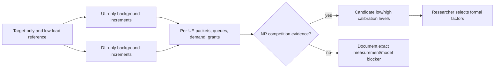

# Mission RA-ENG-005 — six-UE load calibration

**Status:** IN PROGRESS (pre-implementation gate). **Date:** 2026-11-12. **Issue:** [#18 — RA-ENG-005](https://github.com/kirolossedra/oran-publication/issues/18).

## Research objective and scope

Determine whether bounded low/high offered-load probes create measurable NR scheduling competition in the six-UE G1 topology, and record candidate calibration evidence for later researcher decisions. Do not select final formal factors, call a run saturated without radio-side evidence, or merge calibration outcomes into the integrated v2 campaign.

## Scientific motivation and hypotheses (human-owned)

The parent candidate and scientific interpretation remain researcher-owned. This mission tests the engineering proposition that increasing background traffic can produce source-observable queueing or NR grant competition under the pinned simulator. No causal or publication claim is in scope.

## Requirements and acceptance criteria

Issue #18 requires: source-grounded pilot rates; target-only and low-load reference; separate UL and DL increments before optional bidirectional load; per-UE configured offer, generated TX, delivered goodput, packet loss/censoring and received-packet tails; actual scheduler grants, demand/backlog and radio quality where observable; bottleneck separation across application, backhaul, queue and NR allocation; adequate warm-up/measurement/drain accounting; immutable run records; reproducible configs/summary; and a candidate final matrix returned for researcher approval.

Completion requires all six UEs' offered/generated/delivered measures to reconcile, at least one source-evidenced contending NR probe or a precise blocker, separate UL/DL interpretation, explicit observation-window and tail-sample limitations, no unsupported saturation statement, and complete documentation/audit/publication. Final formal rates and thresholds remain human decisions.

## Existing architecture and affected components

The repository contains a pinned ns-3/NR/ib-ORAN environment under ignored `simulator/`, RA-ENG-004 packet and applied-grant telemetry, and the researcher-authored resumable campaign at `campaigns/20261111-g1-integrated-v2/`. Campaign v2 records a 160-cell matrix with light, combined-contending, DL-contending and UL-contending arms. Source-level queue, grant, MAC demand, and rate-generator availability for calibration has not yet been inspected in this mission.

## Implementation details and alternatives

The source audit and quantitative inspection begin after this report shell. Planned bounded arms are target-only reference, six-UE low-load control, one-direction DL increment, one-direction UL increment, and separately labeled combined-load diagnostic if needed. Reuse existing v2 run artifacts only after auditing configuration identity and whether queue/grant snapshots answer #18's contention criterion. Otherwise use new unique run IDs; never overwrite campaign data. Candidate rates can be recommended as calibration evidence but not adopted as final scientific factors without the researcher.

## Architecture/algorithm/workflow diagrams

Conceptual calibration workflow transcribed from issue #18. It separates the evidence-based engineering recommendation from the researcher's final choice.

## Changed files and reproducible patches

Only this template-based report shell exists for RA-ENG-005 at mission start. No source or scenario change has been made for #18 yet.

## Dependencies, versions, configuration, seeds, commands

Retain the current pinned simulator and the RA-ENG-004 packet/grant trace schema. Record exact commits and Python/C++ environment from the current campaign package before implementation. Candidate probe configuration must state topology, six UE identities, channel/mobility, TDD, bandwidth, numerology, scheduler, seed, packet payload, source start/stop, sink drain, and UL/DL rates. Do not infer final rates from the campaign matrix without recording this as an existing researcher-authored choice.

## Tests and verification evidence (logs/paths)

No RA-ENG-005 tests or calibration runs have been inspected or executed yet. Planned evidence includes parsing pre-existing campaign outputs where compatible, controlled low-rate versus incremented-load probes, and checks for source/TX/RX/grant/queue reconciliation. New raw evidence will use `simulator/logs/RA-ENG-005-<unique-run-id>/` and include per-attempt stdout, effective config and analysis outputs.

## Raw data and result references

No RA-ENG-005 result set exists at report creation. The campaign v2 package points to local run artifacts separately; those must remain immutable and distinct from new calibration runs.

## Analysis, sample sizes, uncertainty, interpretation

Report configured offer, actual generated payload rate, delivered goodput, missing/censored counts, received-delay `n` and quantiles, grants by UE/direction/slot, queue/demand observations, and measurement window. A run/seed is the replication unit for later uncertainty; packets are not independent replications. P99 from short pilot samples is diagnostic only. State separately whether evidence indicates app generation, backhaul, queueing or NR allocation limits. No saturation or causal effect is assumed.

## Limitations and unverified assumptions

- Source visibility and logging for MAC queue demand/buffer occupancy, applied grants and radio quality must be audited before choosing probe metrics.
- Campaign v2's 6 Mbps arms are candidate levels recorded by the researcher; this report does not yet verify them as contending in the local raw outputs.
- Small engineering pilots may not support stable P99 tails or formal factor selection.
- Backhaul includes a configured 10 ms path component and must remain separate from radio delay claims.

## Problems, failures, and resolutions

None at report creation. Preserve every diagnostic failure and explain whether it is environmental, configuration, or simulator behavior.

## Decisions and evidence

- Issue #18 permits source-grounded calibration candidates but reserves final factors and thresholds for researcher approval.
- Issue #24 authorizes continuation across the mission chain; this does not transfer scientific interpretation or formal-protocol authority.
- RA-ENG-004 (#17) is closed and its telemetry is available for calibration.
- The integrated v2 campaign remains active and its 92/160 package status is not a completed campaign result.

## Final deliverables

Pending source audit, existing-artifact review, separate bounded load probes or a precise blocker, and candidate calibration recommendation.

## Unresolved questions and next steps

1. Inspect the local campaign run manifest and the exact traffic/grant/queue data available for completed cells.
2. Inspect pinned source hooks to establish whether queue/backlog and demand evidence distinguish NR competition from source/backhaul limitation.
3. Run only the minimal bounded calibrations needed to answer issue #18 and preserve outputs immutably.
4. Document candidate factor recommendation for researcher review; do not launch a formal campaign under this mission.

## Documentation completion checklist

- [x] Report shell created before #18 source inspection
- [x] Conceptual workflow diagram included and labeled
- [ ] Results/config/analysis preserved or blocker documented
- [ ] README, mission index, and audit updated
- [ ] Paths, claims, parameters, and reproduction commands checked
- [ ] Staged-path, size, credential, and generated-artifact audit passed
- [ ] Commit pushed safely to `main`; remote SHA verified
