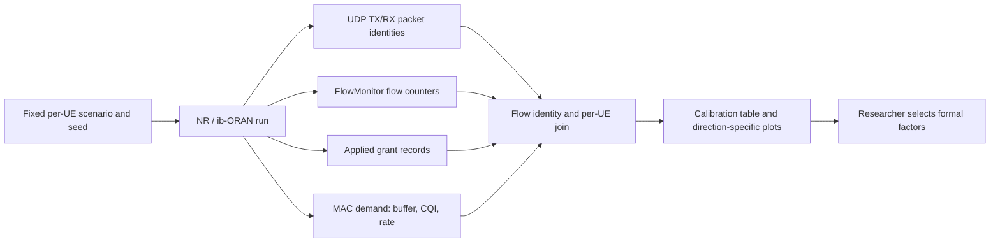

# Mission RA-ENG-005 — six-UE load calibration

**Status:** Completed as an engineering calibration; final load-factor approval remains with the researcher. **Date:** 2026-11-12. **Issue:** [#18 — RA-ENG-005](https://github.com/kirolossedra/oran-publication/issues/18).

## Objective, scope, and rationale

Check whether the candidate low and high offered loads create observable NR resource competition in the pinned one-gNB, six-UE G1 topology. This mission calibrates candidate rates; it does not choose the formal research factors or claim saturation, causal effects, novelty, or a validated factory channel model. The integrated v2 campaign's 92/160 packaging count is not used as a calibration result because its local raw run tree is absent.

The research question, hypotheses, and scientific interpretation remain human-owned. Recorded issue #18 specifies source-grounded low/high probes, per-UE traffic accounting, actual grant and queue evidence, separate UL/DL treatment, and return of a candidate matrix for researcher review.

## Requirements and acceptance

- One target-only reference, one six-UE low-load control, and separate UL and DL high-load increments with paired topology, channel, timing, scheduler, packet size and seed.
- Reconcile per-UE configured offer, unique generated and received packets, goodput, missing-by-sink-stop/censoring, and received-packet P95/P99 with sample counts.
- Inspect applied grants, MAC demand/buffer, CQI and achievable/actual throughput; do not infer radio competition from delay alone.
- Preserve failed attempts, immutable raw evidence, configs, source hashes, reproducible commands, concise results, figures, limitations, documentation audit, and remote verification.
- Return candidate rates for researcher approval. No policy tuning or final protocol was performed.

## Architecture, source, and measurement path

The run uses the isolated pinned `simulator/ns-3.48/` tree. The modified ib-ORAN source hash manifest is in each raw run manifest; ns-3.48 and NR v5.1 pins are listed in `campaigns/20261111-g1-integrated-v2/UPSTREAM-SOURCES.md`. `manifests/environment.json`, named by issue #18, is absent in this repository snapshot; exact pins and the runtime versions below were read from the source map and active virtual environment instead.

Source inspection located the applied-grant CSV writer in `contrib/iboran/model/iboran_ran_environment/iboran-nr-environment.cc:40-57`, called from NR scheduling setup. It records simulation time, direction, RNTI, slot, RBG/PRB allocation, MCS, transport-block size, HARQ fields, and bitmap. The NR scheduler fills E3 demand with RNTI, CQI, buffer bytes, achievable rate and actual throughput in `contrib/iboran/model/iboran_mac_scheduler/iboran-nr-mac-scheduler.cc:245-280`. The dApp trace writer in `contrib/iboran/model/iboran_controller/iboran_dapp_mac_scheduler.py:50-68` records those demand samples to `IBORAN_RUN_DIR/logs/mac-demand.csv`.

The campaign package's traffic configuration/result rows and UDP packet identity traces are joined to FlowMonitor by `scripts/map_g1_udp_flows.py`; packet-level delay and grant tables come from `scripts/analyze_g1_packets.py`. `scripts/analyze_g1_load_calibration.py` joins those outputs with MAC demand and per-UE grants. It leaves grant RNTIs unmatched when they do not agree with the run-end UE/RNTI map; it does not guess a UE identity.



Conceptual workflow, not a timing diagram. It shows the evidence sources and the boundary between engineering recommendation and human research decision.

## Scenario design and parameters

Four configs are committed under `configs/scenarios/` and checked by `scripts/run_g1_load_calibration.py` for six-UE identity, fixed seed, direction, rate, and source/drain windows. Runner refuses an existing output root. Three scenarios were run together in `calibration-run-003`; target-only was run separately in `calibration-run-002` after a runner-path correction.

| Case | UE 0 | UEs 1–5 | Purpose |
|---|---|---|---|
| target-only | 20 kbps UL + DL | no generated traffic | Target reference |
| low-six | 20 kbps UL + DL | 20 kbps UL + DL | Six-UE low-load control |
| DL-contending | 20 kbps UL + DL | 20 kbps UL; 6 Mbps DL | DL increment only |
| UL-contending | 20 kbps UL + DL | 6 Mbps UL; 20 kbps DL | UL increment only |

All: 10 s simulation, six UEs/one gNB, fixed positions, LOS, 3.5 GHz, 10 MHz, one CC/BWP, numerology 1, configured TDD pattern `DL|DL|DL|DL|F|UL|UL|UL|UL|F|`, `k=1`, dApp RoundRobin, xApp Bypass, UDP payload 512 bytes, RNG run 11, source 1–8 s and sink through 9 s. Candidate 20 kbps/6 Mbps levels originated in researcher-authored integrated campaign v2; this pilot checks them as calibration candidates only. No combined high UL+DL arm was run, avoiding an additional TDD-direction confound.

## Software, commands, and run identity

Runtime observed: Python 3.12.3, PyTorch `2.9.1+cpu` (CUDA unavailable), NumPy 2.5.4, PyYAML 6.0.3, Matplotlib 3.11.2. Pins: ns-3.48 `d2add90b452d600cfb4859baed8e9ea633519447`; 5G-LENA NR v5.1 `cedceadda17392c90587fb9400eb9b1f8c236713`; ns3-ai `b8c9858294b1d6a7f122b5154a3ce25057a54740`; Orange ib-ORAN `3ea5046389f0eb993cdf01ef6d6d33017e6921bb`.

Successful run commands, from repository root:

```sh
simulator/ns-3.48/.venv/bin/python scripts/run_g1_load_calibration.py \
  --output-root simulator/logs/RA-ENG-005-20261112/calibration-run-002 \
  --case target-only
simulator/ns-3.48/.venv/bin/python scripts/run_g1_load_calibration.py \
  --output-root simulator/logs/RA-ENG-005-20261112/calibration-run-003 \
  --case low-six --case dl-contending --case ul-contending
```

The original failed target-only attempt is preserved at `simulator/logs/RA-ENG-005-20261112/calibration-run-001/target-only/`. The venv executable is intentionally passed without resolving its symlink so that Python retains the venv context. To reproduce derived outputs for new runs, run the mapper and packet analyzer for each case, then run:

```sh
simulator/ns-3.48/.venv/bin/python scripts/analyze_g1_load_calibration.py \
  --case target-only=simulator/logs/RA-ENG-005-20261112/calibration-run-002/target-only \
  --case low-six=simulator/logs/RA-ENG-005-20261112/calibration-run-003/low-six \
  --case dl-contending=simulator/logs/RA-ENG-005-20261112/calibration-run-003/dl-contending \
  --case ul-contending=simulator/logs/RA-ENG-005-20261112/calibration-run-003/ul-contending \
  --output-dir simulator/logs/RA-ENG-005-20261112/aggregate-analysis
MPLCONFIGDIR=/tmp/ra-eng-005-mpl-cache simulator/ns-3.48/.venv/bin/python \
  scripts/plot_g1_load_calibration.py \
  --summary simulator/logs/RA-ENG-005-20261112/aggregate-analysis/per-ue-load-calibration.csv \
  --output-dir simulator/logs/RA-ENG-005-20261112/figures
```

Each successful attempt used seed 11. This is one seed per case, an engineering pilot, not a replicated experiment. The runner wrote per-case command, timestamps, exit status, scenario SHA256, effective config, KPI/FlowMonitor data and MAC demand. Complete raw logs and checksums are under `simulator/logs/RA-ENG-005-20261112/` (ignored by Git).

The committed [calibration environment record](../../results/RA-ENG-005/calibration-environment.json) captures OS/architecture, CPU/RAM, available storage, Python/scientific-package versions and exact simulator pins. The repository's referenced `manifests/environment.json` was not present, so its pin values were taken from the campaign upstream source map.

## Results and evidence classification

Source-verified: the application event and FlowMonitor packet counts were joined by five-tuple and checked by `map_g1_udp_flows.py`; all six configured flows in each six-UE case have matching generated/delivered event counters in their respective mapping files. The analyzer produced 38 flow rows: 2 target-only, 12 low-six, and 12 each for DL- and UL-contending. It recorded unique TX/RX, missing-by-sink-stop, generated payload rate, delivered goodput, received delay sample count/P95/P99, applied grants, and matched MAC demand samples.

Observed in this seed: all 12 low-six flows delivered 32/32 packets at about 18.7 kbps. In DL-contending, UE 1–3 each generated 9,868 packets but only 18 arrived by sink stop; their observed received-P95 values are about 7.02 s from 18 packets each. UE4/UE5 delivered 9,860/9,868 packets at about 5.77 Mbps, with 3,923/3,788 mapped DL grants and up to 10,157 bytes in sampled MAC buffers. UE0 DL delivered 2/32 packets. In UL-contending, UE1/UE2 generated 9,868 packets each and recorded 0 received by sink stop; UE3–5 received 9,340/9,507/9,561 packets (about 5.47/5.56/5.59 Mbps). The target UE0 UL flow delivered 18/32 with a received P95 around 6.82 s. These values are individual pilot observations, not estimates of population performance.

Interpretation, limited to the instrumented model: the DL arm is source-evidenced contention. Its configured and generated offers are much larger than delivered goodput for UEs1–3, with substantial MAC buffers, delayed received packets, and a highly uneven applied-grant distribution. The UL arm shows achieved-versus-generated divergence and high queue samples for UEs3–5, but grant-to-UE attribution is incomplete (see limitations). This does not establish physical saturation or a causal scheduler effect.

The `missing_by_sink_stop_packets` metric means generated unique packets without a matched sink RX by sink stop; it is not classified as physical-layer loss. Received-packet quantiles exclude missing packets; DL P95/P99 for 18-reception UEs and all P99 values from this single short seed are diagnostic only. Application delay includes modeled backhaul and is not a pure NR-air-interface delay. A 7 s source window, 1 s drain and 1 s initial interval do not establish a stable long-term regime.

No candidate rate was rejected by a rate sweep; this bounded pilot tested only the researcher-authored 20 kbps and 6 Mbps levels. The low arm generated roughly its configured 18.7 kbps and all packets arrived, while the high arm generated roughly 5.77 Mbps and produced substantial queue/achieved-rate divergence. Their engineering meaning is empirical within this simulator configuration, not an asserted real-network traffic model. Combined high UL+DL was not run to avoid adding a TDD-direction confound.

The small [per-UE result CSV](../../results/RA-ENG-005/per-ue-load-calibration.csv), [DL figure](../../results/RA-ENG-005/g1-load-calibration-dl.png), [UL figure](../../results/RA-ENG-005/g1-load-calibration-ul.png), and [summary metadata](../../results/RA-ENG-005/summary.json) are committed. The full source logs, packet rows, demand samples, grant records, cleaned analysis input record, raw XML, failed attempt, and SHA256SUMS are local under the ignored run root.

## Bottleneck separation, failures, and limits

- The source rates generated expected large packet counts in high arms (9,868/UE); therefore the poor delivered rates in the DL/UL-contending cases are not explained solely by a low application generator rate. This is source/application-to-receiver evidence, not proof of a specific physical cause.
- The DL dApp buffer samples reach 10,157 bytes for heavily offered UEs and applied grants differ strongly by UE. That is evidence of pending radio-side demand and resource competition in this configuration. The applied-grant callback means applied to the PHY, not air-time or unique bandwidth.
- In UL-contending, 448 applied-grant rows use RNTIs 26/27 where the end-of-run flow map has RNTIs 76/78 for two UEs. These rows are retained in `aggregate-analysis/unmatched-grants.csv`, and not assigned by assumption. Demand has few or no samples for those mapped UEs. Do not use those rows as a per-UE grant distribution until RNTI lifecycle mapping is improved.
- The DL log has one truncated applied-grant record where `APPLIED_GRANT,...,0` is joined to `Max Packets per trace file exceeded`. The raw stdout is unchanged. The derived analyzer input removes only that one schema-invalid row and records its line number/text in `input-cleanup.json`; 8,121 valid DL grant rows remain. No row was removed from the UL log; its 7,144 parsed grant rows remain.
- `calibration-run-001` failed before simulation because resolving the venv Python symlink lost its venv context and `torch` import failed. Runner now preserves the symlink path. The failed attempt is kept. A stale copied KPI file from that failed attempt was removed as an erroneous generated copy; the corrected runner copies run artifacts only after exit 0 and freshness checks.
- Exactly one seed/case was executed. No independent-run uncertainty, stable tail estimate, generalized user fairness, or formal rate threshold can be claimed. Radio quality is limited to the logged CQI/achievable-rate snapshots; fixed LOS mobility traces are not a per-UE channel-validation study.

## Candidate calibration matrix and researcher decision

Observed evidence supports carrying **20 kbps per UE/direction as the low-load candidate** and **6 Mbps on UEs1–5 in one direction at a time as the high-load candidate** into a multi-seed confirmation pilot. Keep UE0 at 20 kbps both directions. Retain separate DL and UL cells; do not combine high UL and DL based on these results. These are candidates because they visibly separate low delivery from contention in this one seed, not final formal factors. Researcher approval is needed before freezing rates, thresholds, sample counts, or formal protocol.

## Changed files and dependencies

- Four `configs/scenarios/g1-loadcal-*.yaml` configs provide fixed per-UE traffic arms.
- `scripts/run_g1_load_calibration.py` validates case/seed/rates/windows, rejects existing output roots, and records fresh successful artifacts.
- `scripts/analyze_g1_load_calibration.py` creates per-flow joining and unmatched-grant table.
- `scripts/plot_g1_load_calibration.py` creates direction-separated offer/goodput plots and rejects a nonempty output directory.
- `patches/RA-ENG-005-mac-demand-observation.patch` captures the MAC buffer/CQI/rate snapshots in the local pinned ib-ORAN tree. It applies cleanly to the packaged campaign source snapshot with `git apply --check --unidiff-zero --whitespace=error`.
- `results/RA-ENG-005/` contains only the concise 38-row table, summary metadata and two plots; the detailed logs/raw outputs remain ignored locally.

Dependencies observed: ns-3.48/NR v5.1, ns3-ai, Orange ib-ORAN pins above; Python 3.12.3; PyTorch CPU 2.9.1; NumPy 2.5.4; PyYAML 6.0.3; Matplotlib 3.11.2. No GPU was used or required.

## Documentation audit, publication, and checklist

The template report shell preceded RA-ENG-005 source inspection and runs. Root README, `docs/README.md`, `docs/MISSIONS.md`, methodology, and `docs/DOCUMENTATION-AUDIT.md` are updated. Raw evidence is checksum-verified. Before publication, audit staged paths, sizes, credentials, generated artifacts, source trees and virtual environments; verify Markdown links/whitespace; check `main` remote is a safe fast-forward; push and verify the resulting remote SHA. Commit and remote SHA will be recorded here after delivery.

- [x] Mission report created before source inspection
- [x] Existing architecture/source hooks and risks documented
- [x] Fixed target-only, low-six, DL-only and UL-only pilot configs and run manifest
- [x] All six-UE per-flow traffic counters reconciled for each six-UE run
- [x] Source-evidenced DL radio contention with buffers and applied grants
- [x] UL/DL results separately labeled; RNTI mapping limitation retained
- [x] Window, received-packet tail sample counts, single-seed limitation, and no-saturation boundary reported
- [x] Candidate matrix returned for researcher decision; no formal factors selected
- [x] Concise CSV and direction-specific diagnostic figures generated
- [x] Reproduction commands, failure history, source/config hashes and raw evidence documented
- [ ] Staged-path/security/size audit and safe push completed
- [ ] Remote SHA recorded and issue #18 updated

## Unresolved questions and next steps

1. Researcher selects or revises candidate rates and specifies the desired multi-seed confirmation count.
2. Improve UL grant RNTI lifecycle mapping before interpreting all six per-UE UL grant shares.
3. Preserve candidate cells separately from the integrated v2 campaign; do not retrofit these one-seed observations into its results.
4. Proceed to stock policy verification only under the overall KIRO execution scope; final formal study issue #20 remains gated on researcher protocol approval.
