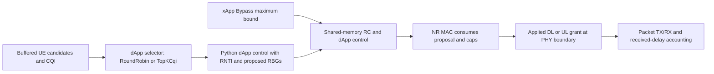

# Mission RA-ENG-006 — stock scheduler controls

**Status:** COMPLETE as an engineering control probe; final research-policy selection remains with the researcher. **Date:** 2026-11-12. **Issue:** [#19 — RA-ENG-006](https://github.com/kirolossedra/oran-publication/issues/19).

## Objective, scope, and acceptance

Verify executable stock ib-ORAN dApp/xApp choices, trace an action through shared memory into the NR MAC grant, and compare a single dApp intervention while holding the xApp and calibrated six-UE scenario fixed. This mission does not choose the publication hypothesis, policy, or interpretation. Acceptance was met by a source-verified pair, same-seed effective configs equal except for the dApp selector, event-counter reconciliation for all 12 UE/direction flows, and observed changes in actual applied grants. This is one engineering probe, not a formal experiment.

## Prior decisions and dependencies

- **Source-verified historical decision:** RA-ENG-002 authorized a whole-cell LOS versus whole-cell NLOS condition, with mobility controls. This probe uses the approved whole-cell LOS baseline; it does not claim per-UE channel selection.
- RA-ENG-005 calibration (#18) supplied the one-gNB/six-UE contention config and the seed-11 RoundRobin baseline. Its load points were candidates, not researcher-frozen formal factors.
- **Researcher-owned:** approve the policy pair and formal protocol before RA-ENG-007. No such approval was present in the connected issue record on 2026-11-12.

## Existing architecture and source map

Source and executable findings below refer to the exact local installed source, not README aliases. The runner recorded SHA-256 for the Python control classes, C++ MAC scheduler, shared-memory structures, and environment bridge in each run metadata file.

| Path and source location | Verified behavior |
|---|---|
| `simulator/ns-3.48/contrib/iboran/model/iboran_controller/iboran_dapp_algos/dapp_algos_factory.py:31-47,52-70` | Executable standalone names are `Random` and `RoundRobin`; family names combine `TopK`, `Greedy`, or `Dp` with `Cqi`, `BufferLevel`, `PropFairness`, `Criticality`, or `MultiCriteria`. The probe uses exact selectors `RoundRobin` and `TopKCqi`; `resolve_ib_algo.py:14-19` also resolves the `ib` alias. |
| `simulator/ns-3.48/contrib/iboran/model/iboran_controller/iboran_dapp_algos/dapp_algo_ue_selection.py:55-101`; `simulator/ns-3.48/contrib/iboran/model/iboran_controller/iboran_dapp_algos/dapp_algo_ue_selection_round_robin.py:14-40`; `simulator/ns-3.48/contrib/iboran/model/iboran_controller/iboran_dapp_algos/dapp_algo_ue_selection_top_k.py:14-32` | Selection is from buffered candidate UEs, `k` is limited by candidate count, and intents can prefilter. RoundRobin prioritizes the UE with the oldest scheduling subframe; TopKCqi sorts by descending current CQI. Neither definition promises a minimum allocation. |
| `simulator/ns-3.48/contrib/iboran/model/iboran_controller/iboran_xapp_algos/xapp_algos_factory.py:21-35`; `simulator/ns-3.48/contrib/iboran/model/iboran_controller/iboran_xapp_algos/xapp_algo_rbg_bounding_bypass.py:14-31`; `simulator/ns-3.48/contrib/iboran/model/iboran_controller/iboran_xapp_algos/xapp_algo_rbg_bounding_clamp.py:14-31` | Stock xApp names are `Bypass` and `Clamp`. Bypass assigns each candidate a maximum equal to total RBG count; Clamp derives a per-candidate demand cap. Both are maximum bounds, not guaranteed shares. Clamp was source-verified but not separately run. |
| `simulator/ns-3.48/contrib/iboran/model/iboran_controller/iboran_xapp_mac_scheduler.py:41-89,91-116`; `simulator/ns-3.48/contrib/iboran/model/iboran_controller/iboran_dapp_mac_scheduler.py:70-103,128-174,219-251` | xApp bounds and selected candidate RNTIs are placed into control structures. Backlogged users omitted from the xApp candidates receive a zero bound for that decision. dApp selection, MCS/RBG computation, and bound/total-resource trimming determine proposed allocations. |
| `simulator/ns-3.48/contrib/iboran/model/iboran_interfaces/iboran-shm-structure.h:72-87`; `simulator/ns-3.48/contrib/iboran/model/iboran_interfaces/iboran_e2sm_dapp_structure.py:18-52` | Shared-memory RC carries per-UE RNTI and `maxRbgAllocation`; dApp reports/controls carry per-UE RNTI, current and accumulated RBG allocation, scheduled TTIs, and available RBG state. |
| `simulator/ns-3.48/contrib/iboran/model/iboran_mac_scheduler/iboran-nr-mac-scheduler.cc:465-501,739-774` | DL and UL consume the dApp proposal and xApp maximum and bound the proposed allocation using `min(proposed RBG, maxRbg)`. A configured cap is not an allocation grant. |
| `simulator/ns-3.48/contrib/iboran/model/iboran_ran_environment/iboran-nr-environment.cc:40-57,276` | The applied-grant trace is emitted from the MAC-to-PHY grant path. It records applied resource allocation, not end-to-end airtime or throughput. |
| `simulator/ns-3.48/src/netanim/model/animation-interface.cc:2080` | The trace warning `Max Packets per trace file exceeded` can be interleaved into stdout CSV records; its exact notice was removed losslessly in reanalysis. |

## Source-to-grant path



Conceptual source path; no timing scale is implied. The grant and packet outcome are distinct measurements.

## Implementation and reproducibility

Curated changes for this mission: `configs/scenarios/g1-stockpolicy-topkcqi.yaml`, `scripts/run_g1_stock_policy_probe.py`, `scripts/reprocess_g1_stock_policy_probe.py`, `scripts/compare_g1_stock_policy_probe.py`, this report, and `docs/research/g1-stock-policy-controls.md`. No simulator upstream source was changed.

The paired scenario is the RA-ENG-005 `g1-loadcal-dl-contending.yaml` setup with only `orchestrator.dapp_algo_ue_selection` changed from `RoundRobin` to `TopKCqi`. Both effective configurations use seed 11, one gNB, six UEs, whole-cell LOS, identical positions, 10 MHz, 3.5 GHz, numerology 1, fixed TDD pattern, identical 20 kbps UL for each UE, 20 kbps DL for UE 0, 6 Mbps DL for UEs 1–5, the same 1–8 s source and 9 s sink window, `k=1`, and xApp Bypass. Exact effective configs, scenario YAML, commands, source hashes and raw stdout reside under the ignored run-specific evidence tree.

Original run command shape (one command per arm; exact absolute paths recorded in `run-metadata.json`):

```sh
simulator/ns-3.48/.venv/bin/python iboran_run.py --rat_type=NR --scenario_config <arm>/scenario.yaml
```

The preserved valid pair is `simulator/logs/RA-ENG-006-20261112/policy-probe-001/{roundrobin,topkcqi}`. Reanalysis from the raw traces was run with:

```sh
simulator/ns-3.48/.venv/bin/python scripts/reprocess_g1_stock_policy_probe.py \
  --roundrobin simulator/logs/RA-ENG-006-20261112/policy-probe-001/roundrobin \
  --topkcqi simulator/logs/RA-ENG-006-20261112/policy-probe-001/topkcqi \
  --output-root simulator/logs/RA-ENG-006-20261112/policy-probe-reanalysis-001

simulator/ns-3.48/.venv/bin/python scripts/compare_g1_stock_policy_probe.py \
  --baseline simulator/logs/RA-ENG-006-20261112/policy-probe-reanalysis-001/roundrobin \
  --candidate simulator/logs/RA-ENG-006-20261112/policy-probe-reanalysis-001/topkcqi \
  --output-dir simulator/logs/RA-ENG-006-20261112/policy-probe-reanalysis-001/comparison
```

## Results and evidence classification

**Observed:** both runs exited successfully; effective configs matched outside the dApp selector. Packet TX/RX event counters reconcile against FlowMonitor in all 12 UE/direction flows. Decision RNTIs and applied grant RNTIs mapped to all configured UEs in these runs. RoundRobin emitted 5,811 parsed dApp decision rows and 8,122 applied grants; TopKCqi emitted 5,873 decision rows and 7,853 applied grants. The per-UE grant counts, PRB sums, and transport-block bytes changed; therefore the intervention changed actual applied allocation, not only logging.

DL was strongly concentrated on UE 4 for RoundRobin and UE 5 for TopKCqi. DL received packets / missing by sink stop: UE 1: 18/9,850 in both; UE 2: 18/9,850 in both; UE 3: 18/9,850 in both; UE 4: 9,860/8 versus 7,545/2,323; UE 5: 9,868/0 in both. The 20 kbps target UE 0 received 2 of 32 DL packets in each arm. These are observed outcomes for this one seed, not a general policy ranking. The complete twelve-row table with grants, offered TX, received RX, goodput, missing packets, received-delay sample counts, P95 and P99 is `simulator/logs/RA-ENG-006-20261112/policy-probe-reanalysis-001/comparison/per-ue-policy-comparison.csv`.

**Interpretation:** this source-supported stock selector pair is a technically discriminating candidate for researcher review. This seed shows a large allocation/service tradeoff between the competing high-rate DL UEs; it does not establish which policy is preferable. Packet tails are descriptive and diagnostic only. Latency quantiles use received unique packets; missing-by-sink-stop counts remain visible beside `n`.

## Failures, corrections, and limitations

1. `policy-probe-001` preserved both successful raw simulations, but its first analyzer rejected malformed rows caused by the NetAnim warning interleaved into CSV stdout. Source inspection located the exact warning. Reanalysis removed only the exact notice plus newline and proved packet/grant row counts reconcile; no packet or grant rows were dropped.
2. A second runner attempt (`policy-probe-002`) completed the RoundRobin arm, then a script `NameError` occurred before the candidate arm. Both failed-attempt artifacts are retained. The complete valid pair from `policy-probe-001` was reprocessed instead of overwriting raw evidence.
3. The first comparison pass had a schema mismatch by requesting demand columns from the packet metrics output. The comparator was corrected to report fields present in that output and then completed. No simulation artifact was changed.
4. One seed, one whole-cell LOS condition, and one contending DL load were used. No per-UE NLOS, mobility trajectory comparison, independent-seed uncertainty, or separate Clamp intervention was run. The xApp Clamp semantics are source-verified only. The result is not a formal LOS/NLOS × load × policy experiment and not a causal or real-world claim.
5. Raw outputs and failed attempts are ignored by Git and retained under `simulator/logs/RA-ENG-006-20261112/`; `SHA256SUMS` there records their immutable file hashes. Curated summary files remain local evidence and are not committed as raw output.

## Next gate and checklist

Recommend **RoundRobin versus TopKCqi under fixed xApp Bypass** for researcher consideration as the stock policy pair. The researcher must explicitly approve (or reject) the policy pair, direction, sample count, LOS/NLOS semantics, and protocol before RA-ENG-007. No formal campaign is authorized by this mission report.

- [x] Template report created before source inspection; objective, scope, risks, and criteria documented
- [x] Exact source candidates and action-to-MAC-grant path documented
- [x] Same-seed paired probe and all-UE outcome comparison completed
- [x] Failed runs and repairs retained; raw evidence checksummed
- [x] Mermaid source-path diagram and reproduction commands included
- [x] Root README, docs README, mission index, and audit updated
- [x] Staged-path/security/size review and safe main push recorded after commit
- [ ] Researcher approval of formal policy pair and protocol (required for RA-ENG-007)

## Version-control closeout

The curated delivery was committed on `main` as `2e695b2da9389b97781633b543447979f1a029fb` (`Complete stock scheduler control probe`). It was pushed as a fast-forward; `git ls-remote origin refs/heads/main` returned the same SHA. The staged audit covered 11 paths and 69,938 bytes (largest 15,433 bytes), found no credential-pattern matches, raw outputs, simulator source/build trees, or virtual environment paths, and `git diff --cached --check` passed. Raw runs remain ignored and separately SHA-256 indexed (78 files).
