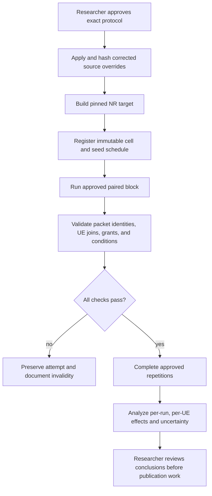

# Mission RA-ENG-007 — paired LOS/NLOS, load, and stock-policy campaign

**Status:** COMPLETE — the approved 160-cell matrix ran, passed source/trace audits, and was analyzed. **Date:** 2026-11-12. **Issue:** [#20 — RA-ENG-007](https://github.com/kirolossedra/oran-publication/issues/20).

## Research objective and scope

After feasibility and stock-policy control checks, run the researcher-approved multi-user NR campaign that contrasts channel condition, offered load, and stock scheduling policy while measuring all six UEs. Do not treat successful simulator runs as evidence of novelty, causal mechanism, or real-world performance. This template-first report records the authorized matrix, implementation, all-cell execution, and validated analysis.

## Scientific motivation and hypotheses (human-owned)

The research question, candidate gap, selected primary direction, policy-pair interpretation, hypotheses, and scientific conclusions remain researcher-owned. RA-ENG-006 (#19) source-verified and observed that `RoundRobin` versus `TopKCqi`, with xApp Bypass fixed, can change applied grants under one seed and one LOS contention condition. That result is a technical control probe, not a formal policy ranking.

## Requirements and acceptance criteria

Issue #20 requires explicit protocol approval before formal simulation. On 2026-11-12 the researcher replied **“existing”** to the approval question that contrasted the current 160-cell v2 matrix with a narrower design and explicitly disclosed its selective UE6 NLOS scope and both-direction measurements. This is recorded as approval of the existing matrix: all-LOS vs selective UE6 NLOS; stationary vs controlled-linear mobility; four load arms; RoundRobin vs TopKCqi with xApp Bypass and `k=1`; both DL and UL measured together; five seeds `[11,22,33,44,55]`; 160 planned unique cells; 20 s runs with 1.1 s application start, 1 s receiver drain, 512-byte payloads, and the matrix's declared percentile method. This selection expands the compact design suggested by issue #20; that expansion is now researcher-approved, not inferred by Codex.

Campaign acceptance is met: all 160 cells have complete measurements matching the corrected source hashes; all six UE/direction outcome tables are populated; channel and mobility trace audits pass; seven failed/interrupted pilot attempts are retained with exclusion reasons; run-level uncertainty, policy/channel interaction estimates, figures, documentation, and reproducibility records are prepared. Repository audit and push are recorded in the delivery commit.

## Existing architecture and affected components

- Researcher-authored campaign package: `campaigns/20261111-g1-integrated-v2/`, including `config/g1-integrated-campaign.json`, runner, analyzer, source overrides, and pinned-source map.
- RA-ENG-006 matched pilot config and results: `configs/scenarios/g1-loadcal-dl-contending.yaml` and ignored `simulator/logs/RA-ENG-006-20261112/`.
- Packet identity and applied grants: `scripts/map_g1_udp_flows.py`, `scripts/analyze_g1_packets.py`, and the RA-ENG-004/005 per-UE grant instrumentation.
- The installed simulator tree and campaign source overrides are distinct artifacts. The approved formal-run source version was pinned, copied, hash-verified, rebuilt, and recorded before pilot execution.

## Implementation details and alternatives

Two materially different scopes are visible in the existing records and require a researcher decision:

| Decision | Existing matrix | Approval recorded |
|---|---|---|
| Channel scope | `all-los` and selective `ue6-nlos` | Approved by “existing” reply; overrides the earlier whole-cell-only scope for this campaign. |
| Direction | DL and UL measured together | Approved by “existing” reply. |
| Policy | `RoundRobin` vs `TopKCqi`; xApp `Bypass`, `k=1` | Approved by “existing” reply; corrected campaign source hashes must be used. |
| Load/mobility | Four load arms; stationary and controlled-linear | Approved by “existing” reply. |
| Repetitions | Seeds 11, 22, 33, 44, 55; five seeds; 160 unique cells | Approved by “existing” reply; preserve checked-in ordering and pairing. |

The researcher has approved the 160-cell v2 matrix despite its broader scope than the compact design described in issue #20. Run exactly this checked-in matrix and do not add cells or alter its factors.

## Architecture/algorithm/workflow diagrams

Conceptual workflow from issue #20; arrows describe the gated process, not completed execution or measured outcome.

## Changed files and reproducible patches

This report is the template-first approval record. Subsequent execution changed the campaign runner/analyzer and created ignored raw pilot output; those changes and their effects are documented below. Source overrides are unchanged from the approved package.

## Dependencies, versions, configuration, seeds, commands

Pinned upstream versions are listed in `campaigns/20261111-g1-integrated-v2/UPSTREAM-SOURCES.md`: ns-3.48 `d2add90b452d600cfb4859baed8e9ea633519447`; 5G-LENA NR v5.1 `cedceadda17392c90587fb9400eb9b1f8c236713`; ns3-ai `b8c9858294b1d6a7f122b5154a3ce25057a54740`; Orange ib-ORAN `3ea5046389f0eb993cdf01ef6d6d33017e6921bb`. The campaign package contains corrected full-file source overrides, but no claim is made here that they are installed or built in the local simulator checkout.

**Observed source drift that must be handled before runs:** the installed RoundRobin source SHA is `8638e94c141d430605d00494f429989dbfa80ea9f8afc522069e0a4898e26272`, while its campaign override SHA is `8d4d640fb14400666fa6bbe38496859d4e14c2dc106883c6e5904d1e41b4be22`. The installed TopK source SHA is `c8aa8e6193a03130131716260fc68ff6eac037c0e04c1a06e8973b41851ed425`, while its override SHA is `ff67a43669574505872791bd1ba0239114d2309a223d3e53a97e1b44c6b71956`. These match the #19 run metadata versus `campaigns/20261111-g1-integrated-v2/source-overrides/SHA256SUMS`; therefore the policy semantics differ and the earlier #19 traces cannot be pooled with a future corrected-source campaign. The local raw/results search found zero files under the v2 run and result roots.

The researcher-approved protocol and source state are recorded. The campaign runner retains the full 160-cell matrix and adds a `--pilot-block` selector for the first matched 2×2×2 block (seed 11, stationary, light/contending, both channel states, both policies; DL and UL measured together). The full run resumed past the 8 valid pilot cells and completed the remaining 152. Raw output is under ignored `simulator/runs/20261111-g1-integrated-v2/`; failed attempts receive unique attempt directories and remain immutable. The analyzer accepts explicit `--campaign-root` and `--output-dir` options and refuses to overwrite nonempty output directories.

## Tests and verification evidence (logs/paths)

**Observed repository state before this approval:** `simulator/runs/20261111-g1-integrated-v2/` and `results/20261111-g1-integrated-v2/` were absent locally. RA-ENG-006 raw logs are separate, one-seed engineering probes.

The approved source override manifest verified 13 files. Pre-application copies and before/after hashes are retained in `simulator/logs/RA-ENG-007-20261112/source-backup/`, `source-installed/`, and `source-application.json`. `./ns3 build ns3iboran_nr -j 2` succeeded after rerunning outside the sandbox because the sandbox initially blocked ccache writes. The v2 regression suite passed nine tests, including the new pilot-block selector check.

The pilot audit identifies three attempts that exited 2 because the runner passed two channel flags not supported by this `iboran_run.py`; those flags duplicate settings already written into `scenario.yaml`. Two attempts exited 1 during CLIP initialization because the default model snapshot was uncached and the Xet CDN timed out; two attempts have no exit-status file and are recorded as interrupted/status unavailable. All seven are preserved and excluded. The model was provisioned from the official OpenAI ViT-B/16 checkpoint, SHA-256 `5806e77cd80f8b59890b7e101eabd078d9fb84e6937f9e85e4ecb61988df416f`, then converted with the official Hugging Face Transformers CLIP conversion script (script SHA-256 `8950db3047c67ce8633052c5498e15ca287f4881f501362272b929bac4c3b7fd`). Conversion parity assertions passed; the converted model and local `CLIPProcessor` load offline on CPU. Model bytes remain ignored and are not committed.

**Observed full-campaign evidence:** the final audit at `results/RA-ENG-008-20261112-audited-v3/` reports 160 planned/complete cells, 167 total attempts, 160 successful measurement-complete attempts, seven excluded failed/interrupted attempts, 1,920 per-run UE/direction metric rows, 1,920 grant rows, and 1,920 demand rows. Every selected cell matches current source hashes. All 160 channel/mobility audits pass with 120 state samples per cell, zero condition mismatches, and expected position-change behavior. All 167 attempts have `artifact-sha256.txt`; final curated outputs have `results-sha256.txt`. The separate pilot analysis remains preserved under `simulator/logs/RA-ENG-007-20261112/pilot-analysis/`.

## Raw data and result references

Full raw attempts are preserved locally under ignored `simulator/runs/20261111-g1-integrated-v2/` with a per-attempt SHA-256 inventory. Curated analysis and figure outputs are in `results/RA-ENG-008-20261112-audited-v3/`; its manifest hashes every output. Pilot raw/analysis evidence is separately preserved under `simulator/logs/RA-ENG-007-20261112/pilot-analysis/`. Simulator raw data are excluded from Git.

## Analysis, sample sizes, uncertainty, interpretation

The researcher approved five seeds and the matrix's type-7 percentile method. Final analysis reports per-run/per-UE offered TX, unique RX, matched RX, unmatched RX, duplicates, missing-at-stop, goodput, mean/P50/P95/P99 received delay and sample counts, applied grants, and condition identity. Uncertainty is computed across independent seeds; packets are not treated as replicate units. All six UEs and both directions remain visible. Of 1,920 UE/direction cells, 673 meet the 1,000 received-sample P99 reporting flag, 1,247 are exploratory-small-n, and 191 have no matched RX delay sample. Across runs, 21,207,360 unique TX sequences reconcile to 10,295,873 matched unique RX sequences and 10,911,487 TX sequences unreceived by the collection stop; no duplicate events or unmatched RX sequences were observed. Missing-at-stop is not attributed to network loss.

## Limitations and unverified assumptions

- Researcher approval was received via the conversation reply “existing,” selecting the current 160-cell v2 matrix and thereby explicitly accepting selective UE6 NLOS, both directions, mobility and five seeds for this campaign.
- Whole-cell LOS/NLOS was approved for RA-ENG-002; the new explicit approval selects the broader selective UE6 NLOS matrix for RA-ENG-007.
- v2 package progress counts are not independently verifiable here because the raw run directory is absent.
- Corrected scheduler source overrides differ from the earlier installed source used for RA-ENG-006. Formal results must use one pinned, rebuilt source version and exclude incompatible earlier outputs.
- The approved design's sample adequacy and scientific interpretation remain for researcher review; protocol factors and direction are fixed by approval.

## Problems, failures, and resolutions

1. Three pilot attempts exited 2 because two unsupported command-line options were passed; the runner was corrected to use the effective scenario YAML for channel settings. Three failed attempts from this runner version are retained.
2. Two pilot attempts exited 1 during CLIP initialization because `openai/clip-vit-base-patch16` was not cached and the Hugging Face Xet storage host timed out; two additional attempts have no exit status and remain classified as interrupted/status unavailable. All are retained. The exact OpenAI checkpoint was downloaded from its official Azure URL, its URL-embedded SHA-256 verified, and Hugging Face's conversion script verified numeric parity before the model was loaded from local disk. `ftfy==6.3.1` and the OpenAI CLIP source checkout at `/tmp/ra-eng-007-openai-clip` (commit `d05afc436d78f1c48dc0dbf8e5980a9d471f35f6`) were used only for conversion. Full download/conversion provenance and hashes are in the ignored run root.
3. The initial local build failed because sandbox restrictions made ccache's external write path read-only; the same build command then passed with required filesystem permission. No source/compiler error occurred.
4. Retrying after correcting runner and embedding dependency uses new attempt directories; prior failed artifacts are never overwritten. Any subsequent simulation failure remains in the manifest and requires trace validation before proceeding.

## Decisions and evidence

- **Source-verified:** the v2 campaign config specifies channels `all-los`/`ue6-nlos`, mobility `stationary`/`controlled-linear`, four load arms, `RoundRobin`/`TopKCqi`, and seeds `[11,22,33,44,55]`; issue #20 describes a narrower, direction-selected design.
- **Observed:** 160/160 approved cells completed with current source hashes and complete trace joins; all 160 channel/mobility audits passed.
- **Researcher-approved:** existing 160-cell v2 protocol as specified in `config/g1-integrated-campaign.json`; exact request and answer recorded above.
- **Observed:** source overrides are applied, the pinned NR target builds, nine regression checks pass, and the pinned CLIP checkpoint converts and loads offline on CPU.
- **Still unresolved:** scientific interpretation, candidate novelty, and any publication claims remain researcher-owned; RA-ENG-009 requires explicit authorization after that review.
- **Stop condition:** stop on source drift during runs, invalid trace/identity joins, or incomplete/failed run integrity; preserve attempts and do not substitute unapproved factors.

## Final deliverables

This report records protocol approval, verified implementation, full execution, analysis, evidence, and limitations. The campaign mission is complete. The distinct publication package/review gate remains open.

## Unresolved questions and next steps

1. Researcher review: examine all six UE outcomes, missing-at-stop counts, low-n latency tails, paired policy/channel interactions, and resource-allocation tradeoffs in RA-ENG-008 outputs.
2. Only after that review, decide whether to authorize RA-ENG-009 publication assets.
3. Preserve the local raw run tree and its per-attempt hashes; reproduce on a new machine using the pinned source and environment instructions.

## Documentation completion checklist

- [x] Report created before formal source mutation/build/run; blocker, scope and criteria recorded
- [x] Conceptual workflow diagram included and labeled
- [x] Researcher-approved protocol recorded (existing 160-cell v2 matrix)
- [ ] Corrected source overrides applied and pinned build verified
- [x] Approved runs, immutable raw evidence, analysis and results complete (160/160 cells)
- [x] README, mission index and audit updated
- [x] Reproduction commands, failure record, checksums and claims reviewed
- [x] Staged-path/security/size audit and safe main push recorded
