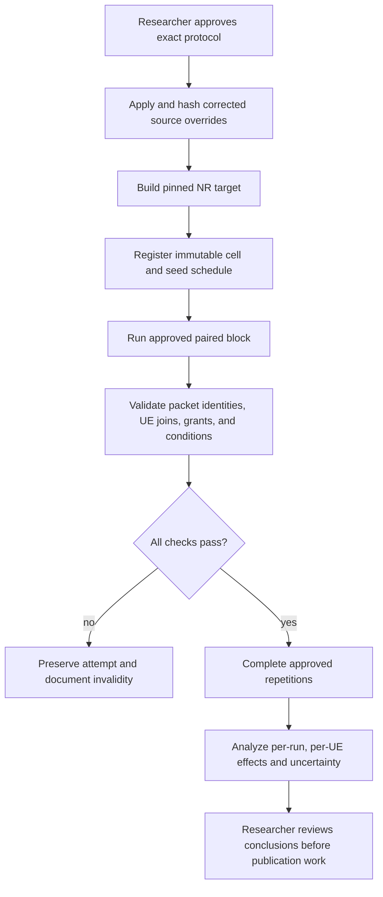

# Mission RA-ENG-007 — paired LOS/NLOS, load, and stock-policy campaign

**Status:** IN PROGRESS — researcher approved the existing v2 matrix; source application/build and formal runs remain. **Date:** 2026-11-12. **Issue:** [#20 — RA-ENG-007](https://github.com/kirolossedra/oran-publication/issues/20).

## Research objective and scope

After feasibility and stock-policy control checks, run the smallest approved multi-user NR campaign that contrasts channel condition, offered load, and stock scheduling policy while measuring all six UEs. Do not treat a successful simulator run as evidence of novelty, causal mechanism, or real-world performance. This report is a template-first approval and readiness record; no formal RA-ENG-007 simulation or analysis was started.

## Scientific motivation and hypotheses (human-owned)

The research question, candidate gap, selected primary direction, policy-pair interpretation, hypotheses, and scientific conclusions remain researcher-owned. RA-ENG-006 (#19) source-verified and observed that `RoundRobin` versus `TopKCqi`, with xApp Bypass fixed, can change applied grants under one seed and one LOS contention condition. That result is a technical control probe, not a formal policy ranking.

## Requirements and acceptance criteria

Issue #20 requires explicit protocol approval before formal simulation. On 2026-11-12 the researcher replied **“existing”** to the approval question that contrasted the current 160-cell v2 matrix with a narrower design and explicitly disclosed its selective UE6 NLOS scope and both-direction measurements. This is recorded as approval of the existing matrix: all-LOS vs selective UE6 NLOS; stationary vs controlled-linear mobility; four load arms; RoundRobin vs TopKCqi with xApp Bypass and `k=1`; both DL and UL measured together; five seeds `[11,22,33,44,55]`; 160 planned unique cells; 20 s runs with 1.1 s application start, 1 s receiver drain, 512-byte payloads, and the matrix's declared percentile method. This selection expands the compact design suggested by issue #20; that expansion is now researcher-approved, not inferred by Codex.

Acceptance for the *campaign* remains unmet until the current corrected source overrides are applied and built, all approved cells and repetitions complete with valid trace joins, run-level uncertainty and all UE outcomes are analyzed, and documentation/audit/push gates pass.

## Existing architecture and affected components

- Researcher-authored campaign package: `campaigns/20261111-g1-integrated-v2/`, including `config/g1-integrated-campaign.json`, runner, analyzer, source overrides, and pinned-source map.
- RA-ENG-006 matched pilot config and results: `configs/scenarios/g1-loadcal-dl-contending.yaml` and ignored `simulator/logs/RA-ENG-006-20261112/`.
- Packet identity and applied grants: `scripts/map_g1_udp_flows.py`, `scripts/analyze_g1_packets.py`, and the RA-ENG-004/005 per-UE grant instrumentation.
- The installed simulator tree and campaign source overrides are distinct artifacts. Any formal-run source version must be pinned, copied, hash-verified, rebuilt, and recorded after protocol approval.

## Implementation details and alternatives

Two materially different scopes are visible in the existing records and require a researcher decision:

| Decision | Existing matrix | Approval recorded |
|---|---|---|
| Channel scope | `all-los` and selective `ue6-nlos` | Approved by “existing” reply; overrides the earlier whole-cell-only scope for this campaign. |
| Direction | DL and UL measured together | Approved by “existing” reply. |
| Policy | `RoundRobin` vs `TopKCqi`; xApp `Bypass`, `k=1` | Approved by “existing” reply; corrected campaign source hashes must be used. |
| Load/mobility | Four load arms; stationary and controlled-linear | Approved by “existing” reply. |
| Repetitions | Seeds 11, 22, 33, 44, 55; five seeds; 160 unique cells | Approved by “existing” reply; preserve checked-in ordering and pairing. |

The researcher has approved the 160-cell v2 matrix despite its broader scope than the compact design described in issue #20. Run exactly this checked-in matrix and do not add cells or alter its factors.

## Architecture/algorithm/workflow diagrams

Conceptual workflow from issue #20; arrows describe the gated process, not completed execution or measured outcome.

## Changed files and reproducible patches

This report and navigation/audit references are the only intended changes before approval. No formal scenario config, source override, simulation output, or analysis result was changed or created for RA-ENG-007.

## Dependencies, versions, configuration, seeds, commands

Pinned upstream versions are listed in `campaigns/20261111-g1-integrated-v2/UPSTREAM-SOURCES.md`: ns-3.48 `d2add90b452d600cfb4859baed8e9ea633519447`; 5G-LENA NR v5.1 `cedceadda17392c90587fb9400eb9b1f8c236713`; ns3-ai `b8c9858294b1d6a7f122b5154a3ce25057a54740`; Orange ib-ORAN `3ea5046389f0eb993cdf01ef6d6d33017e6921bb`. The campaign package contains corrected full-file source overrides, but no claim is made here that they are installed or built in the local simulator checkout.

**Observed source drift that must be handled before runs:** the installed RoundRobin source SHA is `8638e94c141d430605d00494f429989dbfa80ea9f8afc522069e0a4898e26272`, while its campaign override SHA is `8d4d640fb14400666fa6bbe38496859d4e14c2dc106883c6e5904d1e41b4be22`. The installed TopK source SHA is `c8aa8e6193a03130131716260fc68ff6eac037c0e04c1a06e8973b41851ed425`, while its override SHA is `ff67a43669574505872791bd1ba0239114d2309a223d3e53a97e1b44c6b71956`. These match the #19 run metadata versus `campaigns/20261111-g1-integrated-v2/source-overrides/SHA256SUMS`; therefore the policy semantics differ and the earlier #19 traces cannot be pooled with a future corrected-source campaign. The local raw/results search found zero files under the v2 run and result roots.

No run command is authorized until the researcher-approved protocol and source state are recorded. The existing package's 160-cell design is documented as a researcher-authored candidate matrix, not as the approved RA-ENG-007 protocol. Formal outputs, if authorized, must go to unique paths under `simulator/runs/20261111-g1-integrated-v2/` or a newly versioned campaign run root and must never overwrite prior attempts.

## Tests and verification evidence (logs/paths)

**Observed repository state before this approval:** `simulator/runs/20261111-g1-integrated-v2/` and `results/20261111-g1-integrated-v2/` were absent locally. The campaign README reports 92/160 successful cells, two incomplete attempts, and 68 incomplete cells at its package snapshot; those are package-reported execution counts, not locally inspected raw run evidence or completed analysis. RA-ENG-006 raw logs are separate, one-seed engineering probes and cannot be substituted for formal campaign cells.

No RA-ENG-007 build, test suite, run, analysis, or formal result is claimed. Required post-approval verification includes source-override SHA checks, clean build of the pinned NR target, per-cell effective config/provenance, condition/identity checks, six-UE packet/grant reconciliation, and manifest-preserved failed attempts.

## Raw data and result references

No formal RA-ENG-007 raw data or results are available in this checkout. The expected v2 package run root is absent. The previous integrated-v2 package warns that no raw outputs are included in Git. Preserve all raw outputs and an immutable checksum manifest under a unique run-specific ignored directory after approval.

## Analysis, sample sizes, uncertainty, interpretation

The v2 JSON declares five seeds and type-7 percentiles, but those parameters are not treated as approval. The researcher must approve run count, seed schedule, estimator, primary direction, comparisons, and sample adequacy. Formal analysis must report per-run/per-UE offered TX, unique RX, goodput, missing-by-stop/drop, received-delay `n` and P95/P99, actual grant allocation, and condition identity. Compute uncertainty across independent runs, never pooled packets as independent units. All six UEs and service regressions must remain visible.

## Limitations and unverified assumptions

- Researcher approval was received via the conversation reply “existing,” selecting the current 160-cell v2 matrix and thereby explicitly accepting selective UE6 NLOS, both directions, mobility and five seeds for this campaign.
- Whole-cell LOS/NLOS was approved for RA-ENG-002; the new explicit approval selects the broader selective UE6 NLOS matrix for RA-ENG-007.
- v2 package progress counts are not independently verifiable here because the raw run directory is absent.
- Corrected scheduler source overrides differ from the earlier installed source used for RA-ENG-006. Formal results must use one pinned, rebuilt source version and exclude incompatible earlier outputs.
- Sample adequacy, formal direction, channel scope, policy choice, mobility scope, and statistical interpretation remain unresolved.

## Problems, failures, and resolutions

No formal run has been attempted, so there are no RA-ENG-007 run failures. The present blocker is the explicit protocol approval gate, not an execution failure. Preserve this distinction in any future status update.

## Decisions and evidence

- **Source-verified:** the v2 campaign config specifies channels `all-los`/`ue6-nlos`, mobility `stationary`/`controlled-linear`, four load arms, `RoundRobin`/`TopKCqi`, and seeds `[11,22,33,44,55]`; issue #20 describes a narrower, direction-selected design.
- **Observed:** no formal raw v2 run/result directory is present locally at report creation.
- **Researcher-approved:** existing 160-cell v2 protocol as specified in `config/g1-integrated-campaign.json`; exact request and answer recorded above.
- **Still unresolved:** corrected source application/build, execution integrity, campaign outcomes and statistical interpretation.
- **Stop condition:** stop on build/regression failure, insufficient storage, source drift during runs, invalid trace/identity joins, or incomplete/failed run integrity; preserve attempts and do not substitute unapproved factors.

## Final deliverables

This report records the gate and the exact decisions needed. Campaign, analysis, and publication deliverables remain incomplete pending approval and execution.

## Unresolved questions and next steps

1. Back up the installed policy source and preserve a checksum manifest before applying the approved campaign overrides.
2. Apply/hash current source overrides, build the pinned target and run regression checks; freeze the cell/seed manifest and execute the approved matrix.
3. Validate raw traces before campaign analysis. Do not characterize the existing one-seed control probes or absent local v2 outputs as formal campaign results.
4. Only after validated analysis, proceed to RA-ENG-008; only after researcher review/authorization, proceed to RA-ENG-009.

## Documentation completion checklist

- [x] Report created before formal source mutation/build/run; blocker, scope and criteria recorded
- [x] Conceptual workflow diagram included and labeled
- [x] Researcher-approved protocol recorded (existing 160-cell v2 matrix)
- [ ] Corrected source overrides applied and pinned build verified
- [ ] Approved runs, immutable raw evidence, analysis and results complete
- [ ] README, mission index and audit updated
- [ ] Reproduction commands, failure record, checksums and claims reviewed
- [ ] Staged-path/security/size audit and safe main push recorded
