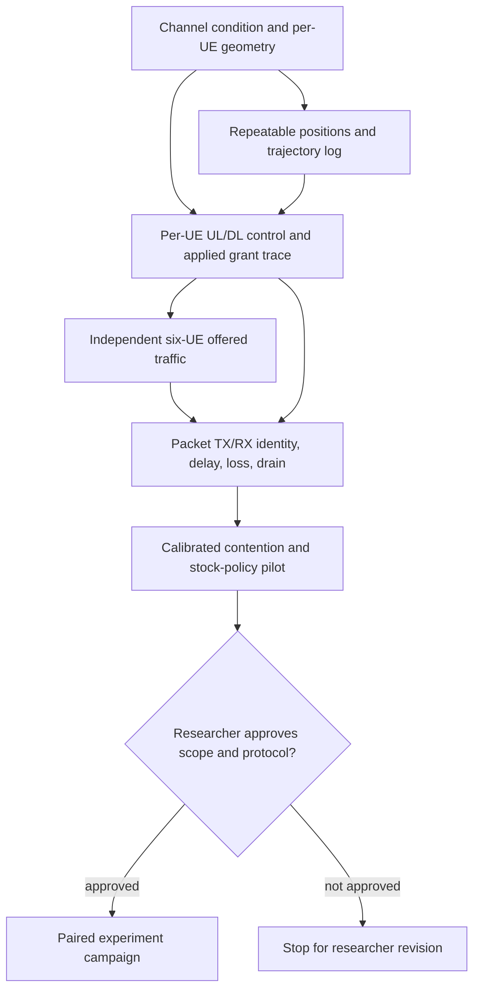

# RA-ENG-001 capability matrix

**Audit updated:** 2026-11-12. **Source pins:** ns-3 `d2add90b452d600cfb4859baed8e9ea633519447`; NR v5.1 `cedceadda17392c90587fb9400eb9b1f8c236713`; ib-ORAN `3ea5046389f0eb993cdf01ef6d6d33017e6921bb`. All four pinned repositories were later restored under ignored `simulator/`; the NR target and Python bridge build. An isolated six-UE C++ probe observed whole-cell LOS/NLOS helper behavior and repeatable positions for seed/run 1. The exact CPU Torch wheel retry on 2026-11-12 failed DNS resolution, so the full Python-controlled ib-ORAN scenario remains unverified.

Status meanings: **DIRECT** is already exposed in the pinned code; **SMALL PATCH** is a bounded implementation path identified from source but still needs a probe; **UNKNOWN** needs local/runtime or further pinned-source evidence; **NOT PRESENT** is absent from the current scenario/output path.

## F1 — LOS/NLOS and channel behavior

| Control / outcome | Evidence and granularity | Verdict | Smallest next check / risk |
|---|---|---|---|
| Force all one-cell links LOS or NLOS | ib-ORAN calls `ConfigureFactories("UMi", "Default", "ThreeGpp")` in [`iboran-nr-environment.cc` lines 53–58](https://github.com/Orange-OpenSource/ns3-iboran/blob/3ea5046389f0eb993cdf01ef6d6d33017e6921bb/model/iboran_ran_environment/iboran-nr-environment.cc#L53-L58). Pinned NR v5.1 maps helper conditions `LOS`/`NLOS` to `AlwaysLosChannelConditionModel` / `NeverLosChannelConditionModel`; ns-3 returns the same condition for every endpoint pair ([NR helper lines 276–285](https://gitlab.com/cttc-lena/nr/-/blob/cedceadda17392c90587fb9400eb9b1f8c236713/helper/nr-channel-helper.cc#L276), [ns-3 condition models lines 220–284](https://github.com/nsnam/ns-3-dev-git/blob/d2add90b452d600cfb4859baed8e9ea633519447/src/propagation/model/channel-condition-model.cc#L220)). NR's `CreateChannel` creates one condition-model instance for the created spectrum channel and passes that pointer to the spectrum/path-loss models ([NR helper lines 108–159](https://gitlab.com/cttc-lena/nr/-/blob/cedceadda17392c90587fb9400eb9b1f8c236713/helper/nr-channel-helper.cc#L108)). A local isolated probe queried all six links and observed all six LOS, then all six NLOS. | **OBSERVED in isolated helper probe;** not currently exposed in ib-ORAN YAML. The helper factory is channel-wide, not a UE-indexed setting. | Probe verifies condition classes, not resulting channel metrics or full scenario propagation. |
| Force only one UE link NLOS, other five LOS | NR helper offers `Buildings` as a channel-condition option. ns-3 `BuildingsChannelConditionModel::GetChannelCondition(a,b)` requires building metadata on both nodes, checks each pair's current positions and returns LOS/NLOS from line-of-sight obstruction ([NR helper mapping](https://gitlab.com/cttc-lena/nr/-/blob/cedceadda17392c90587fb9400eb9b1f8c236713/helper/nr-channel-helper.cc#L276), [Buildings model lines 44–75](https://github.com/nsnam/ns-3-dev-git/blob/d2add90b452d600cfb4859baed8e9ea633519447/src/buildings/model/buildings-channel-condition-model.cc#L44-L75)). Geometry could in principle obstruct one ray while leaving five rays open at matched node positions. The current ib-ORAN setup creates no buildings and does not select this model. | **SMALL PATCH, conditional on a geometry probe.** A building geometry and buildings metadata path is more source-supported than assuming the global `NLOS` factory affects only one link. | Add a minimal static six-UE geometry diagnostic in the ignored simulator, read back each gNB↔UE condition at the same positions, and preserve a unique log. Do not silently fall back to whole-cell NLOS. No geometry probe has run. |
| Default UMi LOS/NLOS evolution under mobility | ib-ORAN sets `ThreeGppChannelConditionModel::UpdatePeriod=0` and condition-helper `UpdatePeriod=0` ([setup lines 53–58](https://github.com/Orange-OpenSource/ns3-iboran/blob/3ea5046389f0eb993cdf01ef6d6d33017e6921bb/model/iboran_ran_environment/iboran-nr-environment.cc#L53-L58)). In pinned ns-3, zero means channel condition is never recomputed; the cached condition is keyed per node pair and computed initially ([condition model lines 331–440](https://github.com/nsnam/ns-3-dev-git/blob/d2add90b452d600cfb4859baed8e9ea633519447/src/propagation/model/channel-condition-model.cc#L331)). | **NOT PRESENT** for condition transitions in the current default configuration. | A Buildings-based condition path evaluates the current line geometry when queried and may transition as endpoints move, but requires explicit building and motion probe. |
| Distance-dependent loss and fast fading while moving | Pinned ns-3 propagation loss queries the channel condition and computes loss from the current endpoint positions ([`DoCalcRxPower`, lines 392–412](https://github.com/nsnam/ns-3-dev-git/blob/d2add90b452d600cfb4859baed8e9ea633519447/src/propagation/model/three-gpp-propagation-loss-model.cc#L392)). The 3GPP channel model’s `UpdatePeriod=0` disables spatial-consistency channel updates ([attribute and update check](https://github.com/nsnam/ns-3-dev-git/blob/d2add90b452d600cfb4859baed8e9ea633519447/src/spectrum/model/three-gpp-channel-model.cc#L1174)). Thus modeled distance-dependent path loss can change with position while LOS/NLOS and the cached small-scale channel realization remain fixed under current settings. This is source inference, not an observed trace. | **CONDITIONAL**; separate large-scale position effects from frozen condition/fading state. | Log positions, condition, path loss/RSRP/SINR/CQI over time in a diagnostic run; verify which exact traces are exposed by the pinned NR build. |
| Observe per-UE condition/state | Current KPM/E3 shared-memory records expose RNTI, CQI, buffer, rate/throughput, served bytes, packet delay, direction, and RBG counts, but no LOS/NLOS field ([`iboran-shm-structure.h` lines 44–137](https://github.com/Orange-OpenSource/ns3-iboran/blob/3ea5046389f0eb993cdf01ef6d6d33017e6921bb/model/iboran_interfaces/iboran-shm-structure.h#L44)). The current source prints initial UE positions only. | **NOT PRESENT** as a retained per-UE condition/position time series. | Add a small trace/probe that records run, sim time, node/RNTI, position, LOS category, and channel metrics; establish mapping at attach time. |
| Industrial indoor validity | Current scenario selects UMi and no measured/calibrated factory geometry. | **UNVERIFIED; no factory-validity claim.** | Any alternative indoor channel scope is a researcher decision, not an automatic engineering fallback. |

## F2 — Mobility and controlled topology

| Capability | Evidence | Verdict / missing evidence |
|---|---|---|
| Existing movement | [`SetupFronthaulMobility`](https://github.com/Orange-OpenSource/ns3-iboran/blob/3ea5046389f0eb993cdf01ef6d6d33017e6921bb/model/iboran_ran_environment/iboran-ran-common.cc#L295) places one gNB at the area center at 30 m; UEs are `RandomWalk2dMobilityModel`, constant 0.83 m/s, change direction every 100 m within square bounds, and start at independently generated uniform x/y positions at 1.5 m (lines 301–350). The NR entry sets ns-3 seed 1 and `RngRun` from config (environment lines 118–119). The isolated probe reproduced this block with six UEs and observed position samples at 0, 60 and 130 s. | **SOURCE-VERIFIED and OBSERVED in isolated probe.** It does not reproduce the full scenario's random-stream creation order. |
| Fixed/waypoint/constant-velocity choice | Current function hardcodes random walk; no topology mode selector is passed. Pinned ns-3 exposes [`ConstantPositionMobilityModel`](https://github.com/nsnam/ns-3-dev-git/blob/d2add90b452d600cfb4859baed8e9ea633519447/src/mobility/model/constant-position-mobility-model.cc#L16), [`ConstantVelocityMobilityModel::SetVelocity`](https://github.com/nsnam/ns-3-dev-git/blob/d2add90b452d600cfb4859baed8e9ea633519447/src/mobility/model/constant-velocity-mobility-model.h#L54), and [`WaypointMobilityModel::AddWaypoint`](https://github.com/nsnam/ns-3-dev-git/blob/d2add90b452d600cfb4859baed8e9ea633519447/src/mobility/model/waypoint-mobility-model.cc#L79) (linear motion between ordered waypoints; repeated positions at distinct times hold position). | **SMALL PATCH** to setup function/config. No alternative trajectory was implemented or run; these are technical options, not selected scope. |
| Same-seed paired trajectories | Two independent invocations of the isolated probe with seed 1/run 1 produced byte-identical positions at 0, 60 and 130 s. Random stream/creation-order stability under changes to the full scenario remains **UNKNOWN**. | Add trajectory logging to the actual scenario and verify paired arms before treating scenario-level matching as established. |

## F3 — Scheduling controls and radio-resource observations

| Capability | Evidence | Verdict / missing evidence |
|---|---|---|
| Per-UE and per-direction inputs | Shared-memory KPM/E3 records include direction and per-UE RNTI, CQI, buffer, achievable/actual rate, served bytes and a packet-delay field ([interface structures](https://github.com/Orange-OpenSource/ns3-iboran/blob/3ea5046389f0eb993cdf01ef6d6d33017e6921bb/model/iboran_interfaces/iboran-shm-structure.h#L44)). `FillUeIndication` populates them separately on DL and UL ([NR scheduler lines 198–291](https://github.com/Orange-OpenSource/ns3-iboran/blob/3ea5046389f0eb993cdf01ef6d6d33017e6921bb/model/iboran_mac_scheduler/iboran-nr-mac-scheduler.cc#L198)). | **DIRECT in the control interface.** HARQ/BLER and PHY occupancy are not in these structures. |
| xApp bounds | xApp returns per-RNTI `maxRbgAllocation`; dApp clips its computed requested allocations to that maximum (Python scheduler lines 180–198); C++ applies the max to both DL and UL scheduling paths (NR scheduler lines 473–501 and 747–774). A bound is an upper limit and does not grant a minimum. | **DIRECT cap; effect on real grants unobserved** for alternatives. Bypass run is not evidence of a restrictive bound. |
| dApp selection/allocation to MAC | dApp emits per-UE RNTI, starting RBG, count, and MCS; C++ validates/caps RBG assignments and creates DL/UL DCI grants (scheduler lines 481–504, 754–777, 855–1003). This distinguishes Python action from applied MAC grant. | **SOURCE-VERIFIED control path; actual intervention effect needs paired run and grant log.** |
| Stock policy candidates | `RoundRobin` favors UEs with less recent service; `TopKCqi` ranks candidates by reported CQI and selects up to k, via source files linked from [the dApp algorithms directory](https://github.com/Orange-OpenSource/ns3-iboran/tree/3ea5046389f0eb993cdf01ef6d6d33017e6921bb/model/iboran_controller/iboran_dapp_algos). These are candidate arms only; no final pair is selected in this audit. | **SOURCE-VERIFIED options.** Prove different applied grants in a controlled saturated smoke before a campaign. |
| Grant telemetry | dApp decision logs can show RNTI/RBG/MCS, and the C++ DCI construction has per-UE RBG range/MCS/TBS fields. | **SMALL PATCH/targeted trace** to capture applied grants with sim time, direction, RNTI, action ID, RBG/PRB definition, MCS and transport-block bytes. Do not label an xApp maximum or requested RBG count as physical occupancy. |
| Fairness | Per-UE delivered bytes/goodput can support a later Jain index once flow attribution/windows are consistent. | **SMALL PATCH in analysis**, no built-in fairness result and no fairness claim from an index alone. |

## F4 — Traffic controls

`SetupIbOranApplications` loops over each UE and creates a separate downlink flow (remote host → UE, port `2000+index`) and uplink flow (UE → remote host, port `4000+index`), with an RNTI getter. NR setup installs UE NR devices, assigns UE IPv4 addresses through EPC, installs the Internet stack, and attaches each UE device to the gNB before applications are installed ([NR environment](https://github.com/Orange-OpenSource/ns3-iboran/blob/3ea5046389f0eb993cdf01ef6d6d33017e6921bb/model/iboran_ran_environment/iboran-nr-environment.cc#L194)). Thus the configured app endpoints use the simulated UE/EPC path through the NR-attached UE devices. Directional UDP/TCP selection, packet size, bitrate and enable switches come from `CommonRanParams`; the same `dlBitRate`/`dlPacketSize` values or `ulBitRate`/`ulPacketSize` values are assigned to every UE ([app setup lines 356–553](https://github.com/Orange-OpenSource/ns3-iboran/blob/3ea5046389f0eb993cdf01ef6d6d33017e6921bb/model/iboran_ran_environment/iboran-ran-common.cc#L356)). All receivers start at 1.0 s, senders at 1.1 s, and both groups stop at a shared simulation-end offset (lines 559–562). The transmitter sends chunks from loaded dataset data, not an unbounded probe stream ([application send path](https://github.com/Orange-OpenSource/ns3-iboran/blob/3ea5046389f0eb993cdf01ef6d6d33017e6921bb/model/iboran_application/iboran-application.cc#L460)).

| Control | Verdict | Smallest later change |
|---|---|---|
| Separate UE/flow identity, RNTI, addresses, ports, direction | **DIRECT** for current per-UE app instances/endpoints; identity is inspectable from setup. Verify actual traffic mapping in a pilot. | Record explicit UE-index ↔ RNTI ↔ IP/port ↔ FlowMonitor ID metadata. |
| Independent target/background rates and sizes | **NOT PRESENT** in current YAML/common-parameter interface; rates/sizes are shared globally per direction. | Add per-UE (or role-based target/background) config and retain global defaults for upstream smoke compatibility. |
| Separate UL and DL offered controls | **DIRECT globally by direction**, not per UE. | Keep UL/DL independent, then per-UE within each direction. |
| Static/bursty/infinite source, independent start/stop/drain | **NOT PRESENT** in current dataset-payload application flow. All app containers share start/stop times. | Add standard deterministic UDP source/sink or small source parameters with per-flow lifecycle; test UE↔gNB radio traversal and sink drain. |
| Offered rate vs generated TX vs delivered RX | Configured rates and per-app sent/received byte/packet counters exist, but current KPI aggregation and retained result do not preserve all per-UE generated/delivered counts. | Export per-flow config and TX/RX counters with explicit offered/achieved definitions. |

## F5 — Packet latency, loss and radio telemetry

The current analyzer reads FlowMonitor XML, computes `delaySum / rxPackets` as an aggregate mean and sums by UL/DL. `iboran_run.py` calls cleanup after writing `kpi.json`; cleanup removes the `.flowstats` directory ([FlowStats/KPI code](https://github.com/Orange-OpenSource/ns3-iboran/blob/3ea5046389f0eb993cdf01ef6d6d33017e6921bb/model/iboran_campaign/iboran_orchestrator.py#L476), [aggregate latency and parsing](https://github.com/Orange-OpenSource/ns3-iboran/blob/3ea5046389f0eb993cdf01ef6d6d33017e6921bb/model/iboran_campaign/iboran_orchestrator.py#L490)). The application constructs a payload-only packet and its receive callback counts bytes/packets; it does not attach a unique sequence/timestamp or export per-packet TX/RX time ([TX](https://github.com/Orange-OpenSource/ns3-iboran/blob/3ea5046389f0eb993cdf01ef6d6d33017e6921bb/model/iboran_application/iboran-application.cc#L460), [RX](https://github.com/Orange-OpenSource/ns3-iboran/blob/3ea5046389f0eb993cdf01ef6d6d33017e6921bb/model/iboran_application/iboran-application.cc#L882)). The Mission 1 aggregate JSON cannot support P95/P99.

**Minimum robust path:** add a fixed-size measurement header carrying run/flow identity, monotonic sequence, and TX simulation timestamp; record TX and matched RX records at application endpoints, plus explicit send failures, duplicate/reordered/unmatched/in-flight status. Preserve immutable raw records before cleanup. Export a synchronized per-UE scheduler/grant trace and positions/channel fields where available. Compute latency percentiles only over received, correctly matched packets; report missing/loss/censoring beside them, separate offered/generated/delivered traffic, and use independent run/seed summaries for uncertainty rather than treating packets as independent replicates. Application delay includes the configured backhaul delay; it is not a pure MAC/PHY delay. This is an implementation recommendation, not implemented evidence.

For a transparent later estimator, use nearest-rank empirical quantiles, rank `ceil(p*n)`, and report matched received sample counts for every UE, flow, direction and run. At P99, only `0.01*n` observations are expected above the percentile; small counts make tail estimates coarse. The minimum sample size and stop rule remain researcher protocol decisions. Summarize uncertainty across independent runs rather than treating packet samples as independent replicates.

## F6 — Environment and dependency map

| Item | Observed state / consequence |
|---|---|
| Branch and repo | Local `main`; remote `main` remains at `39d37ebfca594bb59640477484f0fbb476f998f0`. The mission commits remain local because `git push` failed: Git could not read a GitHub username. No branch switch or remote rewrite was attempted. |
| Pins | All four exact source revisions in [`manifests/environment.json`](../../manifests/environment.json) were cloned and matched with `git rev-parse HEAD`: ns-3 `d2add90b452d600cfb4859baed8e9ea633519447`, NR `cedceadda17392c90587fb9400eb9b1f8c236713`, ns3-ai `b8c9858294b1d6a7f122b5154a3ce25057a54740`, ib-ORAN `3ea5046389f0eb993cdf01ef6d6d33017e6921bb`. |
| Local simulator/build | Present under ignored `simulator/`; C++ environment restored, `ns3iboran_nr`, protobuf objects, and Python bridge built. Python 3.12.3 venv has the frozen packages except pinned `torch==2.9.1+cpu` and `torchvision==0.24.1+cpu`, unavailable after DNS failures to both official and alternate PyTorch package hosts. |
| Host and resources | Ubuntu 24.04.4 x86_64; 20 logical CPUs; 30 GiB RAM, 24 GiB available; 501 GiB free after restoration; Python 3.14.3 system and Python 3.12.3 available; GCC 13.3.0, CMake 3.28.3, Ninja and Conda. Docker command exists but daemon socket access is denied; no Podman or `/dev/kvm`; netlink inspection is denied. |
| Required later changes | Small C++/YAML change for condition selection and per-UE position/channel traces; medium C++/Python/YAML extension for independently configured traffic and applied-grant trace; medium app/header and Python analysis path for packet-tail records and censoring. No upstream simulator source change was made in this audit. |
| Earliest validation and dependencies | Approved whole-cell setup: run minimal paired configurations in the pinned Python environment and retain per-UE condition/position and radio-state logs; requires pinned Torch pair. Before policy comparison: saturated six-UE pilot with synchronized requested-versus-applied grant trace. Before latency comparison: per-flow deterministic source and packet header, sink drain, and loss/censoring accounting. |
| Risk / alternatives | Global forced LOS/NLOS and the existing random walk are the simplest approved engineering path; they do not test selective UE blockage or dynamic LOS transitions. Selective geometry is a small, source-supported path but remains unprobed and is distinct from the approved whole-cell setup. A custom per-link model is a larger alternative and is not approved. |

## Source-backed dependency graph (engineering capabilities, not scientific approval)

This diagram orders technical prerequisites only. The campaign node remains gated by researcher scope and protocol approval.

## Engineering feasibility verdicts

| Factor | Verdict for the recorded scope | Basis / boundary |
|---|---|---|
| F1 channel | **CONDITIONAL GO** for the selected whole-cell forced LOS/NLOS comparison; **CONDITIONAL** for per-UE-only blockage; **BLOCKED in the current default** for mobility-driven UMi condition transitions. | Factory behavior was observed on all six probe links. Full scenario application and propagation effects remain unverified. Selective Buildings geometry needs its own probe and researcher confirmation before use. |
| F2 mobility | **GO** for the pinned random walk as the selected primary motion; **CONDITIONAL** for matching the full scenario across arms. | Exact six-UE model parameters are source-verified; isolated two-run trace was identical at three times. Full scenario RNG ordering is not covered. |
| F3 control | **GO** for source-level per-UE UL/DL inputs and dApp-to-MAC grant path; **CONDITIONAL** for demonstrated control effect. | Source exposes per-UE state/actions and distinct grant construction. A saturated pilot with applied grants is required before any efficacy claim. |
| F4 traffic | **CONDITIONAL GO** for UE/flow/direction attribution; **BLOCKED** for independently varied per-UE offered loads and deterministic unlimited traffic in current config. | Separate endpoints exist; rates and payload sizes are global per direction and data-backed sends are finite. Localized config/application changes are needed. |
| F5 tails | **BLOCKED** with current retained KPIs; **CONDITIONAL GO** with a small packet identity/timestamp instrumentation path. | Current output is aggregate mean delay. Per-packet TX/RX matching, run-level samples, loss/censoring, and independent-run summaries are required. |
| F6 environment | **CONDITIONAL GO** for pinned C++ validation; **BLOCKED** for the Python-controlled full scenario until the exact CPU Torch pair is available. | Sources and C++ build are present and pins verified. No dependency substitution was made. |
