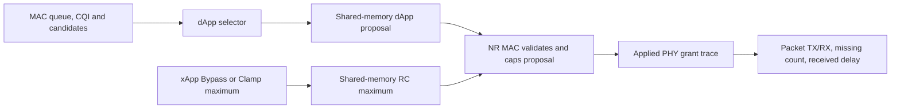

# G1 stock scheduler controls: source semantics and observed probe

**Evidence date:** 2026-11-12. This is an engineering control note for [RA-ENG-006](../missions/RA-ENG-006-stock-scheduling.md), not a frozen protocol or policy recommendation from the researcher.

## Source-verified controls

The local ib-ORAN selector factory exposes `Random`, `RoundRobin`, and the families `TopK`, `Greedy`, and `Dp`, each combinable with `Cqi`, `BufferLevel`, `PropFairness`, `Criticality`, or `MultiCriteria`. The exact candidates run here were `RoundRobin` and `TopKCqi`. The `ib` prefix accepted by the resolver is an alias; the implementation passes the resolved algorithm name to the factory. Candidate UEs are buffered, `k` is bounded by candidate count, and intents may prefilter candidates. RoundRobin orders by the oldest last-scheduled subframe. TopKCqi orders by descending current CQI. These semantics are from the pinned local source paths and line references in the mission report.

The xApp factory exposes `Bypass` and `Clamp`. Bypass returns a maximum equal to the total RBG count for each candidate. Clamp derives an RBG demand cap. The xApp writes per-RNTI maximums into the shared-memory RC interface; backlogged UEs absent from the current bounded set are given zero for that decision. The dApp chooses candidate UEs and proposes allocations. The NR MAC consumes both controls and caps each proposal at the per-UE maximum before applying a grant. A maximum never reserves resources or guarantees a minimum share.

## Conceptual control path

Conceptual data/control path reconstructed from local source. The grant is a radio-resource event; packet outcomes include additional simulated paths and queues.

## Paired probe (observed)

The preserved valid pair used one seed (11), one gNB, six UEs, whole-cell LOS, identical fixed geometry, TDD, bandwidth, numerology, offered traffic, app windows, `k=1`, and xApp Bypass. Only the dApp selector changed. Effective config comparison reports equality outside that selector. All 12 UE/direction flow-event counters match FlowMonitor. There were no unmapped dApp decisions or applied grants in either analyzed arm.

| UE | Direction | RoundRobin grants | TopKCqi grants | RoundRobin DL RX / missing | TopKCqi DL RX / missing |
|---:|---|---:|---:|---:|---:|
| 0 | DL | 3 | 3 | 2 / 30 | 2 / 30 |
| 1 | DL | 6 | 6 | 18 / 9,850 | 18 / 9,850 |
| 2 | DL | 6 | 6 | 18 / 9,850 | 18 / 9,850 |
| 3 | DL | 10 | 9 | 18 / 9,850 | 18 / 9,850 |
| 4 | DL | 3,923 | 1,761 | 9,860 / 8 | 7,545 / 2,323 |
| 5 | DL | 3,789 | 5,554 | 9,868 / 0 | 9,868 / 0 |

Grant counts alone omit allocated size; the machine-readable comparison also includes applied PRBs, transport block bytes, all UL rows, generated TX, RX goodput, missing packets, received-delay `n`, P95 and P99. RoundRobin had 8,122 applied grants total and 5,811 parsed decisions; TopKCqi had 7,853 grants and 5,873 decisions. This demonstrates that a stock intervention changed actual grants in this run. It also shows an observed service tradeoff between high-rate DL UEs. The cause and policy merit remain interpretation for the researcher; one seed does not estimate a stable ranking.

## Claim boundaries and evidence locations

- **Source-verified:** available control strings, selector semantics, xApp maximum-bound semantics, shared-memory fields, and NR MAC consumption are listed with exact source path/line spans in the mission report.
- **Observed:** one seed-11 paired whole-cell LOS DL-contention run changed grant counts, resource sums, and the high-rate UE packet outcomes. The logs were reprocessed after exact lossless removal of NetAnim's interleaved warning string.
- **Unverified:** whether this ranking persists across independent seeds, NLOS, mobility, another load, or another direction; whether Clamp changes applied grants; and any general or real-network validity.
- **Planned / researcher-owned:** approval of the formal policy pair, direction, repetitions, channel granularity, and protocol for RA-ENG-007.

Raw runs, failed attempts, effective configs, exact commands, source SHA-256 records, and reanalysis are in the ignored `simulator/logs/RA-ENG-006-20261112/` evidence tree. Reproduction and failure history are in the linked mission report.
