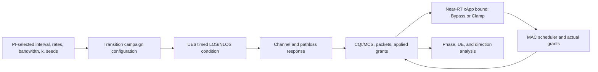

# LOS/NLOS transition study: prior work, provenance, and run readiness

**Status:** Read-only research and evidence review; no simulation, build, or implementation performed for this report. **Date:** 2026-11-13. **Governing issue:** [#26](https://github.com/kirolossedra/oran-publication/issues/26).

## Objective and scope

Summarize closely related primary literature, map the current proposed channel and O-RAN controls to the documented project implementation, audit which earlier results can inform the new study, and list the decisions and evidence required before a formal run. This review supports researcher deliberation; it does not select the research question, hypotheses, operating points, or scientific interpretation.

## Existing design and control path

The candidate design has one gNB and six UEs. UE6 (the sixth UE, index 6 in the study configuration) is the moving target at 1 m/s; five peers are stationary. It compares an all-LOS arm with a selective UE6 LOS→NLOS→LOS transition. The transition is selected by configured simulation time, not triggered by UE location or a measured blockage event. Transition start/end, bandwidth, four offered rates, and `k` are null in [`configs/los-nlos-transition.json`](../../configs/los-nlos-transition.json).

Current documented controls are dApp RoundRobin or GreedyPropFairness, and xApp Bypass or Clamp. Clamp uses feedback-derived per-UE RBG maxima; it does not reserve a minimum for UE6 or guarantee a reliability, throughput, or latency target. GreedyPropFairness is described as PF-like, not as a commercially verified proportional-fair scheduler. The basic UDP setup does not establish 5QI/PDB service semantics, so this should not be called QoS-aware control.

The [implementation note](los-nlos-transition-implementation.md) describes a transition wrapper that returns NLOS only for UE6 during the configured interval, with LOS outside it, and a shared channel/pathloss condition model. It also describes transition-boundary and channel-state traces. This is source-path documentation; a trace label alone does not demonstrate a changed PHY response. A run must show radio indicators such as CQI/MCS and actual applied grants alongside packet delivery and latency evidence.

Conceptual feedback/data-flow diagram based on the repository implementation note; it is not a measured timing diagram or proof that the PHY/controller loop has been validated.

## Primary-source literature scan

1. **Near-RT resource allocation under changing radio and traffic conditions.** Yan et al. describe xSlice, an O-RAN Near-RT RIC xApp that adapts MAC resource slicing to channel variation, mobility, traffic changes, and user demand. The paper reports a 67% reduction in performance regret against its evaluated alternatives on a 10-smartphone O-RAN testbed. Its slice-level interface, learning method, and QoS-weighted regret objective differ from this repository's Bypass/Clamp RBG-bound comparison. [Author manuscript on arXiv](https://arxiv.org/abs/2509.14343).

2. **Latency-aware allocation with a competing user.** Casparsen et al. implement a heuristic Near-RT RIC xApp for 4G O-RAN that steers VR traffic toward a requested latency while making more resources available to a second user. Their testbed reports 15.8% more resources for secondary users than a latency-equivalent static allocation. This is relevant to target-versus-peer tradeoffs, but does not establish results for NR, a timed LOS/NLOS transition, or this project's controller. [Author manuscript on arXiv](https://arxiv.org/abs/2401.01652).

3. **Blockage and mobility interruption.** A 2026 JSAE conference paper record describes an O-RAN Near-RT RIC handover-control xApp on OpenAirInterface and a wireless digital twin used to reproduce driving-related blockage and study interruption duration. The available page exposes the abstract and bibliographic record, not the full paper; it studies handover control rather than RBG bounds. [JSAE record and abstract](https://tech.jsae.or.jp/paperinfo/ja/content/p202601.260/).

4. **Architecture and control timescales.** ETSI TS 103 982 v14 describes Non-RT, Near-RT, and RT control loops, with typical Near-RT use cases on the order of 10 ms or more and O-DU functions such as scheduling potentially below 10 ms. This is general architecture context. The actual loop and actuator available in this study must be verified against the pinned implementation and its exposed functions. [ETSI specification PDF](https://www.etsi.org/deliver/etsi_ts/103900_103999/103982/14.00.00_60/ts_103982v140000p.pdf).

**Interpretation:** These sources establish relevant prior work in dynamic O-RAN resource allocation, user tradeoffs, and blockage-related control. They do not settle novelty. A defensible novelty statement needs a targeted review of the full related literature and a researcher-defined distinction between this study and the cited designs.

## Historical evidence and provenance

Earlier project artifacts are useful for instrumentation and engineering context, but must not be pooled into the new timed-transition study:

| Record | What it supports | Boundary for this study |
|---|---|---|
| RA-ENG-005 load calibration | A one-seed engineering probe with per-UE offers, packet accounting, grants, buffers, and received-only latency summaries. | The report documents an UL RNTI mismatch and small/short-run latency samples. It does not select formal loads or establish stable performance. [Report](../history/missions/load-calibration.md). |
| RA-ENG-006 scheduler probe | A matched one-seed RoundRobin/TopKCqi probe in which applied grants changed. | A changed grant distribution is not a policy-superiority result and is not the proposed UE6 transition control pair. [Report](../history/missions/scheduler-probe.md). |
| RA-ENG-007/008 G1 campaign and analysis | Historical evidence for its own source, matrix, seeds, and runs. | Issue #26 requires source/run/seed provenance before reconciling different snapshots. Do not pool progress counts or metrics across snapshots, or treat the old matrix approval as approval of issue #26 numeric factors. [Campaign report](../history/missions/campaign-execution.md), [analysis report](../history/missions/RA-ENG-008-data-analysis.md). |
| Issue #25 high-throughput calibration and sanity | Eight calibration cells and twenty sanity cells, as recorded in its report. | The 50 Mbps/UE and 100 MHz settings were engineering diagnostics and were not PI-approved as issue #26 factors. They are not LOS/NLOS transition results. [Issue #25 report](../history/missions/issue-25-recovery-calibration.md). |

The records distinguish offered traffic from received throughput. Missing packets at sink stop are not automatically radio loss; latency quantiles describe received packets only and must include sample counts and delivery/loss context. Archived campaign attempts and issue #25 diagnostics retain their own identifiers and source lineage.

## Run-readiness checklist

### PI decisions still needed

- [ ] Numeric transition start/end times and whether a single interval is the intended exposure.
- [ ] Radio bandwidth and offered UL/DL rates for UE6 and each background UE.
- [ ] The formal dApp/xApp comparison, including whether to retain both dApp selectors and both Bypass/Clamp conditions, and whether a matched no-control baseline is needed.
- [ ] `k` and its rationale; the implementation note warns small values can starve UEs.
- [ ] Independent repetitions/seeds. Seed 11 is an engineering diagnostic, not replication.
- [ ] Primary service outcomes and thresholds: packet delivery/loss accounting, received-only latency tails with counts, UE6 performance, and peer cost.
- [ ] Research question/hypothesis and what observation would count as a meaningful xApp benefit during and after the transition.

### Evidence gates after those decisions

- [ ] Confirm checkout, pinned dependencies, override hashes, and environment; preserve each attempt under a unique run path.
- [ ] Run source-level checks/build and a bounded matched all-LOS/transition smoke pair only after PI values are set.
- [ ] Verify the channel change through radio outputs (e.g., CQI/MCS and delivered performance), not only condition labels or boundary logs.
- [ ] Verify the xApp intervention in applied MAC grant/PRB records; do not substitute controller intent or configured bounds for grants.
- [ ] Reconcile configured offer, unique TX/RX, received goodput, and missing-at-stop; report loss/censoring separately from received-packet latency distributions.
- [ ] Confirm UE/RNTI joins, phase attribution, source/config hashes, raw logs, checksums, analysis outputs, failures, and documentation audit before interpreting formal results.

## Decisions, claims, and limits

- **Source-verified:** The candidate JSON leaves transition timing, bandwidth, target/background UL/DL rates, and `k` unset; it lists seed 11 as the sole diagnostic seed and includes RoundRobin/GreedyPropFairness and Bypass/Clamp options.
- **Source-verified:** The implementation note describes UE6-only timed NLOS and Clamp as a per-UE maximum bound; it states that the bound does not guarantee minimum service or QoS.
- **Literature-observed:** The cited papers cover adjacent adaptive allocation and blockage/mobility problems with different systems, control actions, and objectives.
- **Interpretation:** Prior work is sufficiently close to make a specific novelty review necessary; this scan does not determine novelty or scientific validity.
- **Unverified:** No source build, regression suite, PHY-response validation, or simulation run was performed for this report. No experiment result is presented here.

## Reproduction and completion record

This is a literature, documentation, and provenance review. Simulator-result reproduction is not applicable. It relies on the linked primary sources, [issue #26](https://github.com/kirolossedra/oran-publication/issues/26), [`configs/los-nlos-transition.json`](../../configs/los-nlos-transition.json), and the [implementation note](los-nlos-transition-implementation.md). External literature access date: 2026-11-13.

## Unresolved questions and next steps

1. Researcher reviews prior work and states the intended contribution relative to adaptive slicing and blockage/handover studies.
2. Researcher supplies the numeric and policy choices in the checklist and updates the canonical campaign configuration.
3. Only then proceed to run-readiness verification and any authorized campaign execution.
